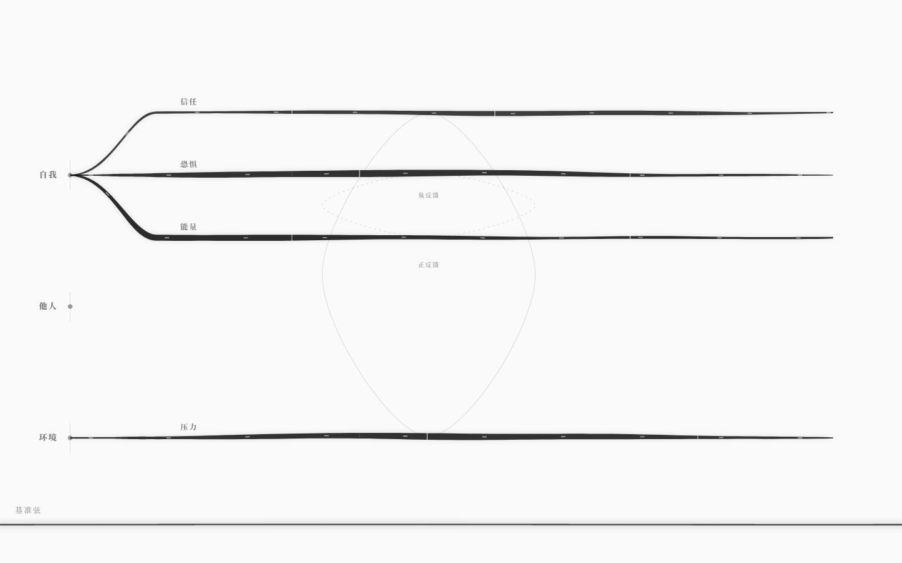

# neurou · 雨若

> 雨若弦，万物皆弦。


neurou 是一门用来写「世界如何运转」的语言，以及执行这些世界的运行时。

它不是剧情编辑器，也不是通用游戏引擎。它更接近 **GLSL 之于图形、Faust 之于音频**：
创作者用一门领域语言声明规则，编译器检查它会不会散架，运行时让它逐拍活起来，
批量模拟告诉你这个世界是否值得发布。

```
.nro 源码 ──▶ 编译器 ──▶ 弦网络图（唯一真源） ──▶ 运行时 / 批量模拟 / 调律台
                 │
                 └─ 三级诊断：语法 · 语义 · 体验
```

**当前状态：v0.1 内核 + v0.5 墨网测试体。** 语言前端、弦网络 IR、确定性运行时、
三种玩家模型的批量模拟、音准仪、命令行都已跑通；GUI 是一张**会呼吸、会生长、会发声**的墨网：
三节点 / 四横向弦 / 两回路 / 一根贯穿屏幕的基准弦，点击处墨晕生长后消散，基准弦可点击塑形并发声。



## 快速开始

```bash
pnpm install
pnpm check          # 内核类型检查 / 构建
pnpm test           # 48 个单元测试（内核 31 + 基准弦数学 17）

# 墨网测试体 v0.5
pnpm gui            # http://127.0.0.1:5188/
pnpm test:gui       # 60 项真实浏览器验收（需要本机 Edge）
```

GUI 快捷键与手势：

| 操作 | 结果 |
|---|---|
| `Tab` | 反色 + 2px 失焦 + 局部聚焦（基准弦保持清晰） |
| 点击空白 / 弦 / 节点 | 点击处长出一簇墨，约 2.6s 后消散 |
| 悬停 / 拖动弦 | 弹性拱形 + 墨影；拖动改弦值，松手回弹 |
| 点击底部横向带 | 基准弦被拉成控制点，多次点击拟合出丝滑波形；同时拨弦发声 |
| 按住拖动 | 连续塑形基准弦；曲线形状持续改 drone 音色 |
| `Escape` | 基准弦清空控制点、回直、声音淡出 |

默认界面只有一张弦网络：没有侧栏、没有工具栏、没有画中画、没有数字。
声音首次点击才启动，25s 无交互自动淡出。

命令行：

```bash
pnpm dev check examples/negotiation.nro          # 编译一个世界
pnpm dev sim examples/rain-slice.nro --runs 600  # 跑批量模拟，看音准仪
pnpm dev run examples/negotiation.nro            # 逐拍游玩
pnpm dev ir examples/rain-slice.nro --out world.json
```

三个示例世界：

| 文件 | 展示什么 |
|---|---|
| `examples/core-test.nro` | **GUI 默认**：3 节点、4 根横向弦、2 条回路、纯结构测试体 |
| `examples/rain-slice.nro` | 完整雨循环世界：7 个实体、23 根弦、31 条耦合、6 条回路、14 条规则、4 个结局 |
| `examples/negotiation.nro` | 最小叙事沙盒：五根弦、两条回路、四条结局 |

## 墨网测试体（v0.5）

| 项 | 内容 |
|---|---|
| 默认视图 | 纯白纸、3 个节点在左列、4 根横向墨弦、2 条回路；没有侧栏/工具栏/画中画 |
| 呼吸 | 每根弦三个慢波叠加 + 极慢整体起伏；`prefers-reduced-motion` 下静止 |
| 弦的材质 | 填充墨带，不是等宽 stroke；深黑半透明、粗细沿长度起伏、两端收细；淡墨晕染 + 拉丝残影 |
| 流动 | 纸色短脉冲沿弦从左向右；高张力 1.1s，低张力 1.85s |
| 点击生墨 | 点击位置长出 5–7 条墨须 + 花丝/孢子，约 2.6s 内雾散；同屏最多 6 簇，确定性形状 |
| 基准弦 | 底部贯穿全屏（1440px）的横向黑弦；点击塑形、PCHIP 丝滑曲线、Karplus-Strong 拨弦 + 曲线驱动 drone |
| Tab | 背景黑白反转；基础层 `blur(2px)`；悬停的弦/点击的节点在清晰聚焦层保持锐利 |
| 节点 | 点节点聚焦该节点的弦；`他人` 是语义节点，暂不连线 |

弦不是装饰：4 根弦分别对应 信任 / 恐惧 / 能量 / 压力；2 条回路是 正反馈 / 负反馈。
详见 [墨网测试体](docs/07-墨网测试体.md)、[生长与基准弦的设计](docs/09-墨网·生长与基准弦.md)
与 [6.4 秒视频](docs/media/ink-6s.mp4)。

## 这不是什么

- 不是「AI 生成游戏」——AI 只做状态解释器，不改规则。
- 不是通用引擎——物理、渲染、动画、网络同步都不在语言范围内。
- 不是脚本语言——它声明状态、阈值、回路与不变量，不写流程。
- 不是 100 分的世界——音准仪的绿区是 **60–85**，满分意味着没有意外。
- 不是完整的调律台——GUI 仍是读 IR 的只读演示，不写盘、不编辑 `.nro`；
  知道差在哪，读 [架构完成度审计](docs/08-架构完成度审计.md)。

## 目录

```
packages/core       语言前端：词法 / 语法 / 名字解析 / 类型检查 / 结构分析 / 弦网络图
packages/runtime    运行时：逐拍状态机、快照分叉、批量模拟、音准仪
packages/cli        命令行：check / sim / run / ir / init
packages/gui        v0.5 墨网测试体：呼吸弦网 / 点击生墨 / 基准弦塑形发声 / Tab 反色失焦
examples/           三个可运行的世界
docs/               总览、语言规范、架构、墨网、审计、交互设计
```

- [构想总览](docs/00-总览.md)
- [语言规范 v0.1](docs/01-语言规范.md)
- [架构与路线](docs/02-架构.md)
- [最小 GUI（历史）](docs/03-最小GUI.md)
- [用户测试包（已取消）](docs/04-用户测试包.md)
- [墨网测试体 v0.5](docs/07-墨网测试体.md)
- [架构完成度审计](docs/08-架构完成度审计.md)
- [墨网·生长与基准弦](docs/09-墨网·生长与基准弦.md)
