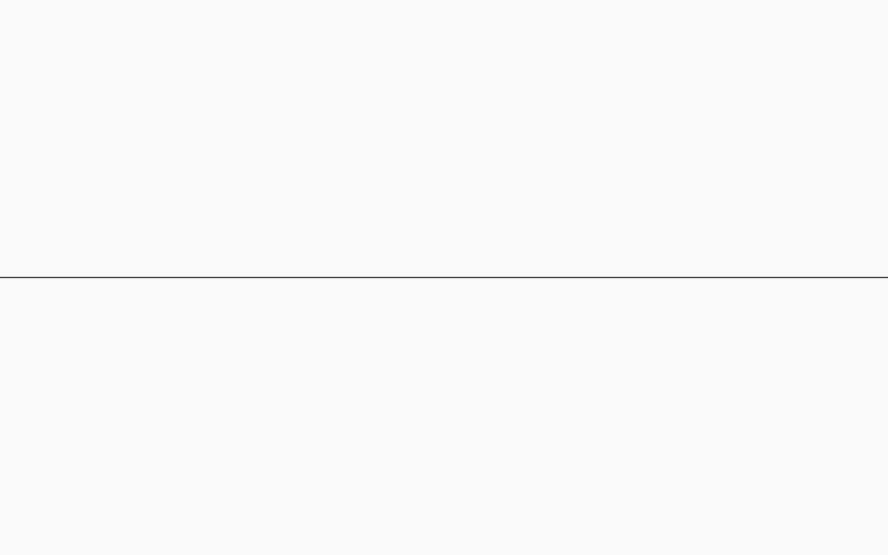
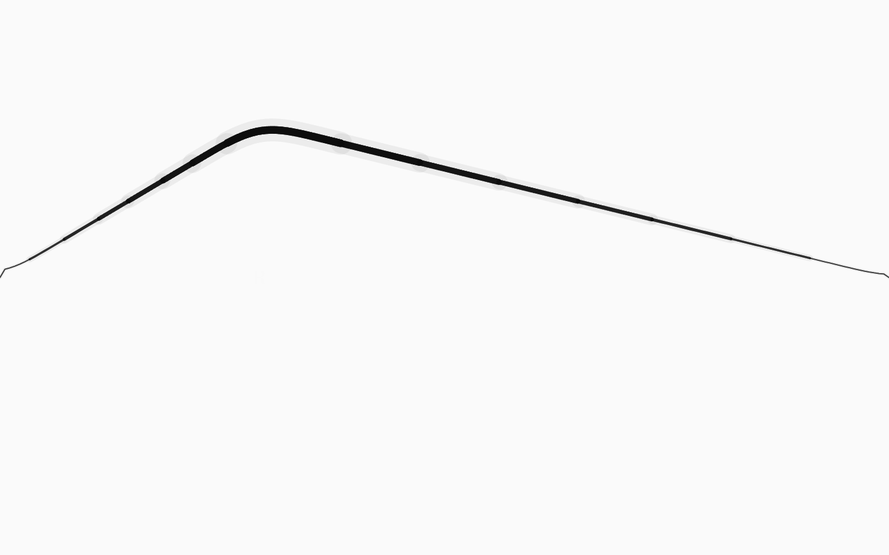
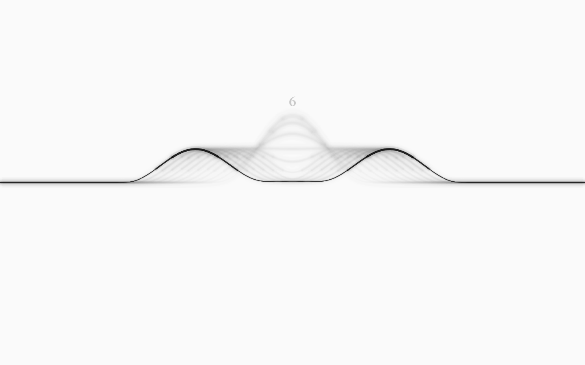
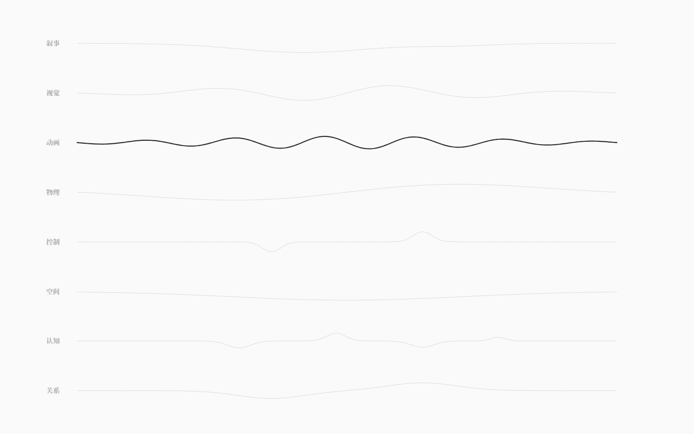

# neurou · 雨若

> 雨若弦，万物皆弦。


neurou 是一门用来写「世界如何运转」的语言，以及执行这些世界的运行时。

它不是剧情编辑器，也不是通用游戏引擎。它更接近 **GLSL 之于图形、Faust 之于音频**：
创作者用一门领域语言声明规则，编译器检查它会不会散架，运行时让它逐拍活起来，
批量模拟告诉你这个世界是否值得发布。

```
.nro 源码 ──▶ 编译器 ──▶ 弦网络图（唯一真源） ──▶ 运行时 / 批量模拟 / 调律台
                 │
                 └─ 三级诊断：语法 · 语义 · 体验
```

**当前状态：v0.1 内核 + v0.6 单弦调律台。** 语言前端、弦网络 IR、确定性运行时、
三种玩家模型的批量模拟、音准仪、命令行都已跑通；GUI 首屏被收成**一张白纸 + 正中一根黑线**：
点击即拨弦，键盘上的数字/字母/符号按真实键位隐形映射到屏幕，拉弦会弯成弓、松手释放行波，
波峰更粗、带黑色帧残留；`Tab` 在 8 类弦之间切换，`Esc` 看总谱。



## 快速开始

```bash
pnpm install
pnpm check          # 内核类型检查 / 构建
pnpm test           # 66 个单元测试（内核 31 + 弦物理/音高 17 + 键盘映射/物理 18）

# 单弦调律台 v0.6
pnpm gui            # http://127.0.0.1:5188/
pnpm test:gui       # 53 项真实浏览器验收（需要本机 Edge）
```

手势：

| 操作 | 结果 |
|---|---|
| 快速点击任意位置 | 弦在该处被**局部**拨动：点在弦上方=向上、下方=向下，离弦越远幅度越大；立刻分成左右两列行波传播；触点浮现该点所属键的字符后消失 |
| 按住上下/左右拖 | 把整根弦拉成弓形；松手释放整弦波形 |
| 敲键盘（数字/字母/符号） | 等同于点击该键在屏幕上的隐形位置：局部行波 + 触点淡字 + 拨弦声 |
| `Tab` / `Shift+Tab` | 在 8 类弦之间循环；类名浮现约 1.4s，并演示一次该类弦的波 |
| `Esc` | 8 类弦的签名波总谱；再按回单弦；总览里 `Tab` 切当前类、点某行选中并返回 |

默认界面没有侧栏、没有工具栏、没有按钮、没有数字、没有常驻文字；声音首次点击才启动。

命令行：

```bash
pnpm dev check examples/negotiation.nro          # 编译一个世界
pnpm dev sim examples/rain-slice.nro --runs 600  # 跑批量模拟，看音准仪
pnpm dev run examples/negotiation.nro            # 逐拍游玩
pnpm dev ir examples/rain-slice.nro --out world.json
```

三个示例世界：

| 文件 | 展示什么 |
|---|---|
| `examples/core-test.nro` | 3 节点、4 根横向弦、2 条回路、纯结构测试体 |
| `examples/rain-slice.nro` | 完整雨循环世界：7 个实体、23 根弦、31 条耦合、6 条回路、14 条规则、4 个结局 |
| `examples/negotiation.nro` | 最小叙事沙盒：五根弦、两条回路、四条结局 |

## 单弦调律台（v0.6）

| 项 | 内容 |
|---|---|
| 首屏 | 纯白纸 + 正中一条水平黑线；静止时没有任何 idle 动画（两帧截图完全一致） |
| 物理 | 固定端点阻尼波方程，固定子步长 1/360s；行波传播、两端反射、衰减 |
| 拉弦 | 按住把整弦拉成弓形，松手释放；拉弦时强平滑、释放后保留行波折点 |
| 波峰 | 线宽与墨色随位移增加；波峰更粗、更黑；宽笔洇开一层 |
| 拖尾 | 离屏 trailCanvas 逐帧淡出 + 双层模糊：运动模糊与黑色帧残留 |
| 键盘 | 46 个物理键位按真实键位归一化映射全屏；上两行向上拨、下两行向下拨；完全隐形，触点处才浮现键字 |
| 8 类弦 | 叙事/视觉/动画/物理/控制/空间/认知/关系：各自的波速、阻尼、激励形状与音色；`Tab` 切换 |
| 总谱 | `Esc`：8 条签名波叠成谱面，当前类实黑，其余极淡 |
| 声音 | 每次触点一次 Karplus-Strong 拨弦；音高随位置，音色随弦类；AnalyserNode 提供真实 rms |







详见 [单弦调律台](docs/07-单弦调律台.md)。v0.5 的墨网/基准弦已归档，设计记录在
[墨网·生长与基准弦](docs/09-墨网·生长与基准弦.md)。

## 这不是什么

- 不是「AI 生成游戏」——AI 只做状态解释器，不改规则。
- 不是通用引擎——物理、渲染、动画、网络同步都不在语言范围内。
- 不是脚本语言——它声明状态、阈值、回路与不变量，不写流程。
- 不是 100 分的世界——音准仪的绿区是 **60–85**，满分意味着没有意外。
- 不是完整的调律台——GUI 现在仍是**与 WorldIR 脱钩的乐器视图**：不读世界、不写盘、不编辑 `.nro`。
  知道差在哪，读 [架构完成度审计](docs/08-架构完成度审计.md)。

## 目录

```
packages/core       语言前端：词法 / 语法 / 名字解析 / 类型检查 / 结构分析 / 弦网络图
packages/runtime    运行时：逐拍状态机、快照分叉、批量模拟、音准仪
packages/cli        命令行：check / sim / run / ir / init
packages/gui        v0.6 单弦调律台：单弦物理 / 隐形键盘映射 / 8 类弦 / 总谱 / 本地合成声音
examples/           三个可运行的世界
docs/               总览、语言规范、架构、单弦调律台、审计、历史设计
```

- [构想总览](docs/00-总览.md)
- [语言规范 v0.1](docs/01-语言规范.md)
- [架构与路线](docs/02-架构.md)
- [最小 GUI（历史）](docs/03-最小GUI.md)
- [用户测试包（已取消）](docs/04-用户测试包.md)
- [单弦调律台 v0.6](docs/07-单弦调律台.md)
- [架构完成度审计](docs/08-架构完成度审计.md)
- [墨网·生长与基准弦（v0.5 历史）](docs/09-墨网·生长与基准弦.md)
