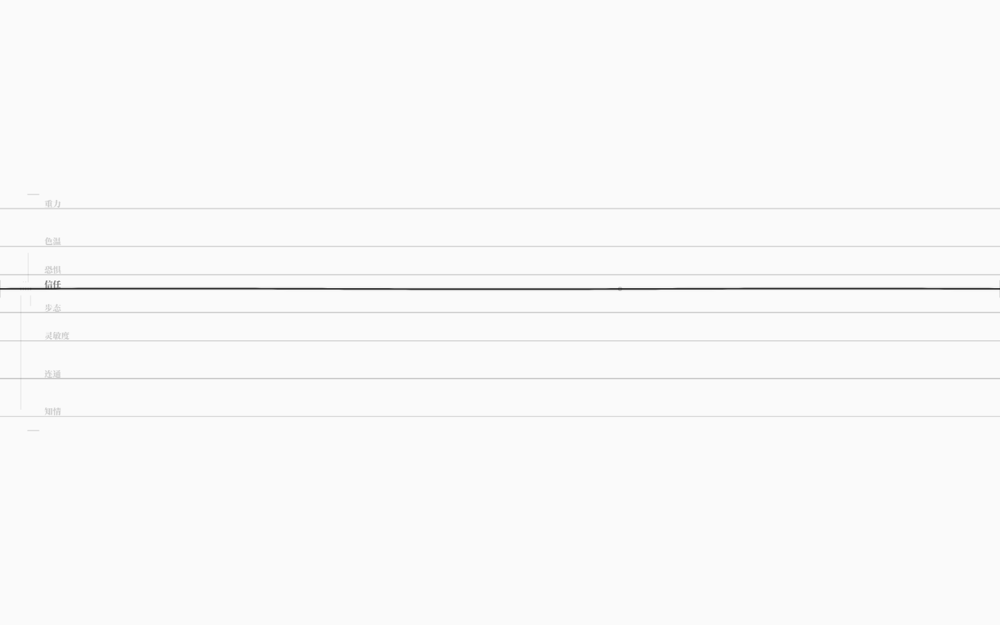
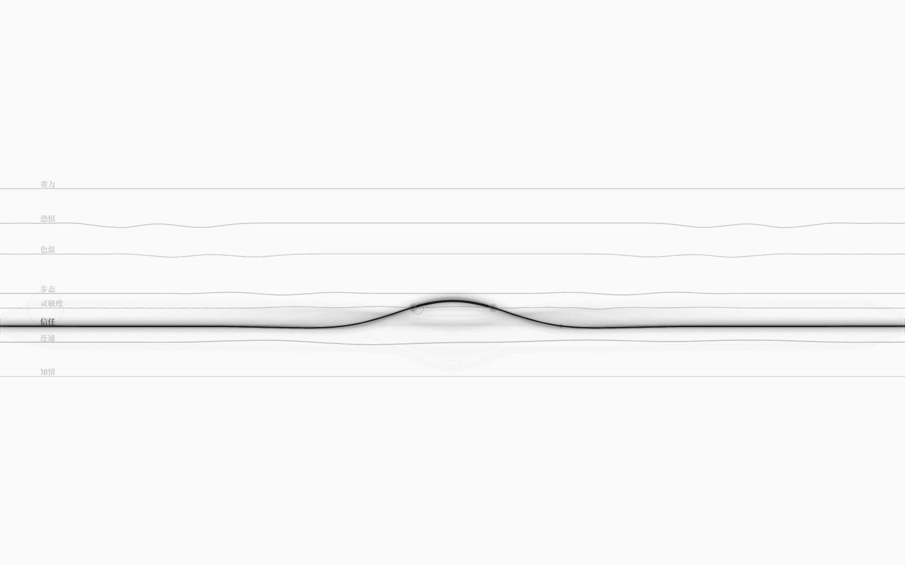
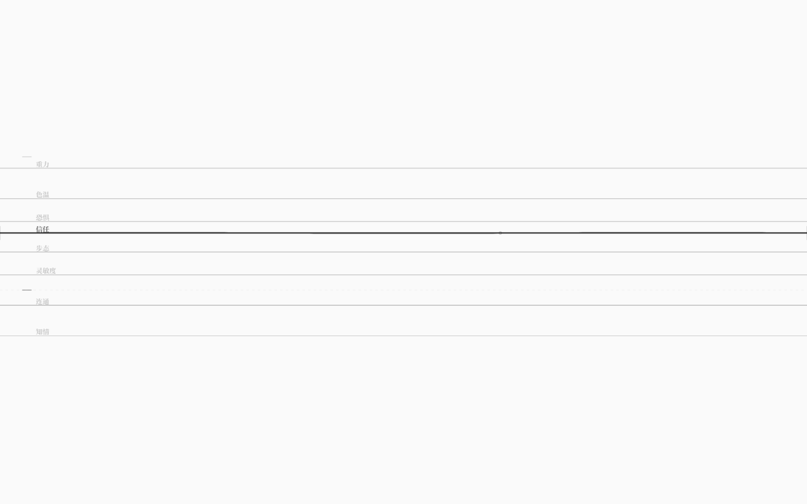
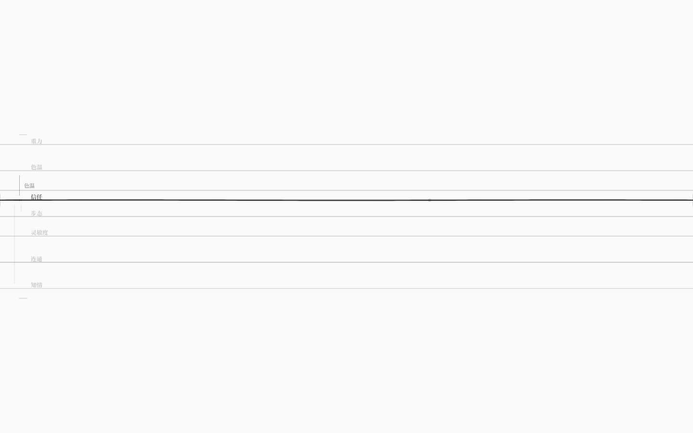
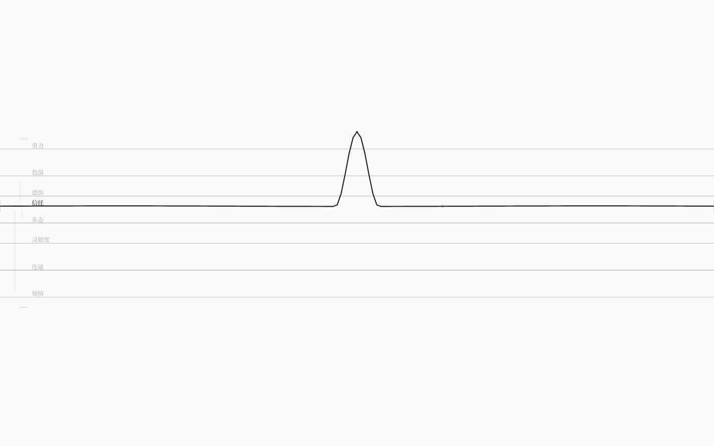

# neurou · 雨若

> 雨若弦，万物皆弦。


neurou 是一门用来写「世界如何运转」的语言，以及执行这些世界的运行时。

它不是剧情编辑器，也不是通用游戏引擎。它更接近 **GLSL 之于图形、Faust 之于音频**：
创作者用一门领域语言声明规则，编译器检查它会不会散架，运行时让它逐拍活起来，
批量模拟告诉你这个世界是否值得发布。

```
.nro 源码 ──▶ 编译器 ──▶ 弦网络图（唯一真源） ──▶ 运行时 / 批量模拟 / 调律台
                 │
                 └─ 三级诊断：语法 · 语义 · 体验
```

**当前状态：v0.1 内核 + v5.3 语言/运行时/调律台（`谱`：曲线数据 + 运行时 + 图形编辑 + 音色绑定 + 查谱表达式）+ v1.6 八弦调律台（可写回、可编辑阈值/耦合、可增删耦合与弦、可打开任意世界、按住绷弦、撤销缓动、写回保真）。** 语言前端、弦网络 IR、确定性运行时、
三种玩家模型的批量模拟、音准仪、命令行都已跑通；GUI 编译一个真实世界
（默认 `examples/tuner.nro`：8 类弦各一根、10 耦合、1 回路、1 条示例谱（信任弦用它做音色）、4 规则、8 信号、3 结局，
也可 `?world=` 打开任意示例世界），每 480ms 推进一拍，把 8 根弦的**基线纵坐标映射成世界的真实弦值**：
拖弦/拨弦通过 `Universe.inject()` 写回世界，下一拍沿耦合传到别的弦；
**松手后约 0.7s，当前状态被冻结成新基线、行级 patch 写回当前世界文件**（dev；只改数字，注释/排版保留）；
焦点弦左侧的悬崖/安全刻度可以直接拖动改阈值，焦点弦参与的耦合显示为左侧极淡竖线、悬停滚轮调强度，
`Shift+↑/↓` 选目标、`Shift+Enter` 可建立/切断耦合；
写回前强制重新编译，`Ctrl+Z` 用 620ms 缓动回退（不闪回）；同类多根弦用 `←/→` 切换；
**按住鼠标/键盘不动，弦会在按点被钉出一个波峰、绷住**。
波速整体放缓、微颤更柔。刷新页面，世界从你刚调好的地方开始。



## 快速开始

```bash
pnpm install
pnpm check          # 内核类型检查 / 构建
pnpm check:gui      # GUI 类型检查
pnpm check:docs     # 文档相对链接检查
pnpm test           # 328 个单元测试（内核 / 运行时 / 弦物理 / 调律台 / 谱 / 音色 / 演奏 / 查谱 / 参考谱 / 关系谱）

# 调律台 GUI
pnpm gui            # http://127.0.0.1:5188/
pnpm test:gui       # 真实浏览器验收 261 项（需要本机 Edge）
pnpm release        # 构建并复制到 release/neurou/（静态发布包）

# 性能基线（需先 pnpm build + pnpm preview）
pnpm perf
```

手势：

| 操作 | 结果 |
|---|---|
| `Tab` / `Shift+Tab` | 焦点在 8 类弦之间循环；焦点弦近黑加粗带微颤，其余按各自粗细/透明度沉灰 |
| 拖动焦点弦上下 | 移动基线 = 修改世界里的真实值（`Universe.inject`）；耦合弦下一拍起自己动起来 |
| 快速点触 / 敲键盘 | 拨动焦点弦：局部行波 + 推动真实值约 8% 量程；触点浮现所属键的字符 |
| 拖动弦两端「膜」 | 改变跨度（0.55–1 倍），弦越短音越高 |
| 悬停结点 + 滚轮 | 展开紧致化结点，调一个微观参数（影响阻尼） |
| 极值处用力拨 | 对偶翻转：弦塌缩成小环，真实值翻到对侧 |
| 拖弦松手 / 拨弦后 | 约 0.7s 后把当拍状态冻结成新基线，行级 patch 写回**当前世界文件**（dev）；刷新从新基线开局 |
| 拖动左侧阈值刻度 | 修改焦点弦的悬崖/安全线；写回前强制编译校验 |
| 悬停左侧耦合竖线 + 滚轮 | 调焦点弦参与的耦合强度（±0.05，0..2）；松手后写回 |
| `Shift+↑/↓` + `Shift+Enter` | 选另一根弦作为目标；建立（默认同向 0.2）或切断一条普通耦合（回路边受保护） |
| `Alt+Enter` / `Alt+Backspace` | 以焦点弦为模板新增同类弦 / 删除焦点弦（回路成员、被规则信号引用的弦会被拒绝） |
| 按住鼠标/键盘不动（≥180ms） | 弦在按点被钉出一个波峰、绷住；移动指针波峰跟随；松手释放拨弦 |
| `Ctrl+Z` / `Ctrl+Shift+Z` | 撤销 / 重做（620ms 缓动回退，不闪回） |
| `Enter` | **可玩层**：打开极淡动作列表；列表打开时执行当前动作 |
| 动作列表内 `↑/↓` + `Enter` | 选择并执行世界动作；`1`–`9` 可直接执行对应项 |
| 结局后 `R` | 重新开始当前世界（不写回文件，只重建运行时） |
| 章节/续章 | `下一章`、`上一章`、结局专属/多出口 `下一章`；N/B/点击半屏切换，多出口用淡列表选择 |
| 结局后点击 | 右半屏下一章、左半屏上一章（触控可用） |
| 结局后 `B` | 若世界声明了 `上一章`，保存当前局并回上一章 |
| `?slot=N` | 选择 0..9 号自动存档槽；配合 `resume=1` / `fresh=1` |
| `` ` `` | 打开存档槽淡列表，`↑/↓` 选择、`Enter` 切换/新建 |
| `F9` | 打开/关闭章节路线图，当前章节高亮 |
| `?resume=1` | 刷新时恢复该世界/槽位的自动存档（默认从文件初值开始） |
| `?fresh=1` | 清除该世界自动存档，强制新局 |
| F3 内 `V` | 运行期只读叠加：格子显示世界当前值/动态格；再按恢复源文件编辑 |
| F3 内 `S` | 关系谱听音：按当前值/曲线采样轻响；再按停止 |
| `F4` | 音量四档循环：1.0 → 0.6 → 0.3 → 静音；localStorage 记住 |
| `?world=examples/xxx.nro` | 打开任意示例世界（dev）；写回目标跟随该文件 |
| `←` / `→` | 同类多根弦时切换显示哪一根（只切视图） |
| `Esc` | 8 类弦的签名波总谱；再按回八弦 |

默认界面没有侧栏、工具栏、按钮、数字、常驻文字；声音首次点击才启动。

命令行：

```bash
pnpm dev check examples/tuner.nro                # 编译调律台的默认世界
pnpm dev check examples/negotiation.nro          # 编译一个世界
pnpm dev sim examples/rain-slice.nro --runs 600  # 跑批量模拟，看音准仪
pnpm dev run examples/negotiation.nro            # 逐拍游玩
pnpm dev ir examples/tuner.nro --out world.json
pnpm dev fmt examples/rain-slice.nro             # 把图重新排成规范 .nro（--write 就地改）
```

四个示例世界：

| 文件 | 展示什么 |
|---|---|
| `examples/tuner.nro` | **GUI 默认**：8 类弦各一根（信任/色温/步态/重力/灵敏度/连通/知情/恐惧），10 耦合、1 回路、4 规则、8 信号、3 结局 |
| `examples/core-test.nro` | 3 节点、4 根横向弦、2 条回路、纯结构测试体 |
| `examples/rain-slice.nro` | 完整雨循环世界：7 个实体、23 根弦、31 条耦合、6 条回路、14 条规则、4 个结局 |
| `examples/negotiation.nro` | 最小叙事沙盒：五根弦、两条回路、四条结局 |
| `examples/relations.nro` | **v2.3.2**：关系谱曲线 + `此刻` 驱动的潮汐世界（曲线越高，潮位涨得越快） |
| `examples/tides.nro` | **v2.5**：关系谱曲线直接决定「月相→潮位」耦合强度；带动作/信号/两个结局 |
| `examples/moon-tide.nro` | **v2.5.1 综合示例**：谱音色 + 关系谱 + 动态耦合 + 动作/信号/三个结局；v2.6 起用速度 1.4 / 相位 0.1；v2.7 第二张灯影矩阵的相位源接月潮曲线 |
| `examples/lighthouse.nro` | **v2.10.1 综合示例**：阶跃潮阶 + 相位源心图 + 动态耦合；3 弦/2 矩阵/4 动作/3 结局 |
| `examples/relational.nro` | **v2.19**：关系谱动态格——谱、矩阵、弦值组合成格值 |
| `examples/soundscape.nro` | **v3.8 声音层**：音频资产 + 世界配乐 + 谱音色 + F3 听音；2 动作/2 信号/2 结局 |
| `examples/garden.nro` | **v3.9 内容**：湿度/光照/花开的反馈小世界；3 动作/1 力迫/2 结局 |
| `examples/harbor.nro` | **v3.9 内容**：关系谱潮图 + 音频 cue 的夜航；3 动作/2 力迫/3 结局 |

## 八弦调律台（v1.6：可写回、可编辑/增删耦合与弦、按住绷弦、撤销缓动、写回保真）

| 项 | 内容 |
|---|---|
| 世界接线 | GUI 编译当前世界 → `WorldIR` → 逐拍 `Universe`；8 根弦的基线 = 弦值归一化投影 |
| 任意世界 | dev 下 `?world=examples/xxx.nro` 打开任意示例世界；写回目标跟随当前文件 |
| 同类多根弦 | 每类显示选中的一根，`←/→` 在同类候选间切换（只切视图） |
| 写回世界 | 拖弦 = `Universe.inject()`；拨一下 = 推动约 8% 量程；下一拍沿耦合传导 |
| 写回文件 | 用户手势（拖弦松手/拨弦/键盘/对偶/阈值/耦合/增删耦合/增删弦）→ 冻结当拍值成新基线 → **行级/块级 patch**（改数字、插删耦合行、插删弦块；增删规则等才回退 `serialize(ir)`）→ dev 中间件写回当前世界文件；注释/排版保留，换行统一 LF |
| 结构编辑 | 焦点弦左侧的悬崖/安全刻度可拖；耦合显示为极淡竖线，悬停滚轮调强度；`Shift+↑/↓` 选目标、`Shift+Enter` 增删普通耦合；`Alt+Enter`/`Alt+Backspace` 增删同类弦；写回前强制重新编译，无效编辑拒写；`Ctrl+Z` / `Ctrl+Shift+Z` 用 620ms 缓动撤销重做 |
| 按住绷弦 | 鼠标/键盘按住 ≥180ms：弦在按点被钉出一个波峰并绷住（两条极淡张力线）；移动指针跟随；松手释放拨弦 |
| 振动 | 波速约 ×0.6、微颤 2.8Hz：波峰更从容、反射更柔 |
| 数据流可见 | 被耦合带动的弦会收到与 Δ值 成正比的视觉波——数字变化变成涟漪 |
| 焦点 | `Tab` 切换；焦点弦近黑加粗、高频微颤，其余按各自粗细/透明度半透明 |
| 阈值即共振 | 值靠近悬崖/安全线 → 驻波态（泛音 + 虚影 + 刻度）；此时拨弦 = 八弦临界和弦 |
| 干涉/奇点 | 8 根弦两两求交；交点画奇点光晕，悬停浮现两个弦名；波经过交点带动另一根弦 |
| D-膜 / 紧致化 / 对偶 | 本地乐器机制：跨度改音高、结点滚轮调阻尼、极值对偶翻转真实值 |
| 总谱 | `Esc`：8 条签名波叠成谱面，当前类实黑 |
| 声音 | Karplus-Strong 拨弦；音高随触点、音色随弦类，D-膜升调，阈值和弦补高五度 |









详见 [八弦调律台](docs/07-八弦叠影.md)、[序列化与写回](docs/11-序列化与写回.md)、
[编辑与撤销](docs/12-编辑与撤销.md)、[任意世界与多根弦](docs/13-任意世界与多根弦.md)、
[耦合编辑](docs/14-耦合编辑.md)、[按住绷弦与撤销缓动](docs/15-按住绷弦与撤销缓动.md)、
[写回保真](docs/16-写回保真.md)、[增删耦合](docs/17-增删耦合.md) 与 [增删弦](docs/18-增删弦.md)。
v0.7 之前的设计记录保存在 git 历史里；v0.5 墨网设计见 [墨网·生长与基准弦](docs/09-墨网·生长与基准弦.md)。

## 变更记录

- [CHANGELOG.md](CHANGELOG.md)

## 这不是什么

- 不是「AI 生成游戏」——AI 只做状态解释器，不改规则。
- 不是通用引擎——物理、渲染、动画、网络同步都不在语言范围内。
- 不是脚本语言——它声明状态、阈值、回路与不变量，不写流程。
- 不是 100 分的世界——音准仪的绿区是 **60–85**，满分意味着没有意外。
- 不是完整的编辑器——GUI 现在会读世界、改运行时状态、把**基线/阈值/耦合强度**行级写回 `.nro`（注释/排版保留），
  也能增删普通耦合与顶层弦；但还**不能增删规则、不能编辑回路、不能改极性/延迟**；
  知道差在哪，读 [架构完成度审计](docs/08-架构完成度审计.md)。

## 编程范式

neurou 不是 OOP，也不是 POP：它是**声明式 + 数据流 + 规则约束**的「弦网」语言。
作者不写执行步骤，只设计世界在什么条件下怎么变化。详见 [编程范式](docs/10-编程范式.md)。

## 目录

```
packages/core       语言前端：词法 / 语法 / 类型检查 / 弦网络图 / IR→.nro 序列化 / IR 编辑 API / 源文本行级 patch / 谱（编译期）
packages/runtime    运行时：逐拍状态机、快照分叉、批量模拟、音准仪、外部注入 inject、谱求解器（锚点/调制/固定与受迫）
packages/cli        命令行：check / sim / run / ir / fmt / init
packages/gui        v1.6 八弦调律台：任意世界 / 同类多根弦 / 行级与块级写回 / 阈值与耦合编辑 / 增删耦合与弦 / 按住绷弦 / 撤销缓动
examples/           五个可运行的世界（含最小的「谱」示例）
docs/               总览、语言规范、架构、调律台、序列化、编辑、任意世界、耦合、绷弦、写回保真、编程范式、审计
```

- [构想总览](docs/00-总览.md)
- [语言规范 v0.1](docs/01-语言规范.md)
- [架构与路线](docs/02-架构.md)
- [编程范式：声明式 · 数据流 · 规则约束](docs/10-编程范式.md)
- [八弦调律台 v1.6](docs/07-八弦叠影.md)
- [序列化与写回：调律台成为编辑器](docs/11-序列化与写回.md)
- [编辑与撤销：阈值、写回闸门、Ctrl+Z](docs/12-编辑与撤销.md)
- [任意世界、同类多根弦与更柔和的振动](docs/13-任意世界与多根弦.md)
- [耦合编辑：在画布上直接调两根弦的关系](docs/14-耦合编辑.md)
- [按住绷弦与撤销缓动](docs/15-按住绷弦与撤销缓动.md)
- [写回保真：只改被编辑的那几行](docs/16-写回保真.md)
- [增删耦合：在画布上建立/切断关系](docs/17-增删耦合.md)
- [增删弦：同类弦实例与干净的删除](docs/18-增删弦.md)
- [谱：曲线数据 / 波形资源（设计文档）](docs/19-谱设计.md)
- [谱的图形编辑（v1.9）](docs/20-谱的图形编辑.md)
- [音色绑定：让谱成为可以听见的世界数据（v2.0）](docs/21-音色绑定.md)
- [谱的读取：查谱() 进入规则与表达式（v2.1a）](docs/22-谱的读取.md)
- [参考谱：把谱当作目标曲线（v2.1b）](docs/23-参考谱.md)
- [关系谱：配对 × 数值的静态关系矩阵（v2.1c）](docs/24-关系谱.md)
- [关系谱 GUI：黑底极简矩阵（v2.2）](docs/25-关系谱GUI.md)
- [关系谱曲线：每格一条时间曲线（v2.3）](docs/26-关系谱曲线.md)
- [关系谱驱动世界：此刻 + 曲线播放（v2.3.2）](docs/27-关系谱驱动世界.md)
- [动态耦合：关系谱曲线决定传导强弱（v2.5）](docs/28-动态耦合.md)
- [月潮之间：谱、关系谱、动态耦合的综合示例（v2.5.1）](docs/29-月潮之间.md)
- [关系谱时间轴：周期/速度/相位/谱位（v2.6）](docs/30-关系谱时间轴.md)
- [多矩阵联动：相位源（v2.7）](docs/31-多矩阵联动.md)
- [阶跃插值：离散平台曲线（v2.9）](docs/32-阶跃插值.md)
- [运行期写关系谱：规则改矩阵标量（v2.17）](docs/34-运行期写关系谱.md)
- [性能与包体：GUI 代码分割（v2.18）](docs/35-性能与包体.md)
- [错误提示：拼写建议与字段级 hint（v2.18.4）](docs/36-错误提示.md)
- [动态值表达式：谱/矩阵组合（v2.19）](docs/38-动态值表达式.md)
- [可玩层：动作选择与结局呈现（v3.0）](docs/39-可玩层.md)
- [运行期只读叠加：F3 里的世界当前值（v3.1）](docs/40-运行期叠加.md)
- [运行期曲线与可玩细节（v3.2）](docs/41-运行期曲线与可玩细节.md)
- [移动端触控：底部 16% 长按动作（v3.3）](docs/42-移动端触控.md)
- [世界选择与发布闭环（v3.4）](docs/43-世界选择与发布.md)
- [声音层：世界 cue 与关系谱听音（v3.5）](docs/44-声音层.md)
- [音量与静音：F4 四档（v3.6）](docs/45-音量与静音.md)
- [音频资产：波形文件进入世界（v3.7）](docs/46-音频资产.md)
- [世界配乐：BGM 循环（v3.8）](docs/47-世界配乐.md)
- [内容扩充：温室与夜航（v3.9）](docs/48-温室与夜航.md)
- [发布闭环：静态发布包（v3.10）](docs/49-发布闭环.md)
- [叙事/关卡层：章节、续章与自动存档（v4.0）](docs/50-叙事关卡与存档.md)
- [章节前后切换与多槽存档（v4.1）](docs/51-章节与多槽存档.md)
- [章节点击切换与标题浮现（v4.2）](docs/52-章节点击与标题.md)
- [结局专属分支：不同结局去不同章节（v4.3）](docs/53-结局分支.md)
- [存档槽入口：Backquote 淡列表（v4.4）](docs/54-存档槽入口.md)
- [多出口结局：选择下一章（v4.5）](docs/55-多出口结局.md)
- [章节路线图：F9 淡图（v4.6）](docs/56-章节路线图.md)
- [DSL 引擎架构 v5：弦网络唯一本体，场景/系统为运行层](docs/57-DSL引擎架构-v5.md)
- [运行层 v5.1：场景与系统](docs/58-运行层场景与系统.md)
- [Engine 门面 v5.2：Host 的唯一入口](docs/59-Engine门面.md)
- [场景切换 DSL：初始场景与切换场景（v5.3）](docs/60-场景切换DSL.md)
- [灯与潮：阶跃 + 相位源 + 动态耦合示例（v2.10.1）](docs/33-灯与潮.md)
- [架构完成度审计](docs/08-架构完成度审计.md)
- [墨网·生长与基准弦（v0.5 历史）](docs/09-墨网·生长与基准弦.md)
- [最小 GUI（历史）](docs/03-最小GUI.md)
- [用户测试包（已取消）](docs/04-用户测试包.md)
