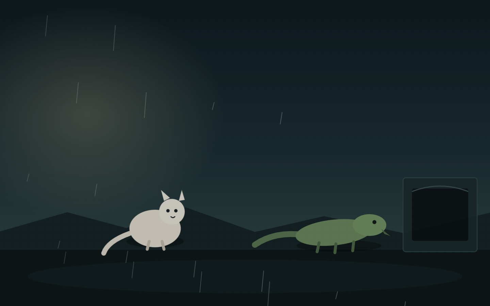
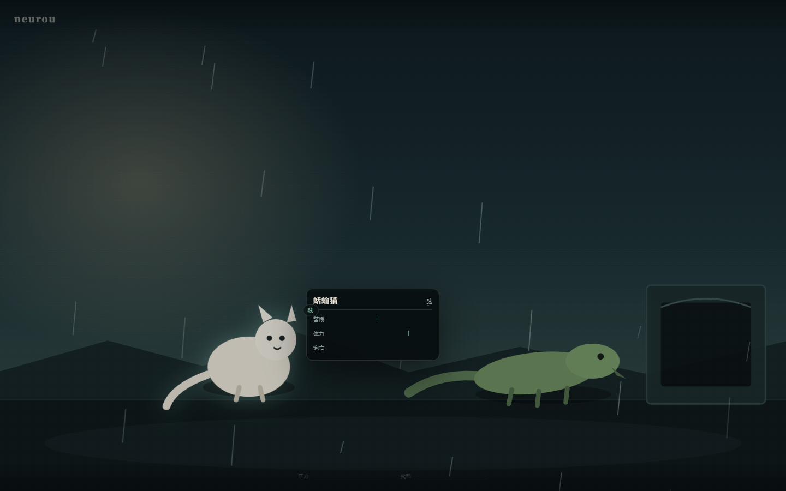

# 最小 GUI（v0.1）

> 范围：只做五件事——现象层、只读结构层、试玩、发布、五个 L1 术语。
> 不做编辑、总览层、移动端、弦包市场、本地 AI、代码编辑区。
> 当前形态：**隐形化**——首屏几乎什么都没有，世界是唯一主角。


## 跑起来

```bash
pnpm gui            # 先开这个，http://127.0.0.1:5188/
pnpm check:gui      # GUI 类型检查
pnpm test:gui       # Playwright 真实浏览器自测（需要本机 Edge + 已开 pnpm gui）
pnpm --filter @neurou/gui build
```

快捷键：

| 键 | 作用 |
|---|---|
| `P` | 试玩 |
| `R` | 发布 |
| `F` | 沉浸模式（所有 UI opacity 0，再按恢复） |
| `Tab` | 现象层 / 结构层 |
| `←` `→` | 切换示例世界（测试脚手架；右下角 1/2 只浮现 1.2 秒） |
| `Esc` | 关闭发布页 |

## 五件事落在哪里

| 能力 | 交互 | 代码 |
|---|---|---|
| 现象层 | 世界自动逐拍运行；段落名只在切换时浮现 2 秒；悬停角色只显示 2–3 根接近阈值的弦（无数字）；底部只有两条 1px 轨道和「压力/残酷」两个 2 字标签 | `Scene.tsx`、`App.tsx`、`tuning.ts` |
| 结构层 | Tab 切换（0.45s 溶解）；纯黑背景；声部线/品丝/回路连线；回路名 0.22、连线 0.6px、品丝只留张力 >80% 的最多 5 个 | `Structure.tsx` |
| 试玩 | `P` 或右上热区 ▶ → 2:00 倒计时、动作按钮、返回（回到进入前的快照） | `Play.tsx` |
| 发布 | `R` 或右上热区 ↑ → 纯黑全屏；默认只有大号分数 + 一句 ≤20 字诊断；`＋` 展开详情；Esc/点背景返回 | `Publish.tsx`、`simWorker.ts` |
| L1 术语 | 弦/回路/调性/力迫/和弦：操作时浮出 1.2 秒（每个最多 3 次）；悬停出现卡片；不弹教程 | `terms.ts`、`Term.tsx` |


## 三个关键设计

### 1. 调性旋钮不是「难度参数」

两条滑块没有直接改世界里的数字，而是被编译成**两根真实的弦 + 四条力迫 + 四条信号**，
再交给同一个 `Universe` 去跑（`tuning.ts`）：

```text
调性.压力 > 55  →  时间进度 += (压力 - 50) / 30
调性.残酷 > 55  →  体力      -= (残酷 - 50) / 30
调性.压力 > 78  →  字幕「雨点变得密集，像有人在敲铁皮。」
```

所以拖动之后发生的是：世界真的变快/变残酷了，信号在下一拍击中玩家。
界面上的色调变化是同时发生的第二重反馈，不是唯一反馈。

调性只在这一次运行里存在，不写回 `.nro`；发布时模拟的是作品本身，不含本次调音。
内部的两根弦/四条力迫/四条信号**不出现在任何界面上**，连力迫提示条也过滤掉它们。

### 2. 结构层只读，但可以「拨」

没有拖拽改值、没有新增删除、没有输入框。唯一的主操作是拨一条回路：
沿环走一遍，把节点序列交给现象层做残影脉冲，同时底部显示「连锁：A → B → A」。
回路名不用图例面板，而是极淡地写在线上（0.22）；悬停时升到全亮，并出现「拨」的提示。
品丝只画张力 >80% 的，且最多 5 个；连线粗细 0.6px，声部标签 0.35，背景纯黑。

### 3. 隐形化：首屏几乎什么都没有

| 元素 | 默认 | 什么时候出现 | 什么时候消失 |
|---|---|---|---|
| 试玩/发布 | opacity 0，只有 ▶ / ↑ | 鼠标进右上 120×60，或按 P / R | 移开 1.5 秒后淡出 |
| 滑块头 | opacity 0 | 悬停轨道，或拖动时 | 拖动结束 1 秒后 |
| 滑块标签 | 「压力」「残酷」两个 2 字标签，随调音条 0.25 | — | — |
| 段落名 | 不存在 | 段落切换时浮现 | 2 秒后 |
| 进度条 | **完全移除** | — | — |
| 世界 1/2 | 不存在 | ← → 切换时 | 1.2 秒后 |
| 术语浮出 | 不存在 | 操作时 | 1.2 秒后，每个最多 3 次 |

`F` 进入沉浸模式：滑块、按钮、段落名、术语浮出、cue、角落索引全部 opacity 0，
只剩世界本身；再按 `F` 恢复。



## 术语（克制版 B）

| 术语 | 锚（卡片第一行） |
|---|---|
| 弦 | 一个会变、也会牵动别处的量。 |
| 回路 | 几件事转成一个圈，一件变了，别的跟着变。 |
| 调性 | 这个世界现在给人的温度。 |
| 力迫 | 一次不能反悔的推动。 |
| 和弦 | 几件事同时改变，一起被记住。 |

每个最多自动浮出 3 次、每次 1.2 秒（`localStorage` 计数），之后只在悬停卡片里出现。
锚点和例子不使用任何 neurou 术语——这条有脚本检查：`pnpm exec tsx scripts/terms-check.ts`。




## 已知边界

- **视觉是舞台，不是求解器**：v0.1 没有真实的视觉/动画/物理/空间求解器，角色是静态 SVG，
  状态变化靠台词、色调、雨量与光晕表达。这是内核边界，不是 GUI 偷懒。
- **调性不持久化**：刷新页面回到 50/50；不写回源文件（本轮没有编辑能力）。
- **调性术语的卡片没有常驻锚点**：底部不再有「调性」标签，只在拖动时浮出 1.2 秒；
  浮出的文字本身不可悬停，所以这张卡暂时没有可点开的入口。是否补一个极淡的锚点，留给下一轮判断。
- **试玩只有桌面键鼠**：没有移动端、没有长按卡片（悬停替代）。
- **发布分数对局数敏感**：600 局时雨循环切片为 62 分；120 局时稀有结局未出现，会升到 72 分。
  发布固定用 600 局，CLI 可通过 `--runs` 调整，比较分数时请固定局数。
- **世界切换会重置世界**：切换示例等于换一个宇宙，不保留上一个的运行状态。

## 自测

```bash
pnpm test        # 31 个内核测试
pnpm test:gui    # 91 项 GUI 验收（Playwright + 本机 Edge）
```

最近一次 GUI 自测：91/91 通过；发布 600 局约 205ms（含 Worker 启动与渲染）；
渲染 60fps；整轮堆内存 12MB、增长约 2MB；无页面级报错。

六项隐形标准：

| 标准 | 实测 |
|---|---|
| 首屏常驻可见 UI ≤3 | **2**：`neurou`（0.4，不可点）、底部调音条（0.25，含两条滑块） |
| 首屏常驻可点击元素 ≤1 | **0**（按钮默认 opacity 0，靠 P / R 或右上热区） |
| 默认 opacity >0.3 的元素 ≤2 | **1**：`neurou`（0.4） |
| 沉浸模式 UI opacity >0 元素 = 0 | **0**（品牌/按钮/调音条全部 0） |
| 发布页默认文字 ≤2 行 | **2**：62 / 站得住，也有分歧（8 字） |
| 滑块默认无数字、无滑块头、标签 ≤2 字 | 无数字；滑块头 0；标签「压力」「残酷」 |
| 段落名常驻不可见、进度条移除 | 常驻 0；`.scene__phase-bar` 0 |
| 结构层品丝 >80% 且 ≤5 | 5 个，最低张力 0.84 |

> 注：结构品丝在 >80% 之外还加了「最多 5 个」的显示上限，因为同一时刻可能有 6 根弦都靠近阈值。
