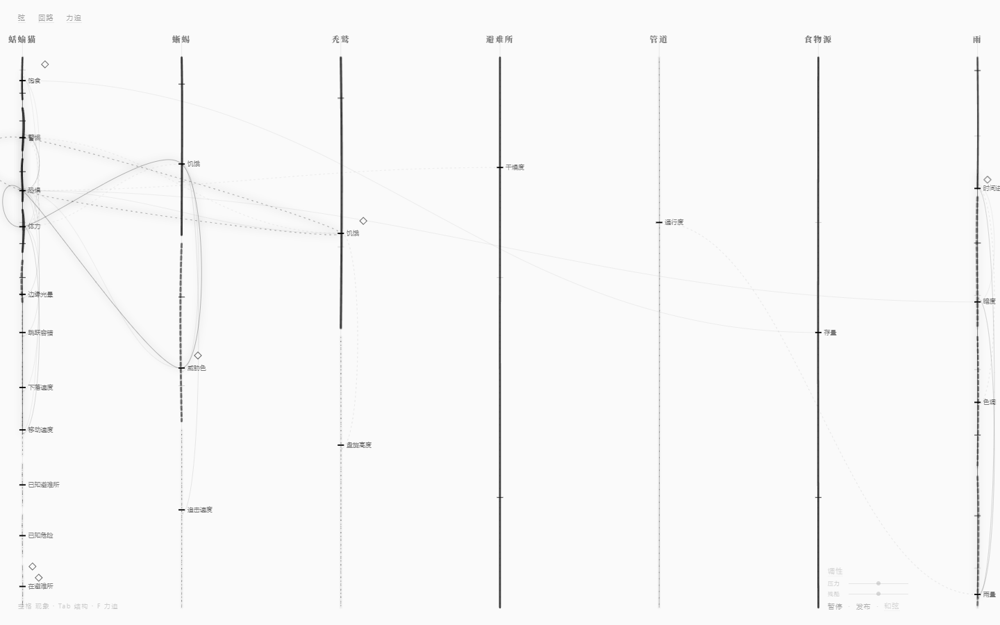
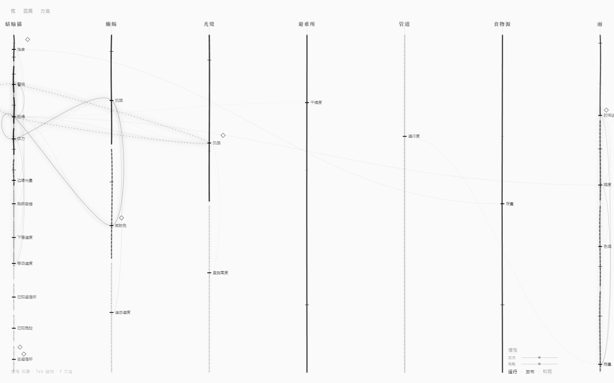
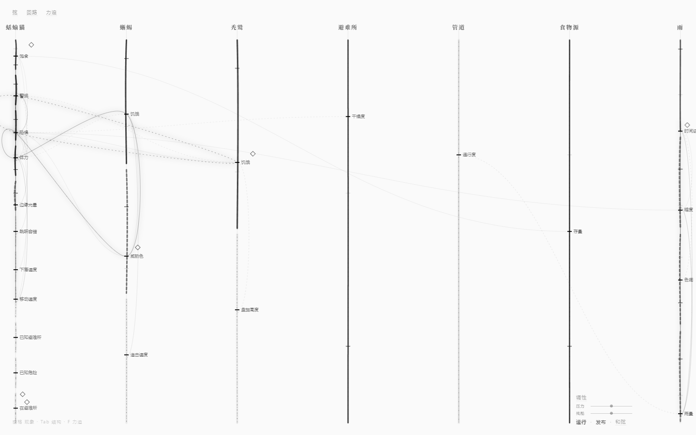
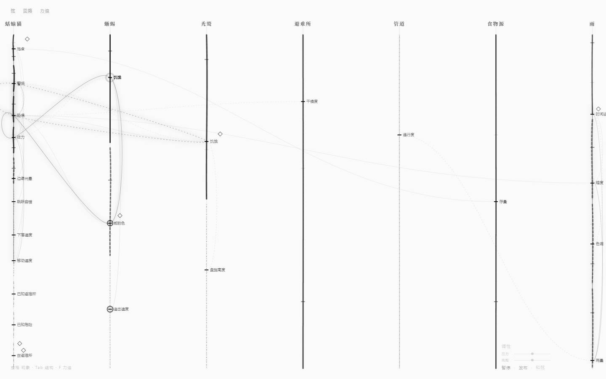
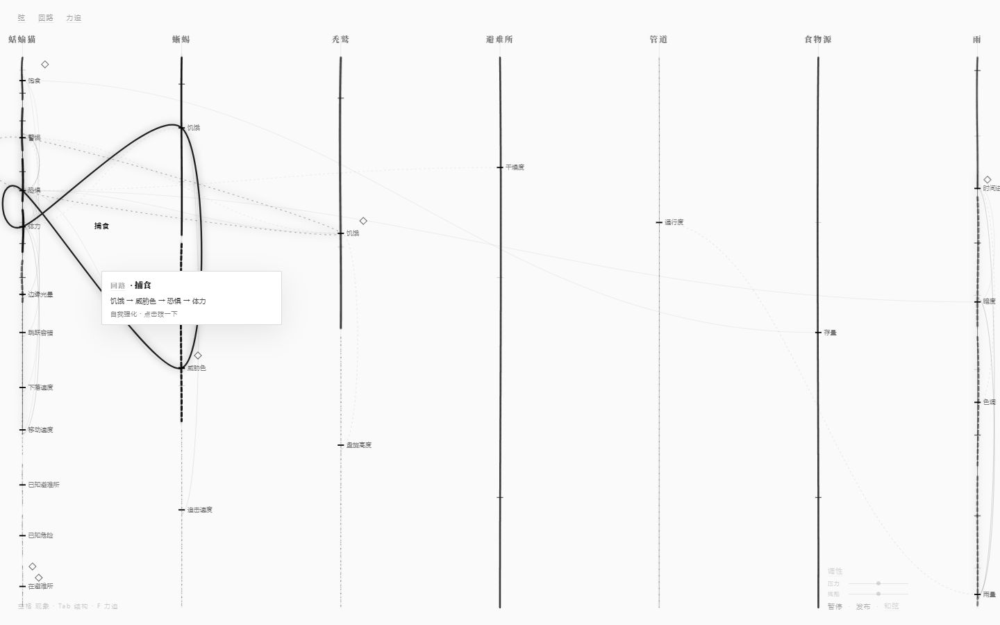
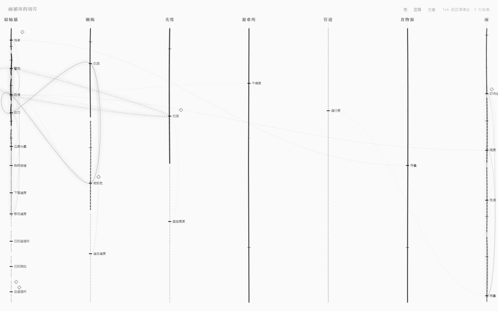
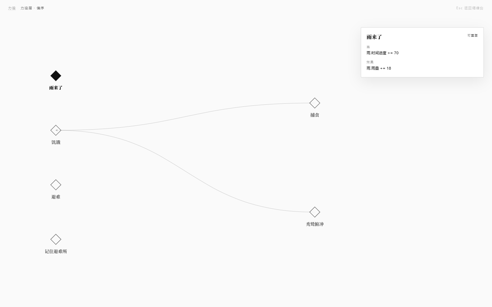
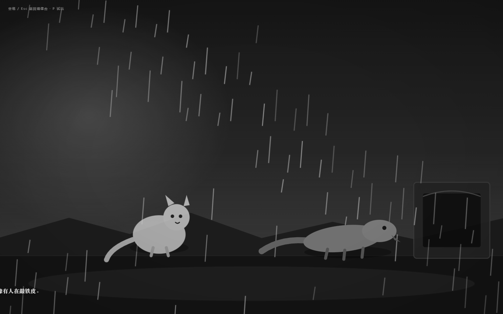
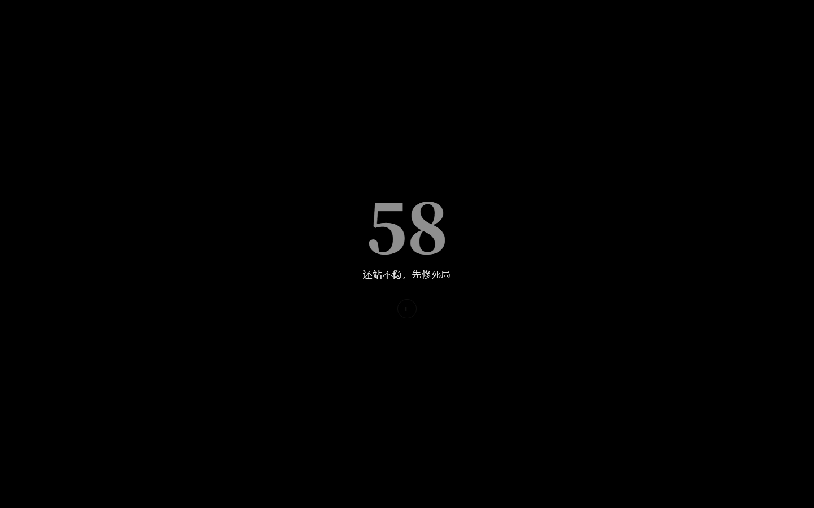

# 白纸黑线（v0.3，历史）

> **v0.4 改为 3 节点 / 4 根横向弦的墨网测试体；v0.5 加了点击生墨与基准弦；v0.6 收成单弦；v0.7 变成八弦叠影。**
> 当前界面见 [八弦叠影](07-八弦叠影.md)；v0.5 设计记录见 [墨网·生长与基准弦](09-墨网·生长与基准弦.md)。
> 本文件保留 v0.3 白纸弦网络（23 弦）的设计记录，不再是当前界面。

> neurou 是编辑器/调律台，不是游戏。
> 默认视图是**铺满屏幕的弦网络**：纯白纸、极细黑线、只用灰度与透明度。
> 没有侧栏、没有底部暗条、没有右下画中画。



## 三条视觉准则

1. **白底黑线**：背景 `#FAFAFA`；所有弦、连线、文字、标签只用黑色与 0.1–0.9 的灰度。
   没有任何彩色；截图做了逐像素检查（10 张图，0 个彩色像素）。
2. **全屏无侧栏**：实体名直接浮在弦的上方；右下角只有几行极淡的字
   （`调性 / 压力 / 残酷 / 暂停 / 发布 / 和弦`）；左下角一行排练记号
   （`空格 现象 · Tab 结构 · F 力迫`，opacity 0.2）。弦网络占 100% 视口。
3. **动态模糊**：弦不是直线。每根弦以不同频率/振幅做贝塞尔震颤；
   拖动时出现黑色残影与模糊，松手回弹；回路脉冲带墨迹拖影。

## 灰度和透明度怎么区分类型与状态

没有颜色之后，**类型靠线型（虚线节奏）+ 基础灰度**，**状态靠粗细、位置、模糊和明暗**。

### 类型

| 类型 | 线型 | 基础灰度 | 读法 |
|---|---|---|---|
| 叙事 | 实线 | 0.80 | 最黑、最实，像主旋律 |
| 视觉 | `6 4` 长虚 | 0.56 | 中灰，呼吸感 |
| 物理 | `1.5 5` 点线 | 0.43 | 细点，最轻的触感 |
| 认知 | `7 3 1 3` 点划线 | 0.35 | 稀薄、断续，像记忆 |
| 空间 | 实线 | 0.24 | 几乎发丝，退到背景 |
| 关系 | `2 4` 短虚 | 0.30 | 短促的牵连 |

悬停时，卡片会直接写「叙事弦 / 视觉弦 / …」，不要求用户先学会线型。

### 状态

| 状态 | 编码 |
|---|---|
| 张力 | 线宽 `1 + 张力 × 2.4`；张力越高越粗、流动越快、震颤幅度越大 |
| 当前值 | 弦上的短横线位置（不显示数字） |
| 悬崖阈值（verge） | 更长、更黑的小刻度（1.4px / 0.7） |
| 安全阈值（safe） | 更短、更淡的小刻度（0.8px / 0.25） |
| 正/负耦合 | 正=实线，负=`3 4` 虚线；强度映射到 `0.05 + 强度 × 0.22` 的透明度 |
| 强化/校正回路 | 强化=实线，校正=`3 5` 虚线；悬停时整条闭环变成 2.6px 的黑墨笔触 |
| 聚焦实体 | 该列保持黑，其余列压到 0.18 |
| 脉冲/拖动 | 弦序列亮起，并出现 `stdDeviation 2.4 / 5` 的两层模糊残影 |
| 力迫 | 白底黑边小菱形；选中时填成实心黑 |

## 动态

### 震颤与流动

- 每根弦用一条贝塞尔曲线，30fps 更新相位：
  `振幅 = 1.1 + 张力 × 3.2`，`频率 = 0.45 + 张力 × 1.7`，每根弦有自己的相位种子。
- 弦上叠了一条 `1.2 / 9` 的流动短划，速度 `1.1–3.6s` 一圈；背后还有 0.008–0.06 的呼吸柔光。
- 暂停世界后连拍三帧，弦仍在动：

| 帧 | 帧哈希 |
|---|---|
| 0 | `21eb437aa7` |
| 1 | `bd476b6a7a` |
| 2 | `cc0378a737` |





### 拖动：动态模糊

拖动时弦向拖动方向弯 ±8px；两条 SVG 模糊残影（`2.4` / `5`）跟着出现，
其中宽残影再横向偏移 `dx × 0.7`，形成拉伸；松手后 460ms 阻尼回弹。



### 回路：黑墨闭环 + 墨迹拖影

回路不靠颜色，靠黑色墨迹的粗细与模糊：悬停/拨动时闭环变成一笔粗黑线，
序列上的弦依次亮起，并出现残影。回路名默认隐藏，悬停才显示（减少左簇的标签堆叠）。



### 因果波

拖一根弦时，从源弦沿耦合走三跳：黑色短脉冲沿耦合线移动，到达的弦亮起一圈。
传播时间 `220 + 延迟 × 200 + (1 - 强度) × 140` 毫秒；三跳最多 21 条边、14 个节点。
拖动后 420ms 实测：**2 根相邻弦亮起、1 条耦合脉冲仍在亮**。

## 视图与快捷键

| 键 | 视图 |
|---|---|
| 默认 | 白纸弦网络（全屏） |
| `空格` | 现象层全屏；再按返回 |
| `Tab` | 同一张弦网络放大；再按返回 |
| `F` | 力迫层（白纸偏序图）；再按返回 |
| `P` | 试玩 |
| `R` | 发布 |





现象层仍然是游戏画面，但整棵界面被 `grayscale(1)` 兜底，连角色一起变成黑白：



发布页：



## 数据

`examples/rain-slice.nro`：7 个实体、23 根弦、31 条耦合、6 条回路、6 个力迫、3 个和弦。
弦网络里保留全部弦；没有侧栏筛选，实体名可点击聚焦该列。

## 自测

```bash
pnpm test        # 31 个内核测试
pnpm test:gui    # 65 项白纸验收（Playwright + 本机 Edge）
Get-ChildItem docs/images/paper-*.png | ForEach-Object { & ./scripts/check-grayscale.ps1 -Paths $_.FullName }
```

最近一次：

- **65/65 通过**；31/31 内核测试；
- 10 张截图逐像素检查：**0 个彩色像素，最大通道差 0**；
- 弦网络 1440×900 铺满；7 个实体名从 x=11 到 x=1414；没有侧栏/画中画/底部暗条；
- 三帧静止哈希不同；拖动残影 opacity 0.22、带 `url(#ink-blur)`；
- 拖动 420ms：2 根相邻弦、1 条耦合脉冲；回路拨动 4 根弦亮起；
- 发布 58 分、2 行、362ms；60fps；堆内存 13MB；无页面级报错。

## 已知边界与风险

- **线型/灰度比颜色难认**：5 种弦的虚线节奏在低分辨率/投影/亮环境下可能难分；悬停卡片是唯一的文字兜底。
- **左簇仍然拥挤**：蛞蝓猫/蜥蜴的 11 根弦、5 条回路挤在左侧；回路名已默认隐藏，但弦名/刻度仍密。
- **单弦列是长空白**：避难所/管道/食物源只有一根弦，整列是一根贯穿全屏的线；有人会觉得空，而不是有压迫感。
- **震颤幅度很小**：静止截图几乎看不出；`prefers-reduced-motion` 下完全静止。要证明「活的」必须看连续帧。
- **动态模糊是 SVG 滤镜**：在低端 GPU 上可能掉帧；本机 60fps，未测其他机器。
- **没有画中画**：拖弦时看不到世界本身；要看现象层必须按空格。拖动与现象层不能同屏对照。
- **浮层没有背景**：右下角的字/滑块直接压在白纸和弦线上；极淡时可能难读/难点。
- **全局 grayscale**：现象层、试玩、发布也被去色；蜥蜴的「威胁色」不再以颜色出现，只靠明暗与形体。
- **没有深色模式**：白纸在暗环境里很亮；长时间使用可能刺眼。
- **回路名默认隐藏**：不悬停就不知道闭环叫什么；这是为了减淡左簇，但牺牲了第一眼可读性。
- **实体聚焦靠点名字**：没有列表，用户不一定知道名字可点。
- **没有保存/撤销**：拖动仍是现场试调，刷新回基线。

## 下一轮

不再改 GUI。用 [用户测试包 v0.3](05-user-test-kit.md) 找 5 个非程序员，跑三条核心判定：
定位、活性、结构。打印版记录表在 [06-观察记录表](06-观察记录表.md)。
测试结果出来之前，不动界面。
