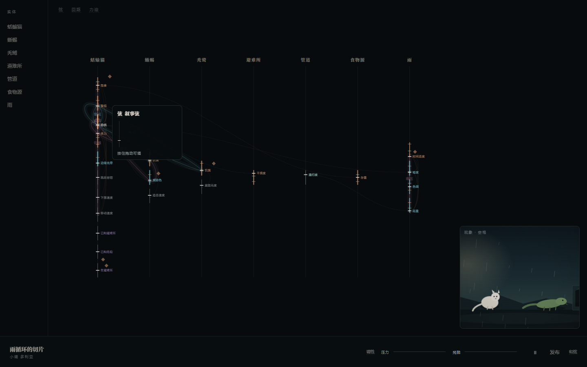
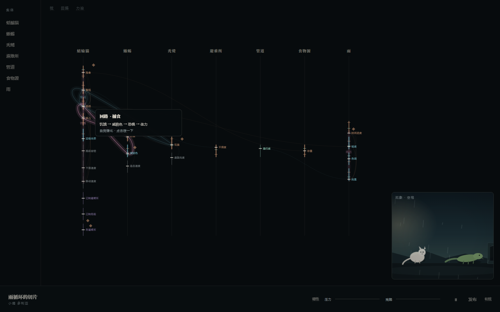
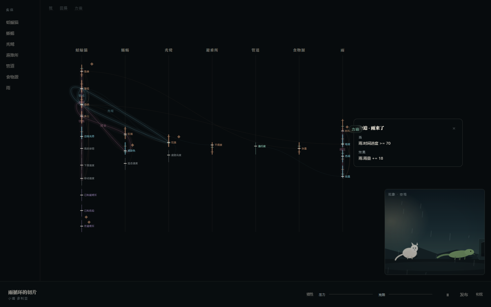
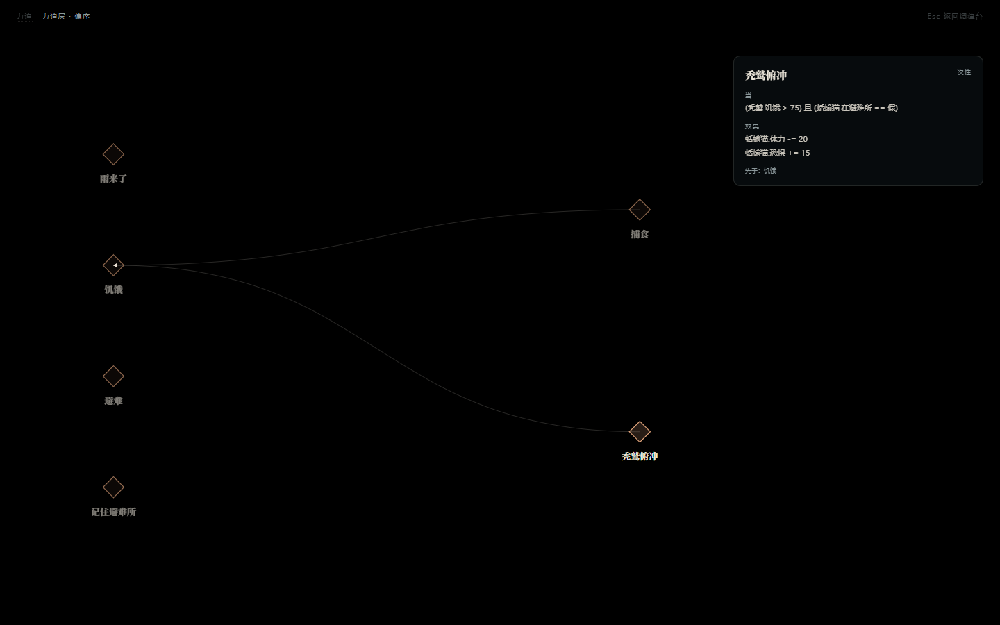
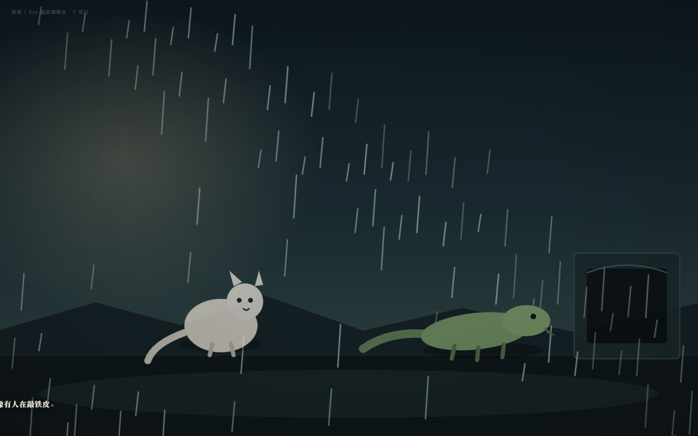
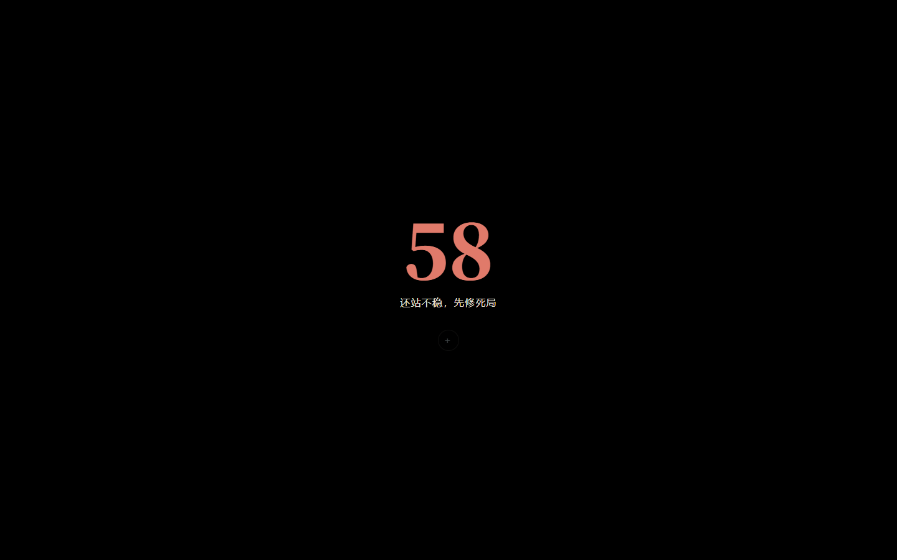

# 调律台（v0.2）

> neurou 是**编辑器/调律台**，不是游戏。
> 用户打开它，第一眼看到的必须是**正在振动的弦网络**；现象层只是右下角的一扇残影预览窗。


## 默认布局

```
┌──────────┬────────────────────────────────────────────┬──────────────┐
│ 实体      │ 弦网络（主区 ~65%）                         │              │
│ 蛞蝓猫    │  7 条竖向声部线 · 23 根弦                    │  ┌────────┐  │
│ 蜥蜴      │  31 条横向耦合（带箭头）                     │  │ 现象残影 │  │
│ 秃鹫      │  常驻品丝（所有阈值，不只 >80%）             │  │ 预览窗   │  │
│ 避难所    │  6 条回路闭环（悬停高亮 + A→B→C→A）          │  │ 点击/空格│  │
│ 管道      │  6 个力迫◇（点击看条件与效果）               │  └────────┘  │
│ 食物源    │                                              │              │
│ 雨        │                                              │              │
├──────────┴──────────────────────────────────────────────┴──────────────┤
│ 世界名 / 调性 │ 调性 压力 ──── 残酷 ──── │ ⏸ 发布 和弦 │                 │
└────────────────────────────────────────────────────────────────────────┘
```

- **中央主区**：弦网络。竖向声部线按实体分列；每根弦是一段竖线，颜色 = 类型
  （叙事暖、视觉冷、物理灰、认知紫、空间绿），粗细 = 张力；线上的小刻度是品丝（阈值），
  横线/圆点是当前值的位置（不显示数字）。横向曲线是耦合，箭头是方向。
  回路以闭环光晕高亮；力迫是以小菱形标记。
- **左侧**：实体列表。点击聚焦该实体的整列弦，其他列压暗；再点取消。
- **右下**：现象残影窗。它不是主画面，只是预览；点击或按空格放大成现象层全屏。
- **底部**：极淡工具栏——世界名、调性、压力/残酷两条滑块、运行/暂停、发布、和弦。
- **术语**：弦 / 回路 / 力迫 在弦网络左上角常驻；调性 / 和弦 在底部工具栏常驻；
  opacity 0.3–0.4，悬停可看卡片。不再藏到「操作时浮现」。

## 弦必须可见、可触、可调

### 悬停一根弦


显示：类型标签（叙事弦 / 视觉弦 / 物理弦…）、一个竖向的当前值位置（无数字）、
「按住拖动可调」。类型标签和值位置都是极淡的；它不抢弦的注意力。

### 拖动一根弦



按住上下拖，弦的当前值位置跟着移动，线粗（张力）随之变化；
现象残影里的对应角色/场景立刻反应——例如拖 `蛞蝓猫.体力`，残影里的蛞蝓猫会变亮；
拖 `雨.雨量`，残影里的雨会变密；拖 `雨.暗度`，画面会变暗。

拖动是**现场调音**：只改这一次运行的内存状态，不写回 `.nro`。

### 回路



回路以闭环形式高亮（强化=暖玫瑰，校正=冷青）。悬停显示：
`回路 · 捕食 / 饥饿 → 威胁色 → 恐惧 → 体力 / 自我强化 · 点击拨一下`。
点击拨一下，序列上的弦依次亮起，残影里的角色收到连锁脉冲。

### 力迫



弦网络上的小菱形是力迫条件；点击弹出「当 … / 效果 … / 先于 …」。
按 `F` 进力迫层，看完整的偏序图：



## 视图与快捷键

| 键 | 视图 | 说明 |
|---|---|---|
| 默认 | **调律台** | 弦网络 + 残影 + 工具栏 + 实体列表 |
| `空格` / 点残影 | **现象层全屏** | 观察/试玩入口；再按空格或 Esc 回调律台 |
| `Tab` | **结构层全屏** | 同一张弦网络，放大；Tab 返回 |
| `F` | **力迫层** | 力迫条件的偏序图；F 或 Esc 返回 |
| `P` | **试玩** | 两分钟逐拍介入；返回进入前的视图 |
| `R` | **发布** | 纯黑全屏；只有分数 + 一句诊断；Esc/点背景返回 |

现象层全屏：



发布：



## 示例世界：雨循环的切片

`examples/rain-slice.nro` 已从「3 个实体、2 条回路」扩到撑得起弦网络：

| 项 | 数量 | 内容 |
|---|---|---|
| 实体 | 7 | 蛞蝓猫、蜥蜴、秃鹫、避难所、管道、食物源、雨 |
| 弦 | 23 | 叙事 9、视觉 5、物理 5、认知 3、空间 1 |
| 耦合 | 31 | 横向把叙事、视觉、物理接起来 |
| 回路 | 6 | 捕食、饥饿、警戒、雨压、秃鹫、虚弱 |
| 力迫 | 6 | 雨来了、捕食、饥饿、避难、记住避难所、秃鹫俯冲 |
| 和弦 | 3 | 暴雨、捕食和弦、避难和弦 |
| 信号 | 16 | 阈值都有对应的看见/听见 |
| 结局 | 4 | 淹死、饿死、被吃掉、活过这场雨 |

视觉弦（雨量/暗度/色调/边缘光晕）与物理弦（移动速度/容错/下落速度/追击速度/盘旋高度）
被叙事弦通过耦合驱动；调律台把它们全部画出来，现象残影则用雨量/暗度/色调/边缘光晕
直接改变画面。运行时没有新增求解器——只改了 `.nro` 和 GUI。

## 自测

```bash
pnpm test        # 31 个内核测试
pnpm test:gui    # 60 项调律台验收（Playwright + 本机 Edge）
```

最近一次：**60/60 通过**；首屏默认是调律台；弦 23、回路 6、力迫 6、实体 7；
悬停读数无数字；拖 `体力` 后弦上值位置 `273.7 → 257.3`、残影角色 opacity `0.82 → 1.0`；
拨「捕食」回路后 4 根弦依次亮起、残影角色收到 `actor--pulse`；
发布 600 局约 350ms、分数 58（红区「还站不稳」）、默认 2 行；
渲染 60fps；堆内存 16MB；无页面级报错。

## 已知边界与风险

- **不是游戏**：默认界面没有角色可操作、没有目标、没有关卡；它是调律台。想玩的人按空格看现象层，或按 P 进试玩。
- **拖动是现场调音**：改的是这一次运行的状态，不写回源文件；刷新/切换世界会回到基线。
- **视觉弦/物理弦没有专属求解器**：运行时只真正求解叙事/认知/关系/控制；视觉弦与物理弦是被耦合驱动的数值，现象层用启发式映射渲染它们。这是内核边界。
- **回路标签在密集区会重叠**：6 条回路都经过蛞蝓猫/蜥蜴附近时，闭环光晕与名字会叠在一起；悬停可以分清，但第一眼可能显得乱。
- **弦网络是只读结构 + 现场拖动**：没有新增/删除弦、没有保存、没有撤销；这不是完整的弦编辑器。
- **世界健康分不高**：发布 58 分（红区「还站不稳」），主要来自结局集中度/节奏；弦网络看起来丰富，但这个世界本身还需要调。GUI 不替它掩盖。
- **`Tab`/`F`/空格是键盘操作**：没有可见的按钮提示；第一次用的人可能只会看到默认调律台，不知道还有三个视图。
