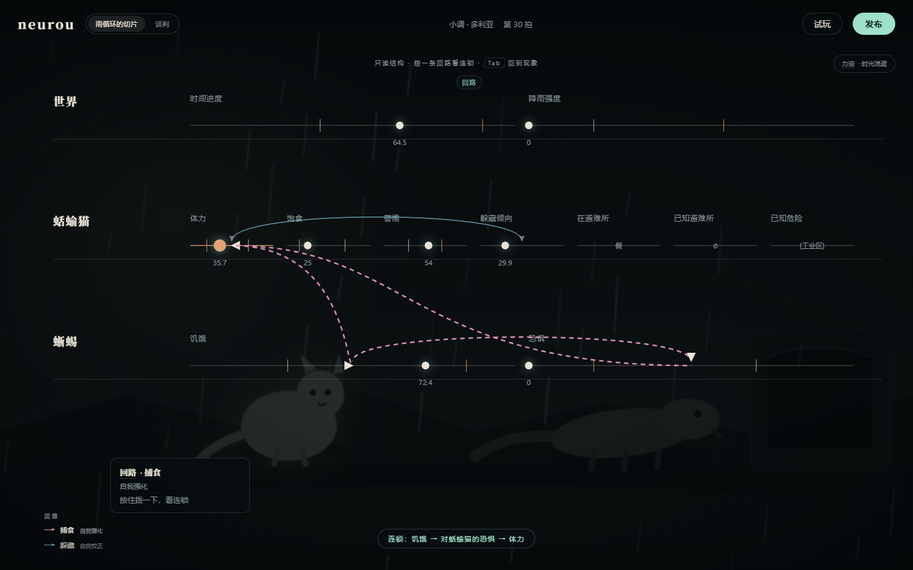

# 最小 GUI（v0.1）

> 范围：只做五件事——现象层、只读结构层、试玩、发布、五个 L1 术语。
> 不做编辑、总览层、移动端、弦包市场、本地 AI、代码编辑区。


## 跑起来

```bash
pnpm gui            # 先开这个，http://127.0.0.1:5188/
pnpm check:gui      # GUI 类型检查
pnpm test:gui       # Playwright 真实浏览器自测（需要本机 Edge + 已开 pnpm gui）
pnpm --filter @neurou/gui build
```

## 五件事落在哪里

| 能力 | 交互 | 代码 |
|---|---|---|
| 现象层 | 世界自动逐拍运行；雨循环段落进度可见；悬停角色出弦状态细线；底部两条调性滑块 | `Scene.tsx`、`App.tsx`、`tuning.ts` |
| 结构层 | Tab 切换（0.45s 溶解）；实体声部线、阈值品丝、回路连线；悬停/点击左下角回路图例「拨」一下，出现连锁提示与残影脉冲 | `Structure.tsx` |
| 试玩 | 右上「试玩」→ 2:00 倒计时、动作按钮、返回（回到进入前的快照） | `Play.tsx` |
| 发布 | 右上「发布」→ Web Worker 跑 600 局 → 音准仪分数、命运分布、维度、文字诊断 | `Publish.tsx`、`simWorker.ts` |
| L1 术语 | 弦/回路/调性/力迫/和弦：操作时浮出一次（每个最多 3 次）；悬停出现卡片；不弹教程 | `terms.ts`、`Term.tsx` |



## 三个关键设计

### 1. 调性旋钮不是「难度参数」

两条滑块没有直接改世界里的数字，而是被编译成**两根真实的弦 + 四条力迫 + 四条信号**，
再交给同一个 `Universe` 去跑（`tuning.ts`）：

```text
调性.压力 > 55  →  时间进度 += (压力 - 50) / 30
调性.残酷 > 55  →  体力      -= (残酷 - 50) / 30
调性.压力 > 78  →  字幕「雨点变得密集，像有人在敲铁皮。」
```

所以拖动之后发生的是：世界真的变快/变残酷了，信号在下一拍击中玩家。
界面上的色调变化是同时发生的第二重反馈，不是唯一反馈。

调性只在这一次运行里存在，不写回 `.nro`；发布时模拟的是作品本身，不含本次调音。

### 2. 结构层只读，但可以「拨」

没有拖拽改值、没有新增删除、没有输入框。唯一的主操作是拨一条回路：
沿环走一遍，把节点序列交给现象层做残影脉冲，同时底部显示「连锁：A → B → A」。
回路名放在左下角图例里，连线只负责表达「谁接谁、什么方向」，避免文字压在线上。

### 3. 术语不教，术语出现

| 术语 | 锚（卡片第一行） |
|---|---|
| 弦 | 世界的一根神经。 |
| 回路 | 几件事互相牵着，一件变了，别的也跟着变。 |
| 调性 | 这个世界现在是冷还是暖。 |
| 力迫 | 你推了世界一下，它再也回不到刚才。 |
| 和弦 | 几件事同时发生，像一只手按下好几个琴键。 |

每个最多自动浮出 3 次（`localStorage` 计数），之后只在悬停卡片里出现。
锚点和例子不使用任何 neurou 术语——这条有脚本检查：`pnpm exec tsx scripts/terms-check.ts`。


## 已知边界

- **视觉是舞台，不是求解器**：v0.1 没有真实的视觉/动画/物理/空间求解器，角色是静态 SVG，
  状态变化靠台词、色调、雨量与光晕表达。这是内核边界，不是 GUI 偷懒。
- **调性不持久化**：刷新页面回到 50/50；不写回源文件（本轮没有编辑能力）。
- **试玩只有桌面键鼠**：没有移动端、没有长按卡片（悬停替代）。
- **发布分数对局数敏感**：600 局时雨循环切片为 62 分；120 局时稀有结局未出现，会升到 72 分。
  发布固定用 600 局，CLI 可通过 `--runs` 调整，比较分数时请固定局数。
- **世界切换会重置世界**：切换示例等于换一个宇宙，不保留上一个的运行状态。

## 自测

```bash
pnpm test        # 31 个内核测试
pnpm test:gui    # 51 项 GUI 验收（Playwright + 本机 Edge）
```

最近一次 GUI 自测：51/51 通过；发布 600 局约 110ms（含 Worker 启动与渲染约 235ms）；
渲染 60fps；整轮堆内存 16MB、增长 +5MB；无页面级报错。
细节与截图在 `artifacts/self-test.json`（该目录不进 git）。
