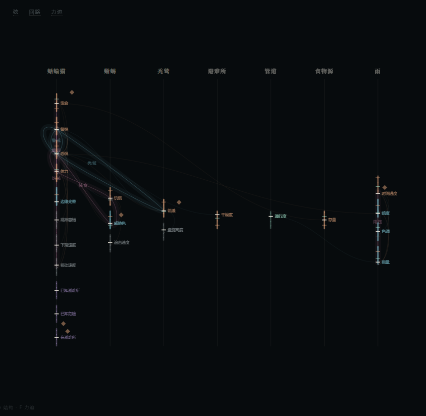
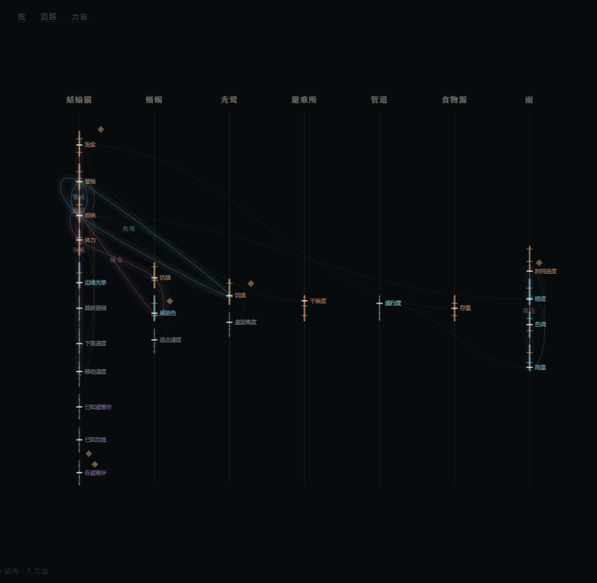
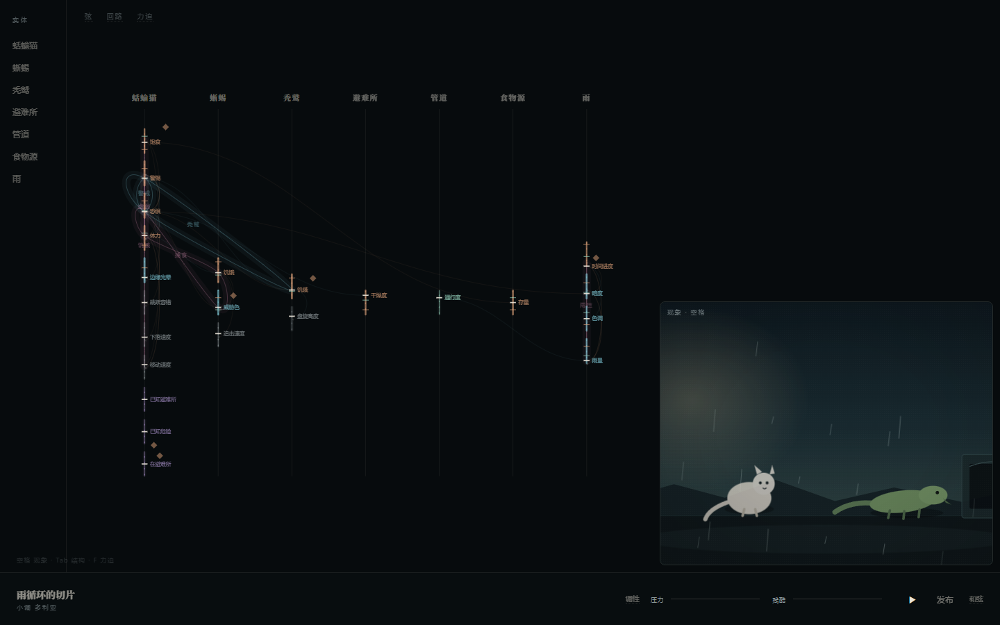
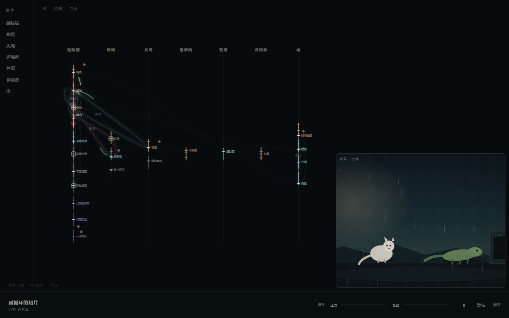

# 调律台（v0.2）

> neurou 是**编辑器/调律台**，不是游戏。
> 用户打开它，第一眼看到的必须是**正在振动的弦网络**；现象层只是右下角的一扇残影预览窗。


## 默认布局

```
┌────────┬──────────────────────────────────┬──────────────────────┐
│ 实体    │ 弦网络（主区 844px ≈59%）          │                      │
│ 蛞蝓猫  │  7 条竖向声部线 · 23 根弦          │  ┌────────────────┐  │
│ 蜥蜴    │  31 条横向耦合（带箭头）           │  │ 现象残影        │  │
│ 秃鹫    │  常驻品丝 · 6 条回路闭环           │  │ 480×380         │  │
│ 避难所  │  6 个力迫◇                        │  │ 点击/空格放大   │  │
│ 管道    │  弦在流动、在呼吸                  │  └────────────────┘  │
│ 食物源  │                                    │                      │
│ 雨      │                                    │                      │
│         │ 空格 现象 · Tab 结构 · F 力迫（0.2）│                      │
├────────┴──────────────────────────────────┴──────────────────────┤
│ 世界名 / 调性 │ 调性 压力 ──── 残酷 ──── │ ⏸ 发布 和弦 │          │
└──────────────────────────────────────────────────────────────────┘
```

- **中央主区**：弦网络。竖向声部线按实体分列；每根弦是一段竖线，颜色 = 类型
  （叙事暖、视觉冷、物理灰、认知紫、空间绿），粗细 = 张力；线上的小刻度是品丝（阈值），
  横线/圆点是当前值的位置（不显示数字）。横向曲线是耦合，箭头是方向。
  回路以闭环光晕高亮；力迫是以小菱形标记。每根弦都有一层极微弱的流动和呼吸。
- **左侧**：实体列表。点击聚焦该实体的整列弦，其他列压暗；再点取消。
- **右下**：现象残影窗 480×380（屏幕面积 14.1%）。它不是主画面，只是预览；
  点击或按空格放大成现象层全屏。比上一版 330×252 大了将近一倍。
- **底部**：极淡工具栏——世界名、调性、压力/残酷两条滑块、运行/暂停、发布、和弦。
- **左下角**：`空格 现象 · Tab 结构 · F 力迫`，opacity 0.2，`pointer-events:none`，
  像乐谱上的排练记号；看漏不影响操作。
- **术语**：弦 / 回路 / 力迫 在弦网络左上角常驻；调性 / 和弦 在底部工具栏常驻；
  opacity 0.3–0.4，悬停可看卡片。不再藏到「操作时浮现」。

## 弦必须可见、可触、可调

### 悬停一根弦


显示：类型标签（叙事弦 / 视觉弦 / 物理弦…）、一个竖向的当前值位置（无数字）、
「按住拖动可调」。类型标签和值位置都是极淡的；它不抢弦的注意力。

### 拖动一根弦


按住上下拖，弦的当前值位置跟着移动，线粗（张力）随之变化；
现象残影里的对应角色/场景立刻反应——例如拖 `蛞蝓猫.体力`，残影里的蛞蝓猫会变亮；
拖 `雨.雨量`，残影里的雨会变密；拖 `雨.暗度`，画面会变暗。

拖动是**现场调音**：只改这一次运行的内存状态，不写回 `.nro`。

拖动时弦不是直线跟随：它会向拖动方向弯 ±6px，松手后以阻尼振荡回到直线（420ms 回弹）。

### 弦在流动、在呼吸

每根弦有两层极微弱的动画：

- **流动**：一段 1.4/8.6 的短划线沿弦移动，像水流/心电图的极小刻度；
  速度由张力决定——高张力约 **1.1 秒**一圈，低张力约 **3.4 秒**一圈。
- **呼吸**：同一根弦背后有一层 5px 的柔光，颜色在 0.01–0.10 的透明度之间缓慢起伏。

暂停世界后连拍三帧，网络仍在变（数值不动，只有弦在流动）：

| 帧 | 帧哈希 | 流动偏移 |
|---|---|---|
| 0 | `49e0de03501b` | `-8.58px` |
| 1 | `dc23892d3d10` | `-18.83px` |
| 2 | `172c47e58558` | `-8.81px` |





### 拖动时的因果波

拖动一根弦，源弦先亮起；沿耦合线出现绿色脉冲；脉冲到达的弦亮起一圈；
再沿它的耦合继续走。可视化走三跳，最多 21 条边、14 个节点。

- 每条边的传播时间：`220 + 延迟 × 200 + (1 - 强度) × 140` 毫秒。
  强度越高越快，延迟越大越慢（数据来自 IR 的 `strength` / `delay`）。
- 拖动 `蛞蝓猫.体力` 后 0.5 秒：**6 条耦合脉冲**、**12 个节点亮起**（其中 11 个是相邻弦）。
- 这是对已有耦合数据的可视化，不是新求解器；拖动本身仍只改这一次运行的值。

静止态（暂停，无波）：



拖动后 0.5 秒（源弦 + 相邻弦 + 耦合脉冲）：



### 回路


回路以闭环形式高亮（强化=暖玫瑰，校正=冷青）。悬停显示：
`回路 · 捕食 / 饥饿 → 威胁色 → 恐惧 → 体力 / 自我强化 · 点击拨一下`。
点击拨一下，序列上的弦依次亮起，残影里的角色收到连锁脉冲。

### 力迫


弦网络上的小菱形是力迫条件；点击弹出「当 … / 效果 … / 先于 …」。
按 `F` 进力迫层，看完整的偏序图：


## 视图与快捷键

| 键 | 视图 | 说明 |
|---|---|---|
| 默认 | **调律台** | 弦网络 + 残影 + 工具栏 + 实体列表 |
| `空格` / 点残影 | **现象层全屏** | 观察/试玩入口；再按空格或 Esc 回调律台 |
| `Tab` | **结构层全屏** | 同一张弦网络，放大；Tab 返回 |
| `F` | **力迫层** | 力迫条件的偏序图；F 或 Esc 返回 |
| `P` | **试玩** | 两分钟逐拍介入；返回进入前的视图 |
| `R` | **发布** | 纯黑全屏；只有分数 + 一句诊断；Esc/点背景返回 |

现象层全屏：


发布：


## 示例世界：雨循环的切片

`examples/rain-slice.nro` 已从「3 个实体、2 条回路」扩到撑得起弦网络：

| 项 | 数量 | 内容 |
|---|---|---|
| 实体 | 7 | 蛞蝓猫、蜥蜴、秃鹫、避难所、管道、食物源、雨 |
| 弦 | 23 | 叙事 9、视觉 5、物理 5、认知 3、空间 1 |
| 耦合 | 31 | 横向把叙事、视觉、物理接起来 |
| 回路 | 6 | 捕食、饥饿、警戒、雨压、秃鹫、虚弱 |
| 力迫 | 6 | 雨来了、捕食、饥饿、避难、记住避难所、秃鹫俯冲 |
| 和弦 | 3 | 暴雨、捕食和弦、避难和弦 |
| 信号 | 16 | 阈值都有对应的看见/听见 |
| 结局 | 4 | 淹死、饿死、被吃掉、活过这场雨 |

视觉弦（雨量/暗度/色调/边缘光晕）与物理弦（移动速度/容错/下落速度/追击速度/盘旋高度）
被叙事弦通过耦合驱动；调律台把它们全部画出来，现象残影则用雨量/暗度/色调/边缘光晕
直接改变画面。运行时没有新增求解器——只改了 `.nro` 和 GUI。

## 自测

```bash
pnpm test        # 31 个内核测试
pnpm test:gui    # 74 项调律台验收（Playwright + 本机 Edge）
```

最近一次：**74/74 通过**；首屏默认是调律台；弦 23、回路 6、力迫 6、实体 7；
预览窗 **480×380（屏幕面积 14.1%）**；左下提示 opacity **0.2**、不挡交互；
每根弦都有流动/呼吸层，流速分档 `1.1s–3.4s`；暂停后连拍三帧哈希不同；
拖 `体力` 后 0.5 秒有 **6 条耦合脉冲、12 个节点亮起（11 个相邻）**；
弦上值位置 `273.7 → 257.3`、残影角色 opacity `0.82 → 1.0`；
拨「捕食」回路后 4 根弦依次亮起、残影角色收到 `actor--pulse`；
发布 600 局约 349ms、分数 58（红区「还站不稳」）、默认 2 行；
渲染 60fps；堆内存 11–13MB；无页面级报错。

## 已知边界与风险

- **不是游戏**：默认界面没有角色可操作、没有目标、没有关卡；它是调律台。想玩的人按空格看现象层，或按 P 进试玩。
- **拖动是现场调音**：改的是这一次运行的状态，不写回源文件；刷新/切换世界会回到基线。
- **视觉弦/物理弦没有专属求解器**：运行时只真正求解叙事/认知/关系/控制；视觉弦与物理弦是被耦合驱动的数值，现象层用启发式映射渲染它们。这是内核边界。
- **回路标签在密集区会重叠**：6 条回路都经过蛞蝓猫/蜥蜴附近时，闭环光晕与名字会叠在一起；悬停可以分清，但第一眼可能显得乱。
- **弦网络是只读结构 + 现场拖动**：没有新增/删除弦、没有保存、没有撤销；这不是完整的弦编辑器。
- **世界健康分不高**：发布 58 分（红区「还站不稳」），主要来自结局集中度/节奏；弦网络看起来丰富，但这个世界本身还需要调。GUI 不替它掩盖。
- **流动/呼吸幅度很小**：在低对比度显示器、亮环境、或 `prefers-reduced-motion` 下，可能几乎看不见；如果第一眼仍然被读成静态图，加大幅度会破坏「极微弱」的意图，需要用户测试判断。
- **因果波是可视化近似**：速度公式用了 IR 的强度/延迟，但不是运行时逐拍的精确调度；0.5 秒内 12 个节点亮起，可能被读成「闪一下」而不是一条可追踪的路径。
- **主区从 69% 降到 59%**：为了 480×380 的预览，右栏变成 500px（34.7% 宽），预览上方留下空白；如果用户觉得弦网络被挤，下一轮要重新分配，而不是缩小预览。
- **左下提示只有 0.2**：它是排练记号，不是按钮；测试时可能会完全看漏，三个视图仍然不可发现。
- **`Tab`/`F`/空格没有按钮**：现在有了一行极淡提示，但仍然只是字；第一次用的人可能只停在默认调律台。

## 下一轮

不再改 GUI。用 [用户测试包 v0.3](05-user-test-kit.md) 找 5 个非程序员，跑三条核心判定：
定位、活性、结构。测试结果出来之前，不动界面。
