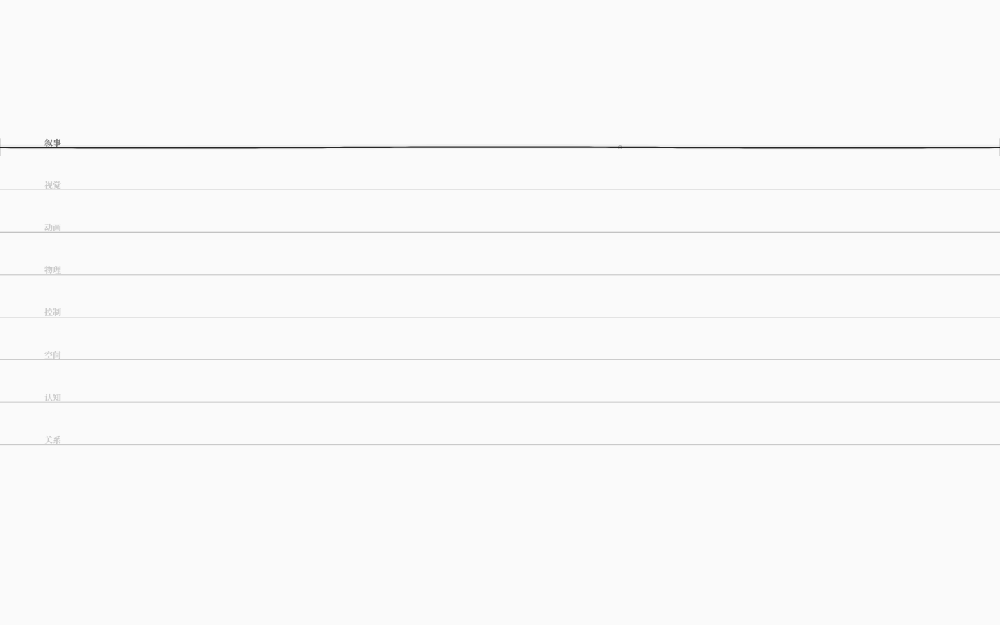
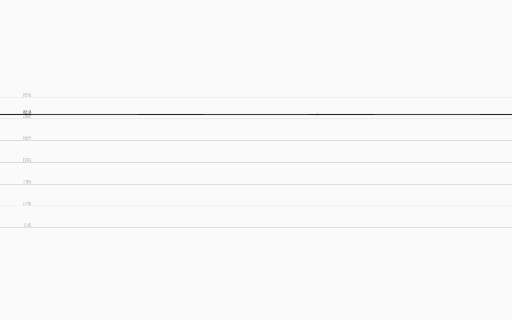
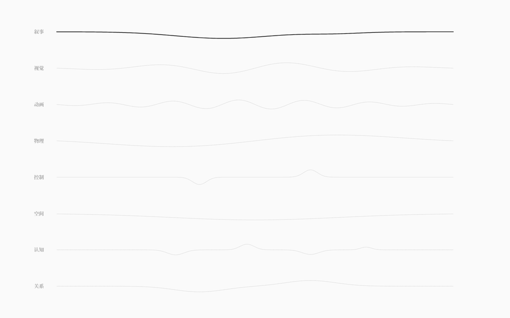

# 八弦叠影（v0.7）

> 一张白纸，八根叠在同一屏上的弦。每根弦的**基线纵坐标就是它的设置值**；
> `Tab` 把焦点交给其中一根（它变成近黑的墨迹，其余七根沉成半透明灰），
> 拨动焦点弦，波会沿弦传播、在交点处干涉、在共振点唱起来。



## 从 v0.6 到 v0.7

v0.6 是「屏幕正中单弦，Tab 换波种」。新设计把它推进了一步：

1. **八类弦不再互相替换，而是同时叠在同一张纸上**（Tab 只切焦点，不切内容）；
2. **弦的作用 = 它的基线纵坐标**：基线越高，设置值越大；拖弦 = 改设置值；
3. 引入一组「超弦」交互：驻波/泛音、干涉/奇点、D-膜、紧致化结点、对偶翻转。

这样界面从「一根弦的乐器」变成「八根弦的同一张谱面」——万物皆弦，而八类弦只是同一种振动的
八种解释。v0.6 的单弦设计与 v0.5 的墨网设计都保存在 git 历史里。

## 首屏与手势

| 手势 | 结果 |
|---|---|
| `Tab` / `Shift+Tab` | 焦点在 8 类弦之间循环；焦点弦变近黑、加粗、带高频微颤，其余七根半透明灰 |
| 拖动焦点弦上下 | 移动它的基线 = 修改它的**设置值**（0..100 映射到 y=790..110）；其它弦不受影响 |
| 快速点触 / 敲键盘 | 拨动焦点弦：方向由触点在其基线上/下决定，幅度由距离决定；触点浮现该点所属键的字符 |
| 拖动弦两端的「膜」 | 改变跨度（0.55–1 倍）；弦越短，张力越高、音越高 |
| 悬停弦上的「结点」+ 滚轮 | 展开折叠结点，调整一个微观参数（影响该弦阻尼） |
| 极值处用力拨动 | 对偶翻转：弦塌缩成小环，设置值翻到对侧（99 → 1） |
| `Esc` | 8 类弦的签名波总谱；再按回八弦；总览里 `Tab` 切当前类、点某行选中并返回 |

没有面板、按钮、数字、常驻说明；八根弦的名字只在左侧以极淡衬线出现。

## 基线即设置

- 纵轴是数值轴：设置值 100 → y=110（上），0 → y=790（下）。
- 横轴是时间/空间轴：一次扰动沿弦向右（和向左）传播。
- 振幅 = 张力：位移越大、波峰越粗越黑。
- 每根弦的默认设置值（只是调律台的初始状态，不是某个世界的真实数据）：

| 弦 | 叙事 | 视觉 | 动画 | 物理 | 控制 | 空间 | 认知 | 关系 |
|---|---|---|---|---|---|---|---|---|
| 默认值 | 85 | 76 | 67 | 58 | 49 | 40 | 31 | 22 |

八根基线从 y≈212 均匀排到 y≈639，像八根悬在纸上的蛛丝。
拖动一根弦时，只有它的基线在动；其余七根像背景里的低音弦一样安静。



## 超弦交互（五件事）

### 1. 驻波与泛音：共振点上的和弦

每类弦有几个「共振点」设置值（如叙事 50、视觉 33/66、动画 25/50/75…）。
当焦点弦的基线停在共振点上：

- 它会进入**驻波态**：弦上叠出高频泛音，并出现 2 层极淡的虚影；
- 此时拨一下 = **和弦**：焦点弦发声，同时把其余七根弦轻轻带动（跨弦和弦），音频补一个高五度。


### 2. 干涉与奇点：八弦的交叉

- 所有 8 根弦的曲线两两求交；交点画成极淡的「奇点」（点 + 光晕）；
- 鼠标停在奇点上，会浮出两个类名（如「叙事 × 视觉」）——只浮现，不做解释；
- 焦点弦的波经过与另一根弦的交点时，会给那根弦注入一个小涟漪：
  **你拨一根弦，另一根在交点处回应你**；
- 交点会随时间移动：弦的位置和波都在变，谱面是活的。


### 3. D-膜：两端的锚

- 焦点弦的两端各有一片半透明的「膜」；横向拖动可以收放跨度；
- 跨度变短 → 弦更紧：同一个音在更短的弦上频率更高（音频按跨度升调）；
- 波在更短的弦上往返更快，衰减也更利落。


### 4. 紧致化结点：藏在弦上的微小维度

- 焦点弦上有一个小结点；悬停时它展开成一个折叠的小环（几瓣非常淡的曲线）；
- 滚轮调整这个环的展开度 = 一个微观参数（影响该弦的阻尼）；
- 不显示数字，只看它的大小与弦的余音长短。


### 5. 对偶翻转：极值处的另一侧

- 当设置值在极值（≤2 或 ≥98），并且你用力拨一下：
- 弦会塌缩成纸中间的一个小环，然后展开——设置值翻到对侧（99 → 1），
  就像高信任与绝对控制、大世界与密室，在边界处互为对偶。


## 键盘映射

46 个物理键位（数字/字母/符号）按真实键位归一化映射到全屏；键盘完全隐形，只在触点浮现键字。

- 列 → 弦上的位置；
- 行 → 相对于**焦点弦当前基线**的方向与幅度：落在弦上方 = 向上拨，下方 = 向下拨，越远越大；
- 因此同一颗键在焦点弦移动后会有不同的音高与方向——这正是「位置就是参数」的一部分。

## ESC：总谱

8 类弦各有一条签名波，横向叠成谱面；当前类的线是实黑，其余极淡。总览里 `Tab` 仍切换当前类，
点击某一行 = 选中它并回到八弦视图。



## 声音

- 每次触点 = 一次 Karplus-Strong 拨弦；音高随触点在弦上的位置（A 小调五声音阶），音色随弦类；
- D-膜缩短时按跨度升调；共振态拨弦会补一个高五度音；
- 首次用户手势才创建 AudioContext；`AnalyserNode` 提供真实 rms，供自动验收。

## 自测

```bash
pnpm test          # 71 个单元测试（内核 31 + 弦物理/音高 17 + 设置值/键盘/干涉 23）
pnpm test:gui      # 64 项真实浏览器验收（Playwright + 本机 Edge，需 dev server 5188）
node scripts/string-shots.mjs   # 重新生成 docs/images/string-*.png
node scripts/string-video.mjs   # 重新生成 docs/media/string-8s.mp4
Get-ChildItem docs/images/string-*.png | ForEach-Object { & ./scripts/check-grayscale.ps1 -Paths $_.FullName }
```

最近一次（v0.7，`artifacts/string-test.json`）：

- 8 条基带 y = 211.5 / 272.5 / 333.5 / 395 / 456.5 / 517.5 / 578.5 / 639.5，与默认设置值一一对应；
  焦点行墨量 106.1 vs 其它弦 13.8，0 彩色像素；
- 点击 `(720, 基线−150)`：`last-amplitude=150`、拨后振幅 72.5、静止墨量 31,593、运动残墨 42,367；
- 拖弦：value 85 → 70，基线 212 → 314；其它弦不动；快速点触只 +1 次拨弦、不改值；
- 干涉：两弦靠近后拨动 crossings 0 → 6，被耦合的视觉弦振幅 10.7px；
- 共振：`叙事=50` 时 data-resonant=true，墨量 28,042 → 36,201（虚影/泛音）；共振拨弦后 8 根弦全部在动，rms 0.0048；
- D-膜 `span=0.70` 端点内移；拖膜到 0.81；结点滚轮 micro 0.50 → 0.58；对偶后 value → 1.0；
- ESC 总览 8 条谱线，Tab 切换正常；60fps；堆内存 11MB；无页面级报错。

## 已知边界

- **GUI 仍与 WorldIR 脱钩**：v0.7 是乐器视图，8 个设置值是本地状态，不来自、也不写回 `.nro`；
- **共振点/默认值/对偶阈值是演示参数**，不是 DSL 语法的一部分，也没有写进 IR；
- **「超弦」是界面隐喻**：驻波、干涉、D-膜、紧致化、对偶都是可操作的视觉/声音机制，
  不是物理结论；D-膜/对偶是简化实现；
- **声音是 GUI 本地合成**，不是运行时的音频求解器；没有静音开关；
- **八类弦共用同一个数值弦求解器**（波方程参数不同），还不是每类弦一个求解器；
- **canvas 拉伸**：逻辑坐标 1440×900，非 16:10 视口会被轻微拉伸；
- **移动端/触摸未验证**；键盘映射以物理键位 `KeyboardEvent.code` 为准。
