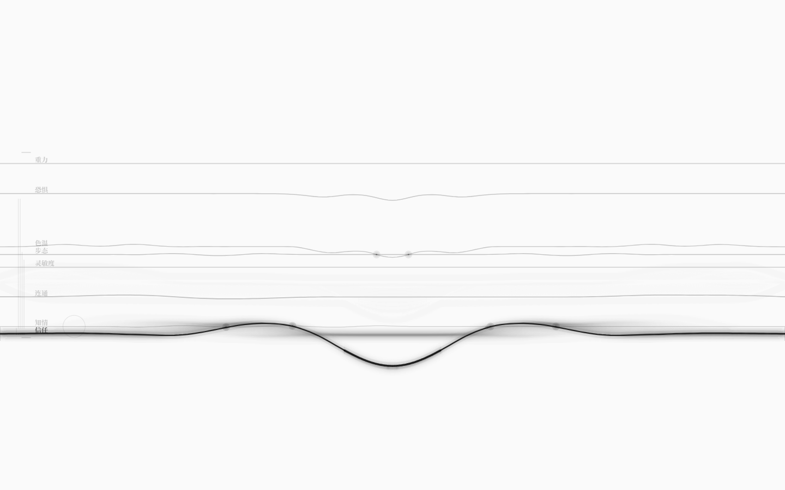
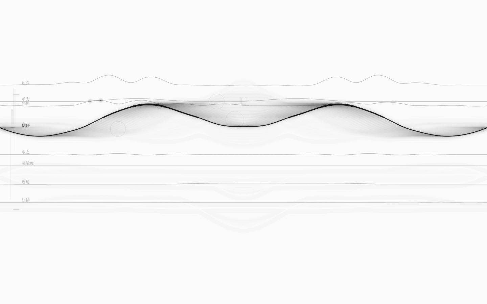
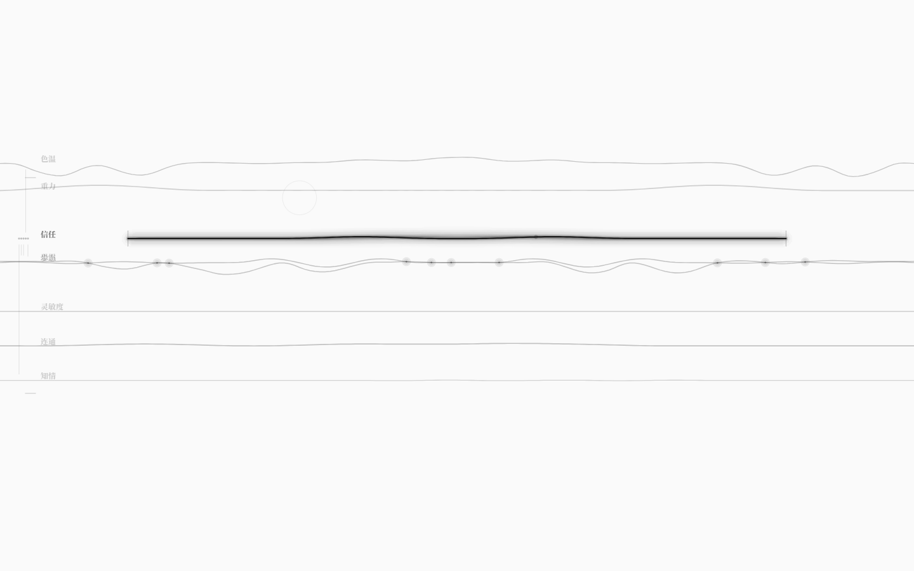
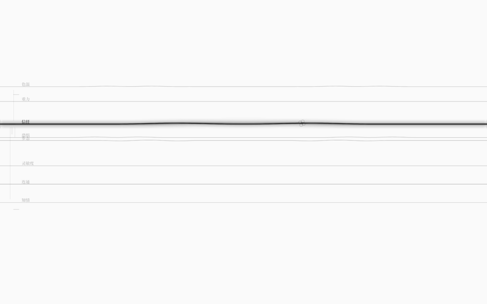
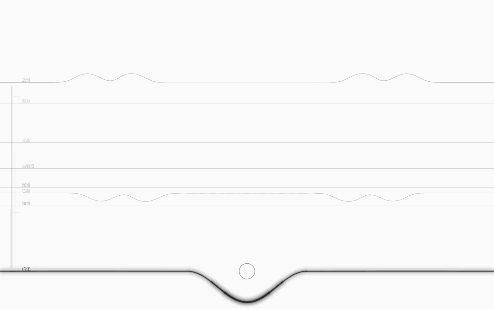

# 八弦调律台（v1.2：任意世界 + 多根弦 + 更柔和的振动 + 耦合编辑）

> 一张白纸，八根叠在同一屏上的弦。每根弦的**基线纵坐标 = 真实世界里的弦值**；
> `Tab` 把焦点交给其中一根（它变成近黑的墨迹，其余七根沉成灰），
> 拖弦或拨弦会写回世界，下一拍沿耦合传导——你看到的是**数据流在弦上走**；
> 松手后约 0.7s，当前状态被冻结成新基线写回当前世界文件；
> 焦点弦左侧的悬崖/安全刻度可以拖动改阈值，`Ctrl+Z` 撤销；
> 焦点弦参与的耦合在左侧显示为极淡竖线，悬停后滚轮可调强度；
> `?world=examples/xxx.nro` 打开任意示例世界，`←/→` 在同类多根弦之间切换；
> 波速整体放慢、微颤更柔。


## 从 v0.7 到 v1.0：从乐器到编辑器

v0.7 的八弦叠影是「本地乐器」：值、阈值、共振点都是 GUI 自己的演示参数。
v0.8 把它接回了真实世界：

```
examples/tuner.nro ──compileText──▶ WorldIR ──new Universe──▶ 逐拍 tick
                                        │                        │
                                        ▼                        ▼
                                   8 类弦各一根 ──▶ 调律台（基线 = 归一化值）
                                        ▲                        │
                                        └──── Universe.inject() ◀─┘ 拖弦 / 拨弦
```

v0.9 补上写回：松开弦之后，把当拍值冻结成新的基线，`serialize(ir)` 成 `.nro` 写回文件：

```
拖弦松手 ──persist──▶ withCurrentBaselines ──serialize──▶ POST /__neurou/save ──▶ examples/tuner.nro
```

- GUI 编译 `examples/tuner.nro`（8 类弦各一根、10 耦合、1 回路、4 规则、8 信号、3 结局）；
- 每 480ms 推进一拍 `Universe`，把弦值归一化后投影成 8 根弦的基线；
- 拖动弦 = 把新值 `inject` 回世界；拨一下 = 把该弦的值推高/推低约 8% 量程；
- 注入的变化会排进耦合队列，**下一拍**流到别的弦；被带动的弦会以涟漪的形式自己动起来；
- 共振点不再是写死的数字，而是**悬崖线 / 安全线**：弦值班接近阈值时进入驻波态；
- **用户手势（拖弦松手 / 拨弦 / 键盘 / 对偶）会触发写回**：dev 下经 Vite 中间件写回
  **当前世界文件**（只写 examples/、原子写、不热重载）；刷新页面从新基线开局。
  序列化、命令与边界见 [序列化与写回](11-序列化与写回.md)。
- **v1.0 结构编辑**：焦点弦左侧两个短刻度 = 悬崖线 / 安全线，可上下拖动改阈值；写回前
  序列化文本必须重新编译通过（否则拒绝写文件），`Ctrl+Z` 撤销、`Ctrl+Shift+Z` 重做。
  见 [编辑与撤销](12-编辑与撤销.md)。
- **v1.1 任意世界与多根弦**：`?world=examples/xxx.nro` 打开任意示例世界，写回跟随该文件；
  `←/→` 在同类多根弦之间切换（只切视图）；波速整体放慢、微颤 2.8Hz，手感更柔。
  见 [任意世界与多根弦](13-任意世界与多根弦.md)。
- **v1.2 耦合编辑**：焦点弦参与的每条耦合在左侧显示极淡竖线；悬停后滚轮调强度（±0.05，0..2），
  写回前仍走编译闸门；`Ctrl+Z` 撤销。见 [耦合编辑](14-耦合编辑.md)。

## 首屏与手势

| 手势 | 结果 |
|---|---|
| `Tab` / `Shift+Tab` | 焦点在 8 类弦之间循环；焦点弦近黑加粗带微颤，其余七根按各自粗细/透明度沉灰 |
| 拖动焦点弦上下 | 移动基线 = 修改世界里的真实值（`Universe.inject`）；其它弦下一拍起沿耦合响应 |
| 快速点触 / 敲键盘 | 拨动焦点弦：产生局部行波，并把真实值推动约 8% 量程；触点浮现所属键的字符 |
| 拖动弦两端的「膜」 | 改变跨度（0.55–1 倍）；弦越短音越高（本地乐器机制） |
| 悬停弦上的「结点」+ 滚轮 | 展开折叠结点，调整一个微观参数（本地阻尼，不写世界） |
| 极值处用力拨动 | 对偶翻转：弦塌缩成小环，真实值翻到对侧（99 → 1） |
| **拖弦松手 / 拨弦后** | 约 0.7s 后把当拍状态冻结成新基线，写回 `examples/tuner.nro`（dev）；刷新从新基线开局 |
| **拖动左侧阈值刻度** | 焦点弦的悬崖/安全线上下移动；写回前强制编译校验，无效编辑拒写 |
| **悬停左侧耦合竖线 + 滚轮** | 调焦点弦参与的耦合强度（±0.05，0..2）；松手后写回当前世界文件 |
| `Ctrl+Z` / `Ctrl+Shift+Z` | 撤销 / 重做上一次成功写回（写回上一份文本并原地重编译；历史只在当前会话） |
| `?world=examples/xxx.nro` | 打开任意示例世界（dev）；写回目标跟随当前文件 |
| `←` / `→` | 同类多根弦时切换显示哪一根（只切视图，不拨弦、不落盘） |
| `Esc` | 8 类弦的签名波总谱；再按回八弦 |

没有面板、按钮、数字、常驻说明；每根弦的标签是**世界里的弦名**（信任 / 色温 / 步态 / …），极淡地贴在左端。

## 默认世界：examples/tuner.nro

| 弦类 | 弦名 | 初值 | 悬崖 / 安全 |
|---|---|---|---|
| 叙事 | 信任 | 55 | 25 / 75 |
| 视觉 | 色温 | 64 | 35 / 80 |
| 动画 | 步态 | 50 | 20 / 80 |
| 物理 | 重力 | 72 | 78 / 35 |
| 控制 | 灵敏度 | 44 | 30 / 78 |
| 空间 | 连通 | 36 | 28 / 72 |
| 认知 | 知情 | 28 | 22 / 70 |
| 关系 | 恐惧 | 0.58（0..1） | 0.8 / 0.2 |

八根弦的基线按归一化值分布在 y≈300–600 之间；`Tab` 立刻能看出哪根在黑、哪根在灰。
`examples/tuner.nro` 同时补上了此前示例里缺席的「动画弦 / 控制弦」用例（审计曾指出它们零用例）。


## 世界如何变成波

1. 拖「信任」下移 → 值变小 → `inject` 把变化排进耦合队列；
2. 下一拍：信任 → 色温（同向 0.35）让色温下降；信任 → 恐惧（反向 0.4）让恐惧上升；
3. 再下一拍：色温 → 步态（同向）……回路「色温回响」把变化送回信任；
4. 调律台上，每根被改动的弦都会收到一次与 Δ值 成正比的视觉拨动——
   于是你能**看见数据流**：不是数字跳变，而是波从一根弦传到另一根。

## 阈值即共振

v0.7 的共振点是每类弦写死的几个数字；v0.8 改成**弦的悬崖线 / 安全线**：

- 焦点弦的值靠近悬崖或安全线（归一化距离 ≤0.035）→ 进入驻波态：泛音、双层虚影、左侧刻度；
- 此时拨弦 = 一次「临界和弦」：八根弦一起被轻轻带动，音频补高五度；
- 离开阈值带 → 回到普通态。

这让「接近危险」不再是一个数字，而是一种可以听见、看见的张力。



## 干涉与奇点

- 8 根弦的曲线两两求交；交点画成极淡的奇点（点 + 光晕）；
- 鼠标停在交点附近，浮现两个弦名（如「信任 × 色温」）；
- 焦点弦的波经过交点时会带动另一根弦；世界里的耦合与视觉上的干涉在这里是同一件事的两面。



## D-膜 / 紧致化 / 对偶

这三件仍是**本地乐器机制**（不改世界结构）：

- **D-膜**：拖动两端的膜收放跨度；弦越短音越高；
- **紧致化结点**：悬停展开折叠环，滚轮调一个微观阻尼参数；
- **对偶翻转**：值在极值且重拨时，弦塌缩成小环，真实值翻到对侧（高信任 ↔ 绝对控制）。







## 键盘映射

46 个物理键位（数字/字母/符号）按真实键位归一化映射到全屏；键盘完全隐形，只在触点浮现键字。

- 列 → 弦上的位置；
- 行 → 相对于**焦点弦当前基线**的方向与幅度：落在弦上方 = 向上拨，下方 = 向下拨，越远越大；
- 一次键盘拨动同样会写回世界（约 8% 量程）。

## ESC：总谱

8 类弦各有一条签名波，横向叠成谱面；当前类的线是实黑，其余极淡。总览里 `Tab` 仍切换当前类，
点击某一行 = 选中它并回到八弦视图。


## 声音

- 每次触点 = 一次 Karplus-Strong 拨弦；音高随触点在弦上的位置（A 小调五声音阶），音色随弦类；
- D-膜缩短时按跨度升调；阈值共振时拨弦会补一个高五度音；
- 首次用户手势才创建 AudioContext；`AnalyserNode` 提供真实 rms，供自动验收。

## 自测

```bash
pnpm test          # 97 个单元测试（内核 34 + 运行时 15 + 弦物理/音高 17 + 设置值/键盘/干涉 23 + 世界投影 8）
pnpm test:gui      # 79 项真实浏览器验收（Playwright + 本机 Edge，需 dev server 5188）
node scripts/string-shots.mjs   # 重新生成 docs/images/string-*.png
node scripts/string-video.mjs   # 重新生成 docs/media/string-9s.mp4
Get-ChildItem docs/images/string-*.png | ForEach-Object { & ./scripts/check-grayscale.ps1 -Paths $_.FullName }
```

最近一次（v1.2，`artifacts/string-test.json`）：

- 首屏 `data-world=调律台`、8 根弦、值 = tuner.nro 初值（信任 55 / 色温 64 / 步态 50 / 重力 72 / 灵敏度 44 / 连通 36 / 知情 28 / 恐惧 0.58）；
  8 条基带 y = 300 / 354.5 / 395.5 / 415.5 / 449.5 / 490.5 / 544.5 / 599；焦点行墨 106.7 vs 其它 13.8；世界逐拍在走；
- 拖动「信任」55 → 40.3；松手等 1.2s 后：色温 64 → 56.6、步态 50 → 47.4、恐惧 0.58 → 0.639——
  **3 根其它弦被世界耦合带动**，对应弦上出现视觉波；
- 拨弦：`data-plucks+1`、方向由触点相对基线决定，真实值 39.8 → 42.8（约 8% 量程）；
- 阈值共振：信任拖到 25 / 75 附近 → `data-resonant=true`、`data-resonance=25.0 / 75.0`；离开阈值带恢复 false；
- 两弦靠近后拨动 → `data-crossings=4`（奇点）；ESC 总谱 8 行；音频 running、rms 0.0055；60fps；堆内存 13MB；无页面级报错；
- **写回**：松手后 `data-saves` 1 → 2、`data-save-state=saved`；`examples/tuner.nro` 里「信任」基线
  68.734 → 59.322（被序列化器重写）；刷新后与文件一致；恢复原文件再刷新回到 55；
- **结构编辑**：拖动左侧悬崖刻度 25 → 40；文件 `悬崖 40`；`Ctrl+Z` → 25、文件与上一版逐字节相同；
  `Ctrl+Shift+Z` → 40；刷新后阈值仍为 40；
- **耦合编辑**：`data-couplings` 10 条；焦点信任 5 个标记；悬停「信任↔色温」滚轮 3 格，
  强度 0.5 → 0.65、`data-coupling-edits` 0 → 3、文件 `边 信任 → 色温 同向 0.65`；
  `Ctrl+Z` 回到 0.5，文件与编辑前逐字节相同；
- **任意世界**：`?world=examples/_acceptance-tuner.nro` 打开副本，写回只改副本，原 tuner 逐字节不变；
- **同类多根弦**：双弦世界里默认「甲」，`ArrowRight` → 「乙」（值 70）、`plucks` 仍 0，`ArrowLeft` → 「甲」；
  单实例世界（tuner）方向键无副作用；
- **振动放慢**：见 [任意世界与多根弦](13-任意世界与多根弦.md) §3 的波速/阻尼表。

## 已知边界

- **世界选择只在 dev、且是 URL 参数**：`?world=examples/xxx.nro`；生产包固定内联 tuner.nro，没有可见的世界选择器。
- **同类多根弦只显示一根**：左右方向键切换候选，但不会把同类多根同时叠在一屏。
- **结构编辑到「阈值 + 耦合强度」**：dev 下可改基线、阈值、已有耦合的强度；还不能在画布上新增/删除耦合，
  也不能增删弦/规则；撤销历史只在当前会话（见 [编辑与撤销](12-编辑与撤销.md)、[耦合编辑](14-耦合编辑.md)）。
- **耦合标记只显示焦点弦参与的耦合**：不画全图网络，也不能改极性/延迟/曲线。
- **写回仍是规范序列化**：注释、曲式名等 IR 不保存的信息会丢，见 [序列化与写回](11-序列化与写回.md)。
- **写回只在 dev**：`vite preview` / 生产包没有写回中间件，`data-save-state=disabled`，文件不会被改。
- **超弦交互的一半是界面机制**：D-膜 / 紧致化 / 对偶不改变 DSL 语义；共振（阈值）与干涉（耦合）是从世界真实状态读出来的。
- **声音是 GUI 本地合成**，不是运行时的音频求解器；没有静音开关。
- **八类弦仍共用同一个数值弦求解器**：tuner.nro 只证明「8 类弦可以各有一根」，没有证明「每类弦一个求解器」。
- **canvas 拉伸**：逻辑坐标 1440×900，非 16:10 视口会被轻微拉伸；移动端未验证。
