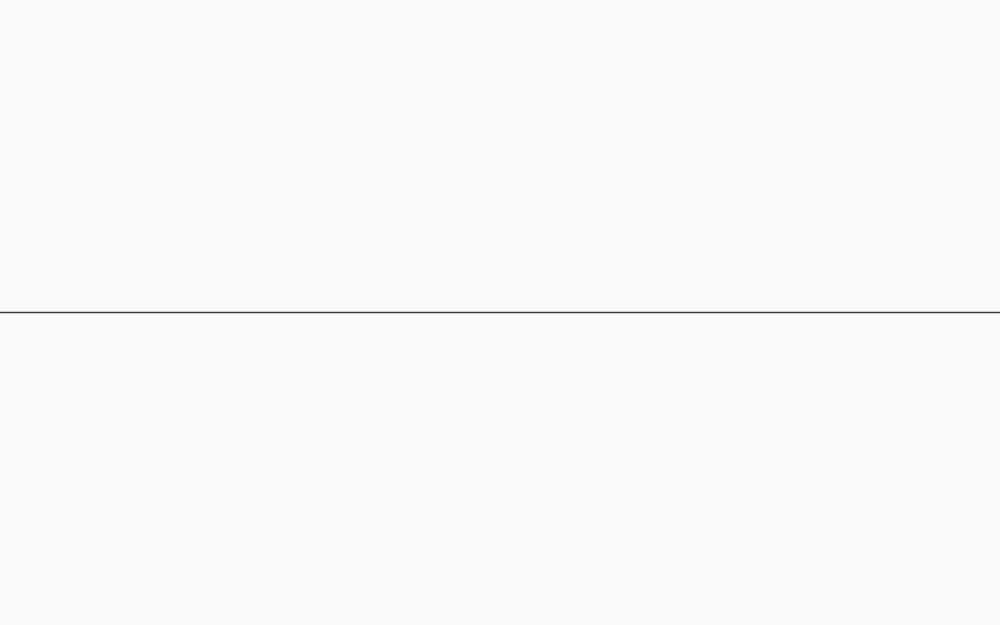
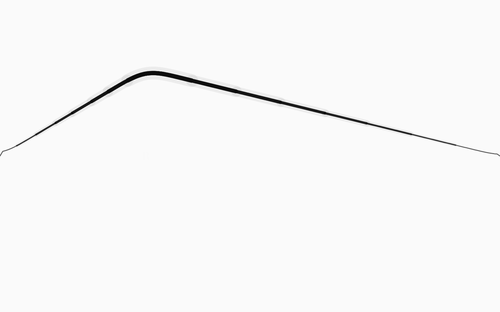
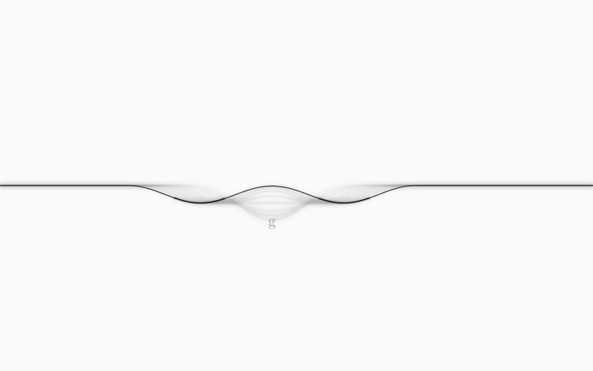
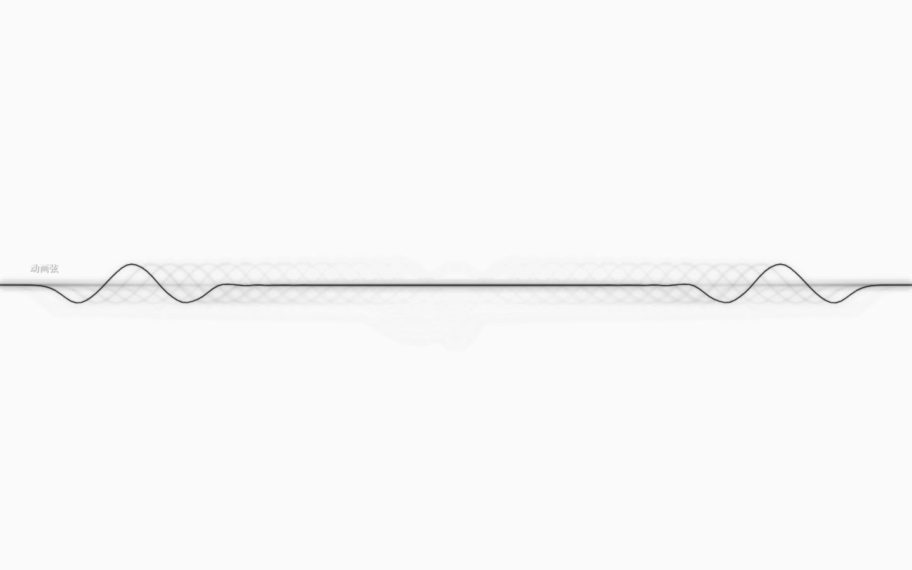
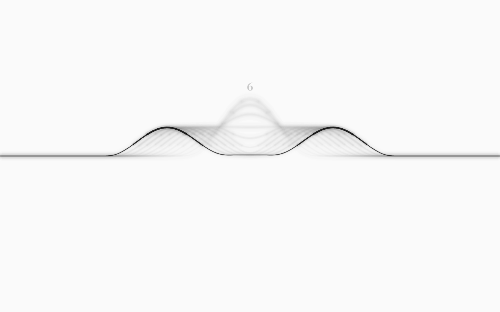
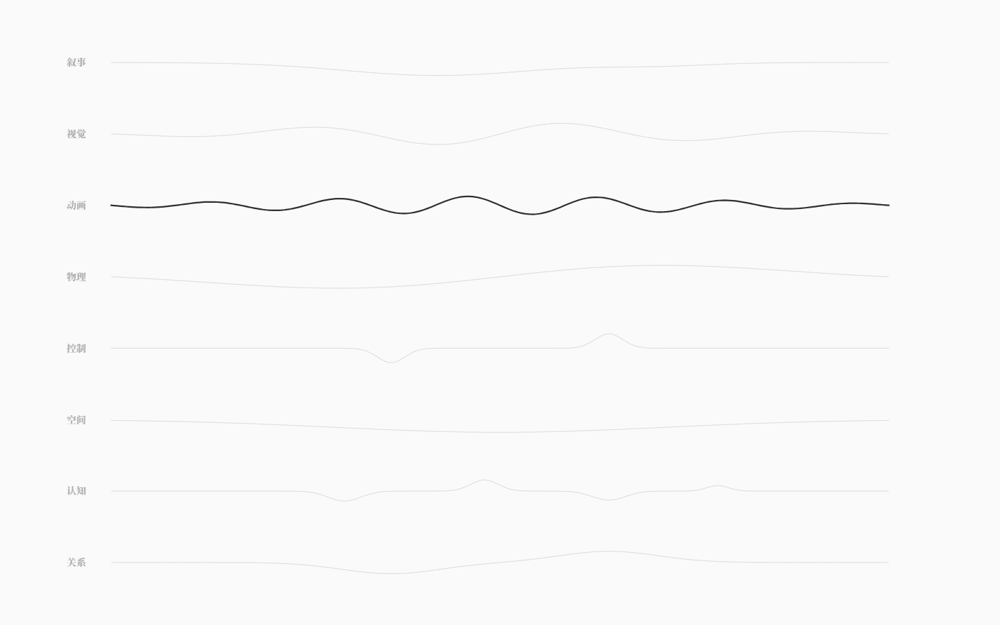

# 单弦调律台（v0.6）

> 一张白纸，正中一根水平黑线。点击即触碰，键盘是一张隐形的 46 键琴面。
> 没有节点、没有面板、没有按钮、没有数字、没有常驻文字。



## 为什么重做

v0.5 的「墨网测试体」把世界结构（节点、四根弦、回路、基准弦）都画在了首屏。用户看完的反馈是
**「对现在交互特效包括界面非常不满意」**，并给出了新方案：一开始一片空白、只有中间一根水平黑线，
弦的振动是一种触屏效果，只在点击时颤动；键盘上的数字/字母/符号按真实键位映射到屏幕上，
点哪里就对应弦的振颤方向与幅度；要有拉弦弯曲、波峰更粗、运动模糊与黑色帧残留；
Tab 换波种，ESC 看总览；**不要越界加奇怪的东西**。

所以 v0.6 把首屏收成了一根弦：删掉全部常驻视图，只留下「纸、墨、手」。
v0.5 的墨网组件已从 GUI 移除（git 历史保留），设计记录见 [墨网·生长与基准弦](09-墨网·生长与基准弦.md)。

## 首屏与手势

| 手势 | 结果 |
|---|---|
| 快速点击任意位置 | 弦在该 x 处被**局部**拨动：点击在弦上方 = 向上，下方 = 向下；离弦越远幅度越大；立刻分成左右两列行波向两端传播、反射；触点处浮现该点所属键的字符，约 550ms 后消失 |
| 按住上下/左右拖 | 拉弦：整根弦被拉成弓形（近黑、峰部变粗），越拉越紧；松手释放**整弦**波形 |
| 敲键盘（数字/字母/符号） | 等同于点击该键在屏幕上的映射位置：局部行波 + 触点淡字 + 声音 |
| `Tab` / `Shift+Tab` | 在 8 类弦之间循环；类名在弦左端上方浮现约 1.4s，并在弦心自动演示一次该类弦的波 |
| `Esc` | 总谱：8 类弦的签名波叠成 8 行，当前类实黑；再按回单弦。总览里 `Tab` 仍切换当前类，点某一行=选中该类并回到单弦 |

「点一下」和「按住拖」是两种不同的物理：点一下 = 一次局部激励（只有一段弦在响，波包沿弦跑）；
按住拖 = 真的把整根弦拉弯再放手（整弦一起振荡）。两者都能从触点位置读出方向与幅度。

没有任何提示文字、教程、"按 Tab 切换"之类的常驻说明；所有发现都来自操作本身。



## 隐形键盘映射

键盘不画在屏幕上，但每个屏幕点都属于某一个键：

- 46 个物理键位：数字行 12、Q 行 13、A 行 11、Z 行 10（`layoutKeyboard`）；
- 按真实键位归一化到 1440×900：四行竖排在 y≈190 / 364 / 536 / 710，弦在 450；
- **上两行 = 向上拨，下两行 = 向下拨**；离弦越远，幅度越大（14px–324px）；
- 列决定弦上的位置；Shift 后按数字会显示 `!@#…` 等符号键，都是同一个物理键位；
- 鼠标点击是连续位置，键盘是键位中心；两者走同一个 `TouchPoint`——所以「点哪里」和「按哪个键」是同一件事；
- 触点淡字是该键的字符（`A`、`6`、`!`），出现后淡出，键盘始终不显示。



## 8 类弦（Tab 切换）

Tab 切的是 DSL 的 8 类弦，不是 8 种合成器波形：每类有独立的振动个性与音色。

| 弦 | 振动个性 | 听见的 |
|---|---|---|
| 叙事 | 慢、宽、余音长 | 温暖、衰减长 |
| 视觉 | 快、亮、碎（双点激励） | 亮、短、偏高 |
| 动画 | 规律涟漪（三点交错激励） | 轻快、偏中高 |
| 物理 | 低频、重、衰减慢 | 低、厚 |
| 控制 | 紧、短促（双点） | 短、闷一点 |
| 空间 | 极宽、极慢 | 很低、很长 |
| 认知 | 细碎、即逝（三点） | 高、短、干 |
| 关系 | 双波源（两个波峰） | 两个音叠在一起 |

同一根弦、同一套手势，切换后 1 秒内就能从波动和声音听/看出差别。
参数在 `packages/gui/src/stringMath.ts` 的 `KIND_VISUAL`；音色在 `stringAudio.ts`。



## 物理与墨

- **一维弦物理**：固定端点的阻尼波方程，内部固定子步长 1/360s（与帧率无关）；
  点击 → 局部激励分成左右两列行波，沿弦传播、在两端反射、逐渐衰减；
  长按拉弓 → 释放整弦弓形，整弦以低阶模态为主缓慢振荡。
- **拉弦弯曲**：按住时按「帐篷」形状把整根弦拉向触点；渲染层在拉弦时做平滑，释放后 120ms 内淡出，
  保留行波的折点，避免只剩一阶「呼吸」。
- **波峰更粗**：线宽 = 静息线宽 + 峰值线宽 ×（|位移|/最大拉幅），近黑；再叠一层很淡的宽笔洇开。
- **运动模糊 + 帧残留**：离屏 trailCanvas 每帧淡出（destination-out），写入当前弦时做两层模糊
  （6px 墨晕 + 1.5px 帧线），所以拖尾是墨的残影，不是工程网点。
- 静止时**没有任何 idle 动画**：两帧截图完全一致；只有被碰时弦才活。



## ESC：总谱

8 类弦各有一条签名波（一个「声音形状」），横向叠成谱面；当前类的线是实黑，其余极淡。
名字只在左侧以极淡的衬线出现，没有数字、没有网格。



## 声音

- 每个触点 = 一次 Karplus-Strong 拨弦：音高随触点在弦上的位置（A 小调五声音阶，110–880Hz × 弦类八度）；
- 8 类弦有各自的八度、亮度、衰减、音量；触点位置决定声像；
- 首次用户手势才创建 AudioContext；没有手势不发声，被浏览器拒绝时优雅降级；
- `AnalyserNode` 挂在 master 之后，`rms()` 给自动验收一个真实信号。

## 自测

```bash
pnpm test          # 66 个单元测试（内核 31 + 弦物理/音高 17 + 键盘映射/物理 18）
pnpm test:gui      # 53 项真实浏览器验收（Playwright + 本机 Edge，需 dev server 5188）
node scripts/string-shots.mjs   # 重新生成 docs/images/string-*.png
node scripts/string-video.mjs   # 重新生成 docs/media/string-7s.mp4
Get-ChildItem docs/images/string-*.png | ForEach-Object { & ./scripts/check-grayscale.ps1 -Paths $_.FullName }
```

最近一次（v0.6）：

- 静止：墨迹 bbox `{x:0, y:448, w:1440, h:4}`，中心 450，墨量 5,760px；两帧截图同哈希；0 彩色像素；
- 点击 `(720,250)`：`last-direction=up`、`last-amplitude=200`、映射到 `Digit6`；140ms 后振幅 ≈83；
  两端位移 0、活动弦长 38%——是局部行波而不是整弦弓形；130ms 内波峰从 x≈480 跑到 x≈312；
  墨量 5,760 → 52,677（墨的帧残留）；波峰列 85px vs 近零列 21px；残墨 47,101px；
- 拉弦 `(400,450)→(400,200)`：位移 −247px；松手后整弦释放；按键 `A` 的触点与鼠标点其键位中心完全一致（x=276.5）；
  `1` 向上、`Z` 向下；
- Tab 8 类循环、每次演示一次拨弦；ESC 总谱 8 条带、当前类最黑；
- 声音：`data-audio=running`，点击后 `rms≈0.0065`；
- 60fps，堆内存 16–21MB，无页面级报错。

## 已知边界

- **视图与 WorldIR 脱钩**：v0.6 的单弦是乐器视图，不读世界、不写 IR、不落盘；8 类弦只借用名字与参数。
  这是把「前端极简」做到极致后的代价，接回世界数据是下一步（见 [架构完成度审计 §10](08-架构完成度审计.md)）。
- **声音是 GUI 本地合成**，不是运行时的音频求解器；没有静音开关（只能不碰/系统音量）。
- **拉弓释放主要激励低阶模态**：整弦会缓慢上下摆；局部行波来自快速点触/键盘。
- **总谱里点某一行**会选中该类并回到单弦；这是总览里唯一的点击，没有别的交互。
- **canvas 拉伸**：逻辑坐标 1440×900，非 16:10 视口会被轻微拉伸（和之前一致）。
- **长余音弦的静止判定**：`resting` 要 10–20s 才 true（视觉上几秒后就几乎静止）。
- **移动端/触摸未验证**；键盘映射以物理键位 `KeyboardEvent.code` 为准。
- **8 类弦的差异靠参数**，不是 8 套独立求解器；与 DSL 的 8 类弦「求解器分离」目标仍有距离。
