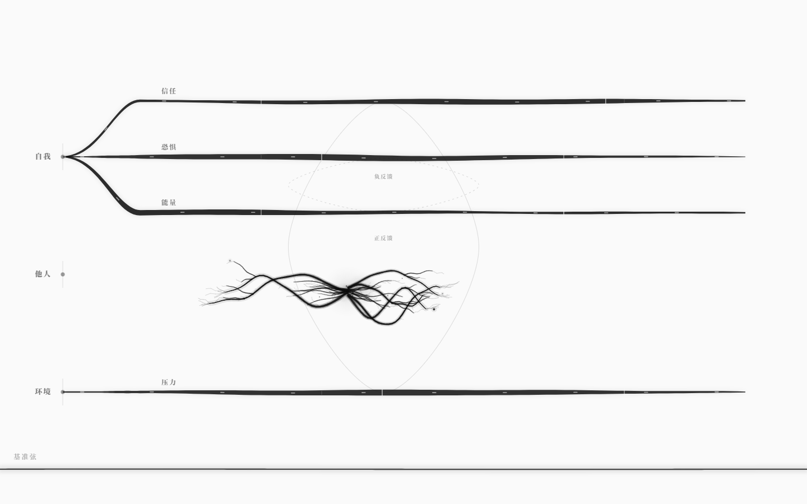
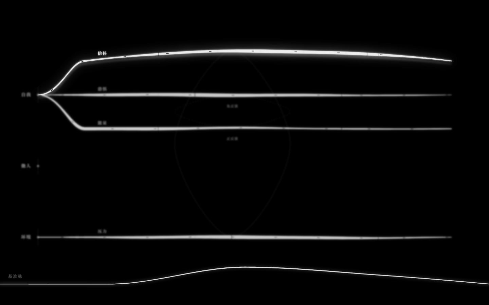
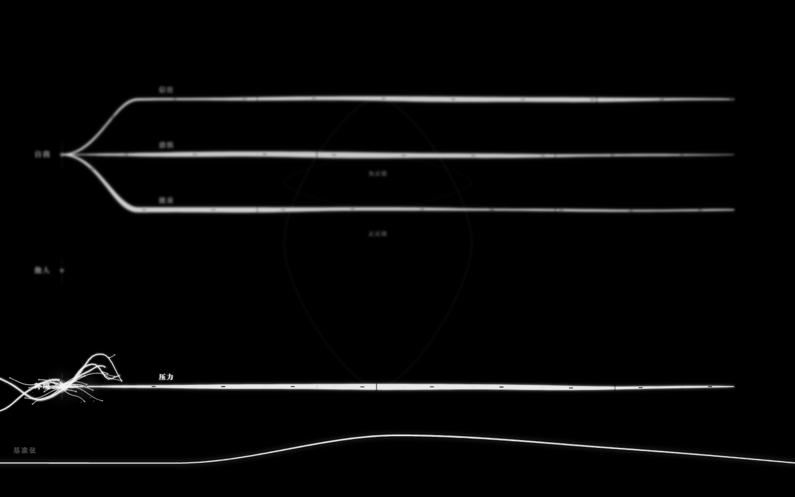
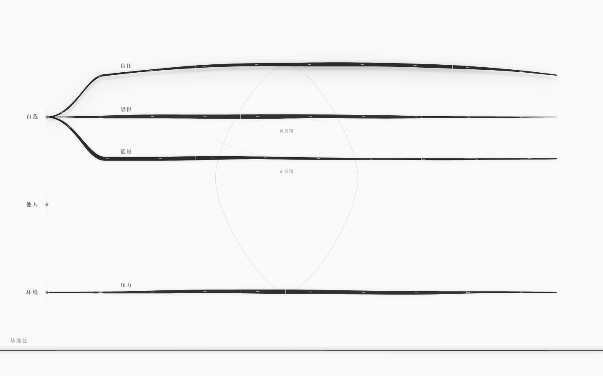

# 墨网测试体（v0.5）

> 不是游戏引擎界面。是一张三节点、四根横向弦、两条回路、底部一根基准弦的、会呼吸、会生长、会发声的墨网。
> 默认加载 `examples/core-test.nro`；没有侧栏、没有工具栏、没有数字。


## 测试世界

| 项 | 内容 |
|---|---|
| 节点 | 自我、他人、环境（左侧一列） |
| 弦 | 信任（自我—他人）、恐惧（自我→环境）、能量（自我）、压力（环境） |
| 回路 | 正反馈：信任↑ → 压力↓ → 信任↑；负反馈：恐惧↑ → 能量↓ → 恐惧↓ |
| 基准弦 | 底部贯穿全屏（1440px）的横向黑弦，不属于 `core-test.nro`，是调律台的参考弦/单弦琴 |

`examples/core-test.nro`：4 弦、4 耦合、2 回路、4 信号、0 结局。它是纯结构测试体，不承载故事。

## 几何

- 3 个节点在 x=112 一列；实体名在点的左侧，极淡。
- 4 根弦从节点向右延伸，横向跨度 1218px；起点不是硬切，从节点到水平段是一条贝塞尔藤蔓。
- 2 条回路以细墨闭环连接相关弦；正反馈=实线，负反馈=虚线。
- 基准弦在 y=838，从 x=0 到 x=1440；`y=724..900` 是它的整条塑形带。

## 呼吸：弦不是死线

v0.5 之前弦只靠流动 dash 表现“活”，静止时是一根僵直墨带。现在：

- 每根弦有 **三个不同波长的慢波叠加**（沿长度收束到 0，所以不是整根平移），振幅约 1–3px；
- 每根弦还有一个极慢的整体起伏（±2.8px，相位由弦的 seed 决定）；
- 以 ~22fps 更新几何，不跟主线程抢帧；墨流 dash 仍在更快的时标上流动；
- `prefers-reduced-motion: reduce` 时全部静止。

看连续三帧截图几乎一样，看 3 秒视频才知道它在动——这是刻意的：呼吸不该抢注意力。

## 点击：墨晕生长

在弦网空白处短按（位移 < 8px），从点击位置长出一簇墨，约 2.6 秒内生长、绽放、消散：

| 时间 | 发生了什么 |
|---|---|
| 0–0.05s | 墨核浮现（2.2–4px，alpha 0.85）+ 种子墨晕开始扩散（半径 20→46px） |
| 0.05–0.85s | **沿水平方向**向左/右抽长 5–7 条主须（带浅角度分叉，宽度 3.4–4.8px → 0.45px，宽笔洇开 alpha 0.07–0.10） |
| 0.55–1.20s | 须尖岔出细花丝（卷曲、收尖）、冒出 4–8 个墨点/孢子并缓慢外漂 |
| 1.25–2.60s | 墨化雾散：主须外扩 1.03–1.08 倍、上飘，花丝先散、墨核最后消失 |
| 2.60–2.75s | 移除 |

扩散方向是**横向**的：它顺着纸的横纹、也顺着弦网络的语法（所有弦、回路、墨流都沿 x 展开）铺开，
不是一朵四面八方的圆花；峰值轮廓宽度约为高度的 3 倍，墨迹基本落在点击点 ±130px 的横向带内。

规则：

- 同屏最多 6 簇；第 7 簇起最旧一簇转入 380ms 加速溶解，墨迹作为 ghost 淡出，不硬切；
- 形状由「spawn 序号 + 坐标」的确定性 seed 决定，可复现；
- 单簇总段数 ≤1200，纯 canvas 填充/描边，无 `shadowBlur`；4–6 簇同屏仍 60fps；
- `prefers-reduced-motion: reduce`：静态出现 ~450ms 后淡出 ~300ms；
- 拖动改值、拖动塑形都不触发墨晕；基准弦的塑形带内也不触发（那里是乐器）。



## 基准弦：贯穿屏幕的横向黑弦

底部那根横贯全屏的黑弦是调律台的“参考弦”。它不属于世界规则，而是**用来调世界的乐器**。

### 塑形

- 点 `y=724..900` 的任意位置：弦被拉向点击位置，留下一个控制点；
- 再点别处，用 **单调三次插值（PCHIP）** 穿过所有控制点，两端锚定在 `(0,838)`、`(1440,838)`；
- 300 个采样、二阶差分 < 0.1px：曲线没有折角、没有过冲，像被手指按住的丝线；
- 按住拖动 = 继续拉同一个控制点；`Escape` = 清空控制点，弦在约 180ms 内弹性回直；
- 静息主体 2.3px / alpha 0.72；形变处最粗 4px / alpha 0.9；控制点只画 1.6px 小刻点（opacity 0.22），不显示数字。


### 发声

第一次点击才创建 `AudioContext`（无用户手势绝不发声），之后：

- **拨弦**：Karplus-Strong —— 噪声激励 + 延迟线 + 低通反馈，按「音高档 + 音色档」缓存。
  - 横向位置 → A 小调五声音阶 16 档，110Hz–880Hz（3 个八度）；
  - 纵向位置 → 明暗与强弱（拉得越高越亮、越响；向下压则闷）；
  - 声像随 x；峰值约 0.25–0.4，接压缩器防削波。
- **持续音（曲线就是波形）**：把当前曲线位移去均值、归一化、做 DFT 取 1–32 次谐波，
  构造 `PeriodicWave`，由 110Hz 振荡器 + 低通 + 极轻 gain（≈0.022）持续发声。
  曲线形状变化 = 音色变化；切换时 40–80ms 交叉淡化，避免爆音。
- 每次点击还沿弦注入一个衰减小波包（振幅 10–16px、约 0.9s），视觉上能看到“拨”的动作传开；
- 25s 无交互后 drone 自动淡出；再点唤醒；`Escape` 全淡出并 suspend。

声音只在本地合成，不需要网络、不需要 LLM、不写进世界 IR。

## Tab：反色 + 失焦 + 局部聚焦

按 `Tab`：

- 背景从纸白 `#FAFAFA` 瞬间变成纯黑 `#000000`，弦/节点/文字变成白/灰；
- 基础层整体 `filter: blur(2px)`；
- 悬停的弦、点击的节点通过独立的**清晰聚焦层**叠在上面，保持锐利；
- **基准弦与墨晕不参与失焦**：那根横向参考弦在反色后保持清晰——世界可以模糊，尺子不能；
- 再按 `Tab` 恢复白底、无模糊。





## 悬停 / 拖动

悬停时弦被拉伸成拱形，出现墨影与拉丝残影；拖动控制点继续被拉，值的位置随之改变，松手回弹。




## 演示视频

6.4 秒：呼吸 → 悬停 → 拖动 → 点击生墨 → 基准弦塑形 → Tab 反色 → Escape 复位。

[ink-6s.mp4](media/ink-6s.mp4)

## 自测

```bash
pnpm test          # 48 个单元测试（内核 31 + 基准弦数学 17）
pnpm test:gui      # 62 项真实浏览器验收（Playwright + 本机 Edge，需 dev server 5188）
node scripts/ink-shots.mjs    # 重新生成 docs/images/ink-*.png
node scripts/ink-video.mjs    # 重新生成 docs/media/ink-6s.mp4
Get-ChildItem docs/images/ink-*.png | ForEach-Object { & ./scripts/check-grayscale.ps1 -Paths $_.FullName }
```

最近一次（v0.5）：

- 默认加载 `core-test`：3 节点 / 4 弦 / 2 回路 / 1 基准弦；0 个 button/input/侧栏/工具栏；
- 弦横向跨度 1218px；深黑 `rgb(11,11,11)`，opacity 0.769–0.85；连续帧几何在变（呼吸）；
- 墨晕：`data-blooms` 0→1→0（约 3s），画布非透明像素 4,509 → 12,181（生长中），3s 后 0；峰值墨迹 429×146px（宽高比 2.94 ≥ 2.5），±130px 横向带外 0%；像素逐点灰度；
- 基准弦：1440px 贯穿；三次点击 `data-wave-points=3`、`plucks=3`、bbox 高 54px、`rms=0.0076`、`data-wave-audio=running`；Escape 后 points=0、bbox 高 3px；
- Tab：背景纯黑、基础层 `blur(2px)`、悬停弦聚焦、基准弦白线清晰；再次 Tab 恢复；
- 60fps；堆内存 13–21MB；无页面级报错；
- `pnpm test` 48/48；`pnpm test:gui` 62/62；7 张截图逐像素 0 彩色；视频 6.4s / 193KB。

## 已知边界

- **仍是只读演示**：调律台不写 IR、不存盘；刷新后基准弦回直线、拖动值回基线。文本 ↔ 图双向绑定仍未实现。
- **声音是 GUI 本地合成**，不是运行时的音频求解器；GUI 仍丢弃 `tick()` 返回的 cue，信号/音准仪没有接到画面上。
- **没有静音开关**：音频只能靠不点、`Escape` 或系统音量控制；drone 25s 后自动淡出。
- **基准弦不持久化**：控制点存在内存里，刷新即失；`Escape` 不可撤销。
- **墨晕纯装饰**：不写入世界、不影响弦值、不参与耦合；它是“纸的反应”，不是规则。
- **移动端/触摸未验证**：按鼠标 pointer 事件写，触摸应可用但没有实测报告。
- **页面切后台**：rAF 暂停，回来后墨晕会按真实时间直接进入消散后段。
- **失焦是两层实现**：Tab 只模糊 `.ink-base`，基准弦与墨晕在新图层上保持清晰；如果你希望“全部都失焦”，需要把新图层也包进 blur。
- **他人节点仍是孤立的**：信任是自我对他人（`对象 他人`）的关系弦，视觉上从自我出发，没有物理连线。
- **没有侧栏/图例/按钮**：没有强制教程；`Tab`、`Escape`、底部塑形带需要自己发现（术语浮现三次尚未接线）。
- **6.4 秒视频是 64 帧 × 10fps 编码**，不是屏幕录制；音频不在视频里。
