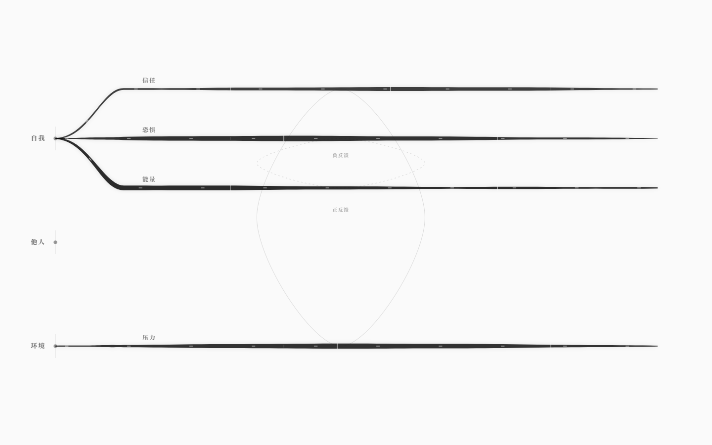
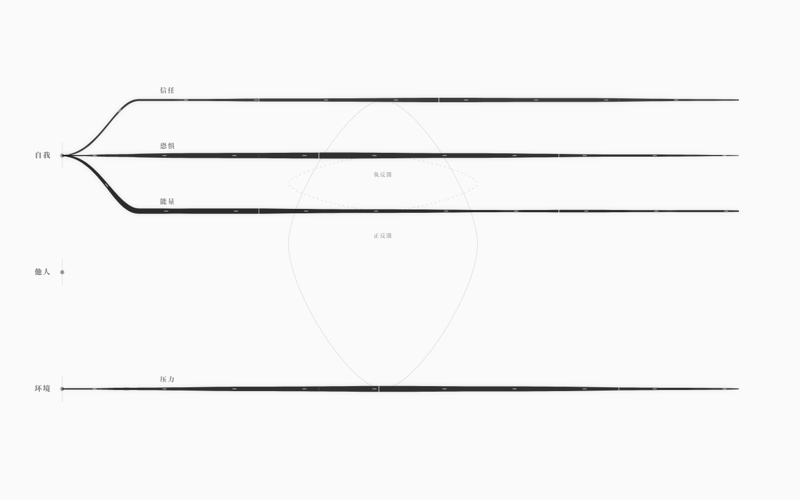
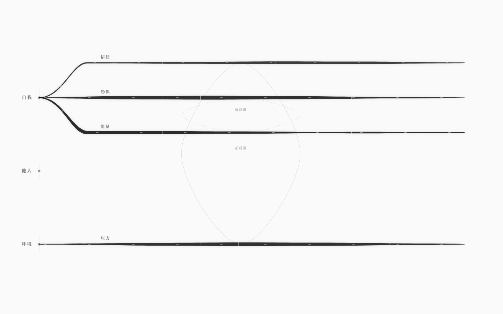

# 墨网测试体（v0.4）

> 不是游戏引擎界面。是一张三节点、四根横向弦、两条回路的、会流动的墨网。
> 默认加载 `examples/core-test.nro`；没有侧栏、没有工具栏、没有画中画。



## 测试世界

| 项 | 内容 |
|---|---|
| 节点 | 自我、他人、环境（左侧一列） |
| 弦 | 信任（自我—他人）、恐惧（自我→环境）、能量（自我）、压力（环境） |
| 回路 | 正反馈：信任↑ → 压力↓ → 信任↑；负反馈：恐惧↑ → 能量↓ → 恐惧↓ |

`examples/core-test.nro`：4 弦、4 耦合、2 回路、4 信号、0 结局。它是纯结构测试体，不承载故事。

## 几何

- 3 个节点在 x=112 一列；实体名在点的左侧，极淡。
- 4 根弦从节点向右延伸，横向跨度 1218px。
- 弦的起点不是硬切：从节点到水平段是一条贝塞尔藤蔓；水平段本身也是一条贝塞尔，悬停/拖动时控制点上下拉伸。
- 2 条回路以细墨闭环连接相关弦；正反馈=实线，负反馈=虚线。

## 墨的质感

- 弦是**填充的墨带**，不是一条等宽 stroke：宽度沿长度起伏（毛笔/血管），起点与终点收细。
- 基色 `#0b0b0b`，`fill-opacity 0.58–0.85`（张力越高越深）。
- 宽度 `3.2 + 张力 × 5.8`；宽度轮廓在弦的中段最厚，两端收尖。
- 每根弦有一层 `blur(4px)` 的淡墨晕染，和一层 `blur(2.5px)` 的拉丝残影（悬停/拖动时出现）。
- 墨迹流动：`stroke-dasharray: 6 120`，用**纸色**在墨带上切出脉冲；高张力 1.1s 一圈，低张力 1.85s 一圈。
- 值/阈值：纸色小刻度（当前值一根、悬崖/安全阈值各一），不显示数字。


悬停时弦被拉伸成拱形，阴影落下；拖动时控制点继续被拉（±72px），值的位置随之改变。


## Tab：反色 + 失焦 + 局部聚焦

按 `Tab`：

- 背景从纸白 `#FAFAFA` 瞬间变成纯黑 `#000000`；
- 全部弦/节点/标签变成白/灰；
- 基础层整体 `filter: blur(2px)`；
- 悬停的弦、点击的节点通过独立的**清晰聚焦层**叠在上面，保持锐利；
- 没有悬停/选择时，默认聚焦「自我」节点及其三根弦；
- 再按 `Tab` 恢复白底、无模糊。


## 流动的三帧

| 帧 | 帧哈希 |
|---|---|
| 0 | `e1f357fe3a` |
| 1 | `494f4587f1` |
| 2 | `e4d2ceae65` |





3 秒视频（墨迹流动 + 悬停弹性 + 拖动 + Tab）：

[ink-3s.mp4](media/ink-3s.mp4)

## 自测

```bash
pnpm test        # 31 个内核测试
pnpm test:gui    # 38 项墨网验收（Playwright + 本机 Edge）
node scripts/ink-video.mjs
Get-ChildItem docs/images/ink-*.png | ForEach-Object { & ./scripts/check-grayscale.ps1 -Paths $_.FullName }
```

最近一次：

- 默认加载 `core-test`：3 节点 / 4 弦 / 2 回路；0 个 button/input/侧栏/工具栏；
- 弦横向跨度 1218px；深黑 `rgb(11,11,11)`，opacity 0.769–0.85；
- 流动速度 1.85s / 1.35s / 1.1s；墨迹偏移在 500ms 内变化；
- 悬停弦产生形变、`drop-shadow(... 12px 18px)` 墨影、拉丝残影；
- 拖动 `信任`：值标记 x `790 → 1122`，控制点继续拉伸；
- Tab：背景 `rgb(0,0,0)`、基础层 `blur(2px)`、悬停弦 `data-focus-string` 1 条；
- 点击「环境」：`data-focus-node=环境`，压力弦同时清晰；
- 再次 Tab：恢复 `rgb(250,250,250)`、`filter:none`、聚焦层消失；
- 8 张截图逐像素：0 个彩色像素；3 秒视频 **3.0s / 70,788 bytes**；
- 60fps；堆内存 13MB；无页面级报错；
- `pnpm test` 31/31；`pnpm test:gui` 38/38；build 通过；生产包冒烟通过。

## 已知边界

- **`他人` 节点是孤立的**：信任是自我对他人（`对象 他人`）的关系弦，视觉上从自我出发；没有把线物理连到他人的点，避免破坏“横向弦+左列节点”的几何。
- **两条回路很淡**：正/负反馈是结构提示，不是主交互；第一眼可能只看到弦。
- **流动是纸色切口**：在墨带上用纸色 dash 表现脉冲；远看像细白纹，不是发光脉冲。
- **Tab 的默认聚焦**：没有悬停/点击时固定聚焦「自我」节点；如果用户想先看别的节点，需要点一下。
- **悬停/拖动是同一个手势语义**：悬停是预览弹性，拖动才改值；没有数字读数，只有值刻度。
- **没有侧栏/图例/按钮**：节点名、弦名、回路名是唯一的文字；发现 Tab 需要有人告诉或自己按。
- **黑底模式没有独立开关**：Tab 是唯一的反色入口；刷新恢复白底。
- **3 秒视频是 30 帧 × 10fps 编码**，不是屏幕录制；足够看流动/弹性，但不是逐帧 60fps。
- **没有保存/撤销**：拖动仍是现场试调，刷新回基线。
