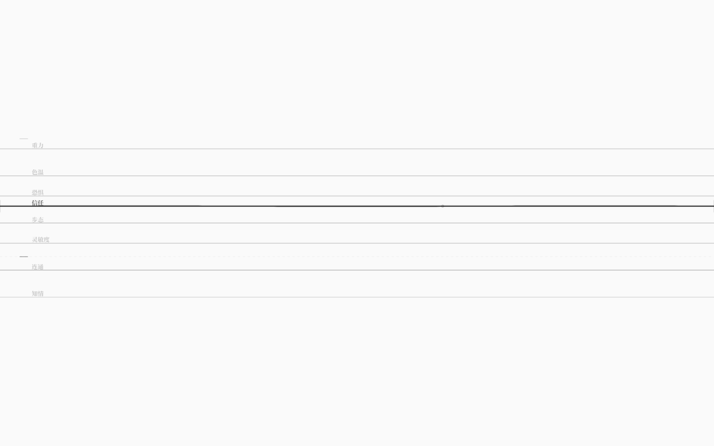

# 结构编辑：阈值、写回闸门与撤销

> v0.9 让调律台能改**值**并写回 `.nro`；v1.0 开始改**结构**——第一个可编辑对象是「悬崖线 / 安全线」。
> 同时补上两条工程底线：写回前必须重新编译通过；每一下编辑都可以 Ctrl+Z 撤销。

## 1. 这一版能做什么

- 焦点弦的两条阈值线变成左侧两个**可拖刻度**（x≈40–56 的 1px 短线，alpha 0.22）；
- 鼠标靠近时刻度变亮，并浮出一条极淡（alpha 0.05）的横向虚线，指出这条线在世界里的位置；
- 上下拖动 = 改 `悬崖` / `安全`；拖动中阈值实时变、不落盘；松手才写回；
- 写回前 `serialize(ir)` 得到的文本会先 `compileText` 验证，**编译不过就拒绝写文件**；
- `Ctrl+Z` 撤销、`Ctrl+Shift+Z` 重做：把上一份文件文本写回，并原地重编译世界（不刷新页面）；
- 耦合强度的编辑 API 已在 core 提供（单测覆盖），GUI 手势留到 v1.1。



## 2. 三层实现

### core：纯函数编辑 API（`packages/core/src/edit.ts`）

```ts
setStringBaseline(ir, id, value)                 // 值
setStringThreshold(ir, id, 'verge' | 'safe', v)  // 结构
setCouplingStrength(ir, couplingId, strength)    // 结构
setCouplingStrengthBetween(ir, from, to, v)
```

- 全部是**纯函数**：返回新 `WorldIR`，不修改入参；
- 先验证再返回：未知弦、非数值弦、越界值、两条阈值线重合都返回 `{ ok: false, error }`；
- 只改目标字段，其余原样保留；
- 6 个单测：改基线/阈值/强度、越界拒绝、两线重合拒绝、组合编辑、序列化+重编译一致、原图不变。

### GUI：世界投影层（`packages/gui/src/worldView.ts`）

从 App 里抽出的纯逻辑，新增 5 个单测：

- `collectLanes(universe, ir)`：8 类弦各取第一根数值弦，值/阈值按各自域归一化；
- `withCurrentBaselines(ir, universe)`：写回前把当拍值冻结成基线。

App 维护一份 **`worldIR`（编辑后的图）**：

- 运行时 `Universe` 仍按原始初值逐拍跑；`lanes` 用 `worldIR` 的阈值 + 运行时的值投影；
- 阈值拖动 → `setStringThreshold(worldIR, …)` → 视图立即变；
- 写回 → `withCurrentBaselines(worldIR, universe)` → `serialize` → 编译闸门 → dev 中间件写文件。

### 写回闸门与撤销（`App.tsx`）

```
编辑 ──debounce 700ms──▶ serialize(editedIR + 当拍值)
                              │
                              ▼
                       compileText(新文本)
                         │ ok          │ 失败
                         ▼             ▼
                    POST 写文件     data-save-state=error
                         │             （拒绝写，文件不变）
                         ▼
              undoStack.push(上一份文件文本)
```

- **撤销**只回退**已成功写回**的版本：栈里是文件文本，不是字段 diff；
- 撤销/重做后调 `reload()` 重新 fetch 世界源码并重编译；`rev` 计数器保证
  “文本与上一次相同”时也会重算 `compiled`、重建 `Universe`（否则画布会停在编辑后的状态）；
- 历史栈只在当前页面会话内，刷新即清空（撤销的持久化留到后续）。

调试属性（`.ink-app`）：

| 属性 | 含义 |
|---|---|
| `data-save-state` | `idle / saving / saved / error / disabled` |
| `data-save-error` | 被闸门拒绝时的诊断（如两线重合） |
| `data-saves` | 成功写回次数 |
| `data-undo-depth` / `data-redo-depth` | 撤销/重做栈深度 |

`StringField` 侧（`data-thresholds`）：

```json
[{ "kind": "叙事", "verge": 25, "safe": 75, "vergeNorm": 0.25, "safeNorm": 0.75 }, …]
```

调试 API 新增 `setThreshold(kind, which, raw)`（不落盘）与 `thresholds()`。

## 3. 验收

单元（`pnpm test`，94 个）：

- core 序列化 7 个、编辑 6 个；
- gui 世界投影 5 个（值/阈值归一化、运行时变化、写回冻结、缺类不凭空造 lane）；
- 其余 76 个为既有内核/运行时/弦物理测试。

真实浏览器（`pnpm test:gui`，60 项）新增：

- `data-thresholds` = 8 条、信任 `{verge:25,safe:75}`；
- 用真实鼠标拖左侧刻度 25 → 40：阈值实时变、基线值/拨弦计数不变、拖动中不落盘；
- 松手后 `data-saves+1`、`data-save-state=saved`，磁盘上 `悬崖 40`；
- `Ctrl+Z` → 阈值 25、磁盘文件与上一版逐字节相同；`Ctrl+Shift+Z` → 阈值 40、文件与编辑版相同；
- 刷新后阈值 40（持久化）；恢复原文件后初值回到 55；
- 编译闸门、Tab/拨弦/ESC/音频/60fps/无 console error 不回归。

## 4. 边界（这一版还没做）

- **耦合强度的 GUI 手势未做**：API 已有、单测已有，画布上还不能连/拖耦合；
- **还不能增删弦/耦合/规则/结局**；
- **写回仍是规范序列化**：会丢注释、曲式名等（IR 不保存的东西）；
- **撤销只在当前会话**，刷新后只剩文件最后一版；
- **世界仍固定为 `examples/tuner.nro`**，还没有“打开任意世界”。

## 5. 路线（由 Lead 规划）

1. **v1.1 世界与耦合**：URL/快捷键打开任意 `examples/*.nro`；同类多根弦时可聚焦选择；画布上拖两根弦之间连线 = 改耦合强度（先做选择 + 强度编辑，增删边下一步）。
2. **v1.2 结构与写回保真**：增删弦/耦合/规则；写回从「整图序列化」升级为「源文本行级 patch」，保留注释与排版；冲突/无法 patch 时回退规范序列化。
3. **v1.3 求解器层**：`KIND_SOLVER` 适配层 + 叙事/关系专属模型，让 8 类弦真正各有物理。
