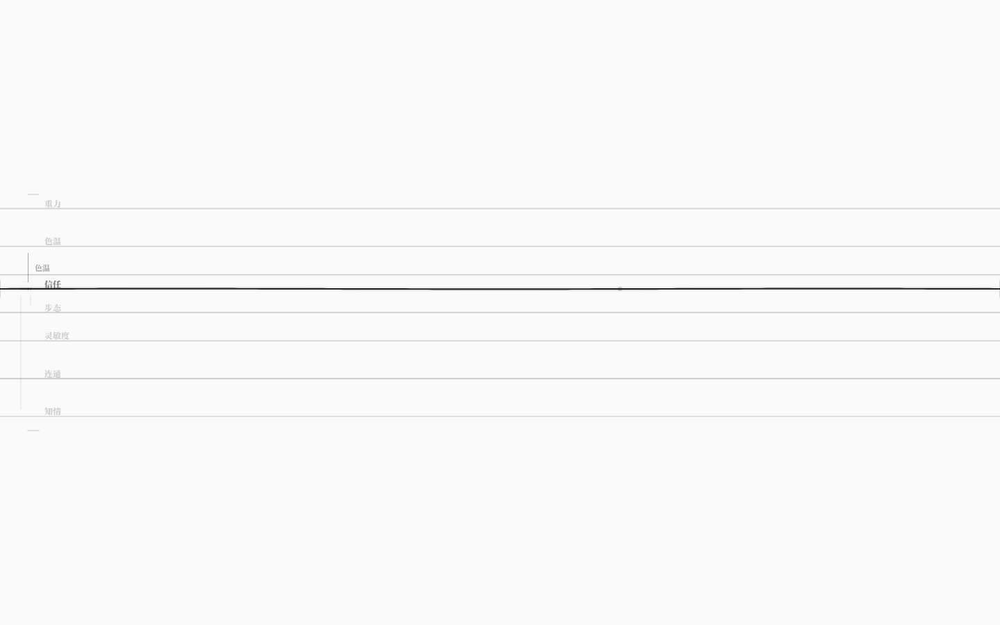

# 耦合编辑：在画布上直接调「一根弦对另一根弦的驱动力」

> v1.2 让调律台第一次能编辑**弦与弦之间的关系**：焦点弦参与的每条耦合，
> 都会在左侧空白处出现一条极淡竖线；把鼠标移上去、滚轮一下，就改了这条耦合的强度。
> 数据流不再是只读的——你可以直接调「信任对色温的推动有多大」。

## 1. 怎么用

1. 把焦点切到某根弦（`Tab`；同类多根用 `←/→`）；
2. 它参与的每条耦合会在左侧出现一条极淡竖线（x 在 30 附近，相邻多条横向错开 3.5px）：
   - 竖线从两端基线各内缩 10px，1px、alpha 0.10；
   - 焦点端有一个 r=1.5 的小圆点（alpha 0.25），提示「这条线归当前弦」；
3. 鼠标靠近（x 18–44、距中点 ±14px）→ 竖线变亮（alpha 0.35），右侧以极淡衬线显示伙伴弦名；
4. **滚轮**：强度 ±0.05，夹在 0..2，保留两位小数；约 0.7s 后写回当前世界文件；
5. 写回前仍然走**编译闸门**；`Ctrl+Z` 撤销、`Ctrl+Shift+Z` 重做。

命中优先级：阈值刻度 > 耦合标记 > 膜 / 取值拖动 / 拨弦；结点滚轮优先。
点在耦合标记上只会“消费”这次点击，不会误拨弦、误改值。

## 2. 为什么这样设计

- 调律台的纵轴是值，横轴是时间；**两根弦之间的关系**没有天然位置。
  把「关系」放在左侧空白处：不占主画面、不画满屏连线，只在焦点弦上展开它自己的关系；
- 不显示数字：强度只能靠滚轮“拧”，听到/看到的是波传播强弱的改变；
- 与已有的「阈值刻度」共用左侧边缘，但一个贴基线、一个贴弦中点，不会抢手势；
- 回路里的耦合也走同一条路径：序列化时会写回回路块的 `边 … 强度 …`。

## 3. 实现

### App（`App.tsx`）

- `WorldView` 新增 `couplings: CouplingLane[]`（`from/to` 是世界弦 id，`polarity/strength/loop`）；
- `worldView.ts` 新增纯函数 `couplingLanes(ir)`，把 IR 耦合投影成界面列表（有单测）；
- `onEditCoupling(from, to, strength, persist)`：
  - core `setCouplingStrengthBetween(worldIR, from, to, strength)`（校验 0..2/未知耦合）；
  - 成功 → 更新 `worldIR`、`data-coupling-edits` +1、`data-last-coupling` JSON；
  - `persist=true` → debounce 写回；
- **修了一个 debounce 闭包 bug**：`doSave` 在 700ms 的 timer 里执行，原先捕获的是编辑前的 `worldIR`，
  导致「一次滚轮事件」写回慢一个编辑。现在 `worldIRRef` 同步更新，`doSave` 读 ref。

### StringField（`StringField.tsx`）

- `buildCouplingMarks()`：按焦点 lane 过滤 `view.couplings`，算每条耦合的左右端点、中点、伙伴名；
- 画：极淡竖线 + 焦点端圆点；hover 时加亮并显示伙伴名；
- 滚轮：hover 标记时 `preventDefault` → `onEditCoupling(..., true)`；空白/结点滚轮保持原行为；
- 调试：`data-couplings`、`couplingMarks()`、`setCoupling(from,to,strength)`（persist=false）。

### core（`packages/core/src/edit.ts`）

`setCouplingStrength(ir, id, strength)` / `setCouplingStrengthBetween(ir, from, to, strength)`：
纯函数、验证 0..2 与未知耦合、返回新图；已有单测。

## 4. 验收

- `pnpm test` **97/97**：新增「耦合投影」单测（10 条、回路边带 loop、极性/强度）；
- `pnpm test:gui` **79/79** 新增：
  - `data-couplings` 10 条，信任→色温 0.5、极性 +1；
  - 焦点信任画出 5 个耦合标记；hover 后截图；
  - 在「信任→色温」标记上滚轮 3 格：强度 0.5 → 0.65、`data-coupling-edits` 增加、
    `data-last-coupling` 指向它；写回后文件 `边 信任 → 色温 同向 0.65`；
  - `Ctrl+Z` 撤销回 0.5，文件与编辑前逐字节相同；
  - 既有 69 项（世界接线/写回/阈值/撤销/任意世界/多根弦/音频/60fps）全部不回归。
- `pnpm check` / `build` / 生产冒烟通过（生产没有写回中间件，耦合编辑只在当前会话生效）。

## 5. 边界与下一步

- **只能调已有耦合的强度**：不能在画布上新增/删除耦合（v1.3）；
- **只能调数值强度**：极性/延迟/曲线/条件仍要改源文本；
- **标记只显示焦点弦参与的耦合**：不画全图网络；
- 写回仍是规范序列化（有损），撤销只在当前会话；
- 不能增删弦/规则/结局。

下一步（v1.3 规划）：
1. **写回保真**：源文本行级 patch，编辑强度/阈值时只改对应行，保留注释、空行、原排版；
2. **增删耦合**：在两根弦之间画连线/拖拽建立关系，删除同理；
3. 之后才是增删弦与 `KIND_SOLVER` 求解器层。
