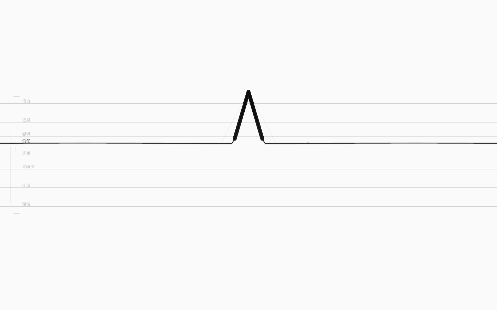

# 按住绷弦 + 撤销缓动（v1.3）

> 这一版修两个“手感”：**按住鼠标或键盘时，弦在按点被钉出一个波峰、绷住不散**；
> **Ctrl+Z 不再闪回**，而是用约 0.62s 的缓动把八根弦的值与阈值慢慢送回上一版。

## 1. 按住绷弦

- **鼠标**：在弦上按住不动约 180ms（其间位移 ≤5px）→ 焦点弦在按点生成一个局部波峰，
  峰顶到基线有两条极淡张力细线（“绷住”的视觉），物理波照常走；
- 按住期间可以移动指针：波峰的 x/y 跟着走（像按着弦移动弓点），**不会**转成取值拖动；
- 松开 → 以当前 pin 位移作幅度/方向触发一次拨弦（视觉波 + 音频 + 真实值注入）；
- **键盘**：映射键 keydown 进入按住，180ms 后出现同样的 pin；keyup 才拨弦；
  `repeat` 忽略、重复 keyup 不会重复拨；短按同样在 keyup 拨一次；
- 命中优先级不变：阈值刻度 / 耦合标记 / 膜优先，在这些区域按住不会误入绷弦；
- 同一时间只有一个 pin（鼠标/键盘后按者优先）；切焦点、总览、对偶、reset 会清掉 pin。

工程细节（`StringField.tsx`）：

- `HOLD_MS = 180`；进入 pin 后焦点弦渲染 = 物理位移 + 一个半宽 44px 的 tent；
- 峰部比普通过波峰略粗略深，峰顶圆点 + 两条张力线；
- 松手用 pin 位移调用既有的 pluck 路径（同一套音频/真实值注入/写回闸门）；
- 调试：`data-holding`、`data-held-amplitude`、`pinInfo()`。

## 2. 撤销缓动

以前 `Ctrl+Z` 是：写回旧文件 → 重新编译 → 新世界瞬间替换 → 画布**闪回**。
现在：

1. 写回旧文件；
2. 用旧文本编译出一份目标世界，取目标的 8 根弦值/阈值；
3. **暂停逐拍**，用约 620ms 的 `cubic in-out` 把画布上的值、阈值从当前插值到目标；
4. 动画结束才真正切换世界；`data-transition=undo|redo` 可观测，期间禁止编辑；
5. 重做（`Ctrl+Shift+Z`）同样缓动。

实测一次撤销：信任 `58.35 → 58.71（110ms）→ 66.62（310ms）→ 72.05（结束）`——
中间帧都能看到，不再是一帧闪回。

工程细节（`App.tsx`）：

- `interpolateLanes(from, to, easeInOutCubic(t))` 按弦类匹配，同时插值 `value/norm` 与 `verge/safe`；
- 动画结束用 `apply(text)` 直接应用旧文本（不再发网络请求），等新世界编译完成后再清 transition，
  避免最后一帧闪回；
- 逐拍定时器在 transition 期间跳过；`onInject/onEditThreshold/onEditCoupling/onCycleString` 全部暂时拒绝。

## 3. 验收

- `pnpm test` **97/97**（这一版没有新增纯函数单测）
- `pnpm test:gui` **95/95** 新增：
  - 鼠标按住 380ms：`data-holding=true`、`data-held-amplitude≈158`、`data-plucks` 仍 0；
  - 按住移动指针：`pinInfo()={x:620,y:334,amplitude:108.3}`，plucks 仍 0；
  - 松手：plucks+1、方向 up、有波；
  - 键盘按住：`data-holding=true`、plucks 0；keyup 后 plucks+1；
  - 撤销：`data-transition=undo`，110ms 时值已开始回退但未到终点（58.35→58.71），
    310ms 时 66.62，结束后精确落在 72.046，文件与编辑前逐字节相同；
  - 既有 79 项（世界/写回/阈值/耦合/任意世界/多根弦/音频/60fps）不回归。
- `pnpm check` / `check:gui` / `build` / 生产冒烟通过；生产包没有写回中间件，绷弦/撤销只在当前会话。

## 4. 边界与下一步

- 绷弦幅度上限仍是该弦 `maxPull`；音频在松手前不出声；
- 撤销历史仍只在当前会话，刷新清空；
- 撤销缓动只插值“值 + 阈值”，不插值耦合强度/波形（波形继续衰减）；
- 写回仍是有损的规范序列化（注释/排版会丢）。

下一步（v1.4 规划）：
1. **写回保真**：源文本行级 patch，只改被编辑的行，保留注释与排版；
2. **增删耦合**：画布上连两根弦建立关系，或删掉一条；
3. 然后是增删弦/规则与 `KIND_SOLVER` 求解器层。
