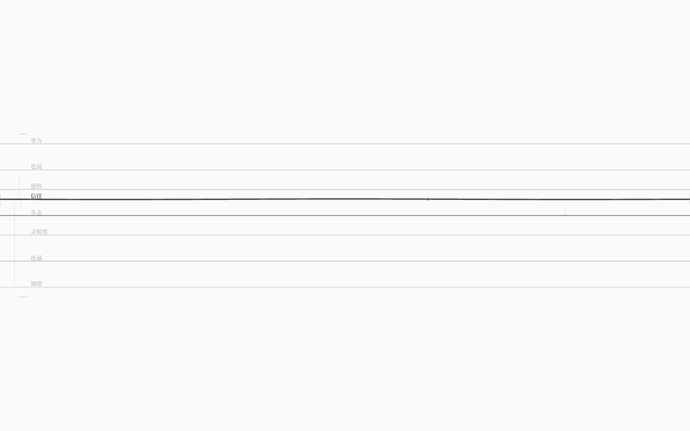

# 增删耦合：在画布上建立/切断两根弦的关系

> v1.2 能调「已有耦合的强度」；v1.5 能**新建**和**删除**一条普通耦合。
> 手势保持极简：`Shift+↑/↓` 在其它弦之间选目标，右侧浮现一条极淡连接线，
> `Shift+Enter` 建立/切断；写回同样走源文本行级 patch，注释与排版保留。

## 1. 手势

1. 焦点在「信任」（`Tab` 切换焦点）；
2. `Shift+ArrowDown` / `Shift+ArrowUp`：在“其它弦”之间循环选择耦合目标——
   右侧 x≈1180 出现一条连接线：
   - 这个方向已有耦合 → 实线（alpha .30）；
   - 没有 → 分段虚线（alpha .12）；
   - 目标弦的基线临时加深（alpha .55）；
3. `Shift+Enter`：没有则**新建**（默认同向、强度 0.2、无延迟）；已有则**删除**；
4. `Escape` 退出 link 模式（不会误开总谱）；`Tab` / 切焦点 / 总览 / 对偶 / reset 也会退出。

数据属性与调试：`data-link-target`（非 link 模式为空串）、`data-coupling-adds` / `data-coupling-removes`、
debug `linkTarget() → {index,id,name,existing}`。

## 2. 规则

- **回路里的边不能单独删除**：删掉一条边回路就不成立，App 会把错误写进 `data-save-error`
  （例：`耦合「信任 → 色温」属于回路「色温回响」，不能单独删除`），世界不变；
- 不能把新耦合直接加进回路（还没有编辑回路的 UI）；
- 自耦合、未知弦、重复方向、强度越界都会被 core 编辑 API 拒绝；
- 新增仅支持普通有向耦合：同向 / 0.2 / 延迟 0；极性/延迟/曲线仍需改源文本；
- 每次切换都会 debounce 写回，可 `Ctrl+Z` 撤销（同样 620ms 缓动）。

## 3. 实现

### core（`packages/core/src/edit.ts`）

- `addCoupling(ir, from, to, { strength?, polarity?, delay? })`：验证端点/重复/参数，
  追加一条耦合（`id` 唯一、无 span——写回时由 patch 插入）；
- `removeCoupling(ir, from, to)`：回路边返回错误，否则按 id 删除；
- 均有单测（默认值、自定义极性/强度、拒绝情况、回路保护）。

### 写回 patch（`packages/core/src/patch.ts`）

新增结构行编辑：

- **新增**：在最后一条普通耦合行之后插入 `耦合 A → B 同向 0.2`（没有普通耦合时插在
  首个顶层段之前/文末）；注释与排版不动；
- **删除**：按 baseIR 的 span 删掉整条声明（行内一行或块声明多行）；
- 连续两次 patch（新增→删除）也能恢复原文；跨 patch 比较时把 loop 的 `edges`（耦合 id）
  归一成 `{name, polarity, edgeCount}`，因为新增耦合会让后续 id 顺延。

### App（`App.tsx`）

- `onToggleCoupling(fromId, toId)`：`findCoupling` 判断有无 → `removeCoupling` / `addCoupling`；
  成功后更新 IR、计数、`data-last-coupling`、debounce 写回；失败写 `data-save-error`；
- 写回仍优先行级 patch，只有 patch 拒绝才回退规范序列化。

## 4. 验收

- `pnpm test` **111/111**：edit 10 项（新增 4 项）+ patch 10 项（新增/删除/连续两次 patch/回路拒绝）；
- `pnpm test:gui` **110/110** 新增：
  - `Shift+ArrowDown` 两次选中「步态」，`data-link-target=步态`，`linkTarget().existing=false`；
  - `Shift+Enter`：10 → 11 条、`data-coupling-adds≥1`、文件出现 `耦合 信任 → 步态 同向 0.2`、
    注释 5/5、`data-save-mode=patch`；
  - 再 `Shift+Enter`：11 → 10 条、行消失、**文件恢复到与操作前逐字节相同**；
  - 切到回路边「色温」再 `Shift+Enter`：couplings 不变、`data-save-error` 有字；
  - 既有 97 项（写回保真/按住绷弦/撤销缓动/耦合强度/世界/音频/60fps）不回归。
- `pnpm check` / `check:gui` / `build` / 生产冒烟通过；工作树干净。

## 5. 边界与下一步

- 手势完全靠键盘（`Shift+↑/↓` + `Shift+Enter`），没有可见按钮；发现靠文档/试用；
- 只能增删**普通有向耦合**：不能改极性/延迟/曲线，不能编辑回路；
- 结构 patch 的插入位置是“最后一条普通耦合之后”，不保证按人的审美分组；
- 增删弦/规则、回路编辑仍未做；`KIND_SOLVER` 求解器层仍未做。

下一步（v1.6 规划）：
1. 增删弦/规则（块级 patch、焦点命名）；
2. 回路编辑（把一组边收成回路）；
3. 最后是每类弦一个 `KIND_SOLVER` 求解器层。
