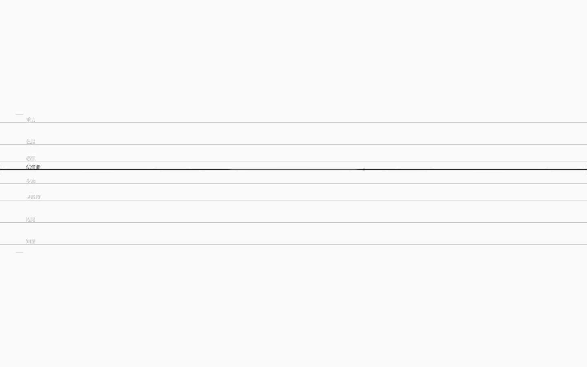

# 增删弦：同类弦的第二个实例与「干净的删除」

> v1.6 让调律台第一次能**增删弦本身**：
> `Alt+Enter` 以焦点弦为模板新增一根同类弦，`Alt+Backspace` 删除焦点弦。
> 新增/删除都走源文本块级 patch——插入或删除一整块声明，注释与排版保留。

## 1. 手势与语义

- **Alt+Enter**：新增同类弦
  - 继承焦点弦的：类型（种类 + 取值域）、悬崖/安全、响应曲线、关系弦的对象；
  - 基线取焦点弦当前值；
  - 自动起名：`信任新`、`信任新2`……（与已有 id 去重）；
  - **视图仍每类显示一根**（v1.1 的约定）：lane 数不变，新实例用 `←/→` 切换；
- **Alt+Backspace**：删除焦点弦
  - 普通耦合会被一并删除；
  - **属于回路的弦不能删**（先编辑回路）；
  - 被规则 / 信号 / 公理 / 结局引用时，编译闸门会拒绝并给出 NRO 诊断；
  - 世界里至少保留一根弦；
- 失败不改变世界，只把原因写进 `data-save-error`；成功 debounce 写回，可 `Ctrl+Z` 撤销。

## 2. 为什么这样限制删除

删除一根弦会牵动耦合、回路、规则、信号、结局。与其“悄悄帮你删掉引用”，
不如在**编译闸门**上诚实拒绝：世界要么完整，要么不动。
新增是安全的（没有引用），所以流程是先加、调、再决定是否删；
被引用的旧弦暂时留给后续的“引用重写”能力。

## 3. 实现

### core

- `addString(ir, focusId, preferredName?)`：复制焦点弦的结构与阈值，追加到 IR，
  编译闸门验证；只支持顶层数值弦；
- `removeString(ir, id)`：拒绝回路成员；级联删除普通耦合；序列化+编译验证后返回；
  错误信息直接来自编译器（例如“引用了不存在的弦”）。

### 写回 patch（块级）

- 新增：在最后一块弦声明之后插入 `stringBlockLines(newString)` 生成的整块 + 空行；
- 删除：按 `span` 删除整块声明（多行）；
- 连续 patch（新增→删除）能**逐字节恢复**原文；注释/缩进不变；
- 编辑弦名/类型/取值域等仍会回退规范序列化。

### App

- `onAddString` / `onRemoveString`：调用 core，成功后重建 `Universe`（保留仍在弦的当前值，
  新弦从基线开始），更新 `data-string-adds/removes`，debounce 写回；
- `.ink-app` 新增 `data-string-adds` / `data-string-removes`。

### StringField

- `Alt+Enter` / `Alt+Backspace` → 焦点 lane 的 id；
- `data-focus-id` 暴露当前焦点弦 id，方便验收；
- 同类多实例仍用 `←/→` 切换（视图一层一根）。

## 4. 验收

- `pnpm test` **115/115**：edit 13 项（新增弦继承/去重/删除/引用拒绝）+ patch 11 项（块插入、连续加删逐字节恢复）；
- `pnpm test:gui` **121/121** 新增：
  - Alt+Enter：`data-string-adds 0→1`、lane 数仍 8、焦点仍「信任」；文件出现 `叙事弦 信任新`、
    注释 5/5、`data-save-mode=patch`；
  - ArrowRight：`data-focus-id=信任新`；
  - Alt+Backspace：`data-string-removes 0→1`、焦点回「信任」、文件恢复操作前内容（弦数 8）；
  - 对「信任」Alt+Backspace：`data-save-error` 给出回路保护、弦数不变；
  - 既有 110 项（增删耦合/写回保真/绷弦/撤销/世界/音频/60fps）不回归。
- `pnpm check` / `check:gui` / `build` / 生产冒烟通过。

## 5. 边界与下一步

- 只能增删**顶层数值弦**；实体里嵌套的弦、关系弦新增暂不支持；
- 新增的弦从焦点值出发、不带耦合，需要手动连；
- 被引用的旧弦不能删（没有引用重写）；
- 不能重命名弦或改类型/取值域；
- 视图仍是每类一根（同类多实例用 `←/→` 切换，不是同时叠一屏）。

下一步（v1.7 规划）：
1. 引用重写：删除弦时把规则/信号/结局里的引用一并处理（交互式确认）；
2. 回路编辑（把已选边收成回路、拆回路）；
3. 之后是 `KIND_SOLVER` 每类弦求解器层。
