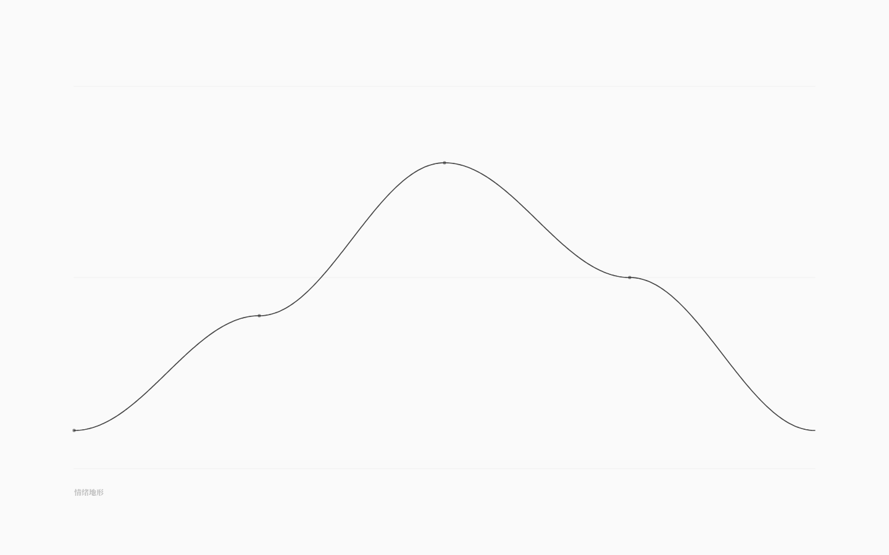

# 谱的图形编辑（v1.9）

> v1.7 让语言认识「谱」，v1.8 让运行时能跑谱；v1.9 把谱放回调律台：
> **F2 进入谱模式**，白纸上的曲线就是世界里的数据。拖段点、松手写回，
> 注释与排版保留；`Ctrl+Z` 撤销；`F2` 回八弦。

## 1. 怎么用

1. 打开带谱的世界：`http://127.0.0.1:5188/?world=examples/spectra.nro`（「谱之境」）；
2. 按 **F2** → 画面切成谱模式：一条曲线、几个段点、三条极淡水平参考线、左下极淡谱名；
3. **拖动段点**：显示值带缓动追随，松手才落盘（一次拖拽 = 一次修改）；
4. **Tab / Shift+Tab**：在世界的多条谱之间切换；
5. **↑/↓**：微调选中段（量程的 1/100）；**←/→**：切换选中段；
6. **Ctrl+Z / Ctrl+Shift+Z**：撤销/重做（谱模式内的撤销立即生效，不做八弦的缓动插值）；
7. **F2 / Esc**：回到八弦模式。

## 2. 视觉

- 纯白纸、零彩色、无面板/按钮/数字；
- 曲线区 x=120..1320、y=140..760；值 `min` 在下、`max` 在上；
- 曲线 480 点采样：`线性` 或余弦平滑；墨色 alpha 0.75、1.65px、圆头；
- 三条参考线（min / 中 / max）1px、alpha 0.04；
- 段点：常态 r2.6 α.45，hover r3.6 α.65，选中 r4.5 近黑；
- 左下 12px 衬线谱名 α.25；多谱时右下角用对应数量的小点表示（不显示数字）。

## 3. 手感

- 拖动时目标值立即更新，**显示值按帧收敛 18%**（60fps 下 95% 约 250ms），不闪变；
- 拖拽阈值 2px（纯点击只选中、不写值）；值夹在 `min..max`；
- 松手调用一次 `onEditBand(..., persist=true)`；拖拽过程中零写盘；
- 键盘微调立即写回。

## 4. 写回

- core 新增 `setSpectrumBand(ir,id,index,value)`：纯函数、索引/范围校验、值域校验；
- patch 新增**段行数字替换**：只改 `段 …` 行里的数字，缩进、数字间空白、行尾注释全部保留；
- 结构变化（段数/范围/插值/循环/模式/谱增删）仍回退规范序列化；
- `data-save-mode=patch` 可观测；`.ink-app` 新增 `data-screen / data-spectrum-index / data-spectrum-count / data-spectrum-band-edits`。

## 5. 验收

- `pnpm test` **154/154**：core 新增 setSpectrumBand（值域/索引/未知谱/编译）与 patch（段值保真、结构变化拒绝）；
- `pnpm test:gui` **138/138** 新增：
  - `?world=examples/spectra.nro` 加载「谱之境」，F2 进入谱模式，显示「情绪地形」4 段；
  - 拖第 2 段（坐标来自 `window.__neurouSpectrum.bandPositions()`）：值改变、`data-save-mode=patch`、
    文件 `段 0.1 0.x 0.8 0.5` 更新且注释保留；
  - `Ctrl+Z` 撤销，值恢复、文件逐字节回到编辑前；
  - F2 退出回到八弦；既有 127 项全部不回归；
- `pnpm check` / `check:gui` / `build` / 生产冒烟通过；0 彩色像素（灰度检查）。

## 6. 边界与下一步

- 谱模式目前只编辑**锚点曲线**，不显示运行时调制后的值（v1.8 的调制 API 还没有接进 GUI）；
- 不能增删段/改范围/插值/模式/谱数量（回退规范序列化；后续再做）；
- 谱模式内的撤销不做缓动（八弦的 620ms 缓动只用于弦值/阈值）；
- 音频还未使用谱（v2.0 音色/波表绑定）。

下一步（v2.0）：
1. 谱 → Karplus-Strong/波表的音色绑定（GUI 先做，编译期校验引用）；
2. 世界状态调制谱 → 音色随世界变化；
3. 之后是规则采样谱、参考谱与关系矩阵。
