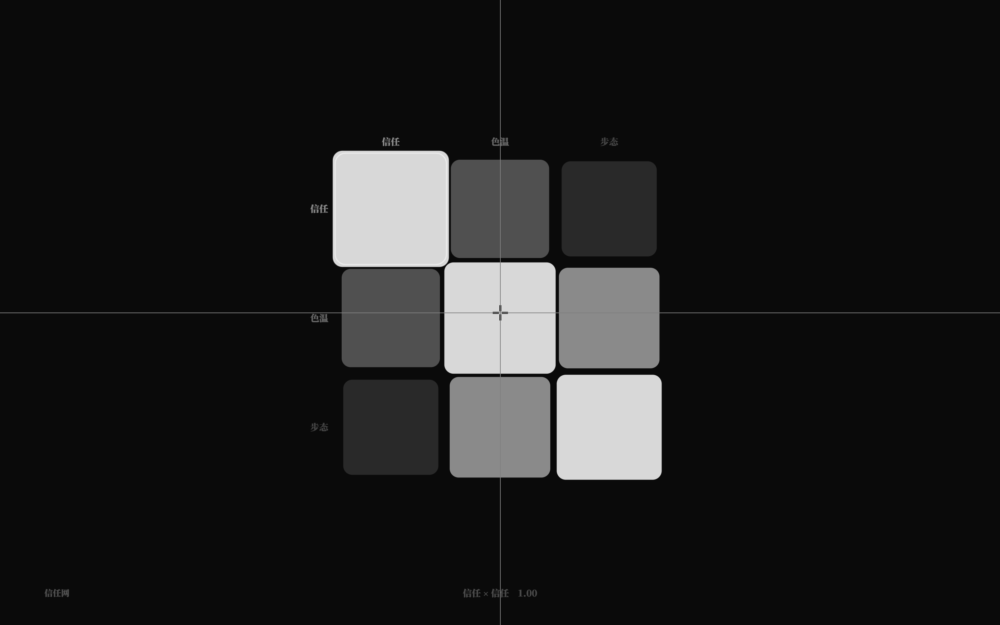
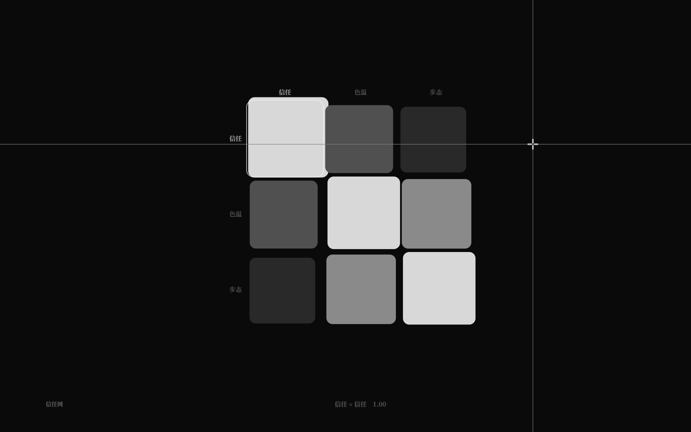
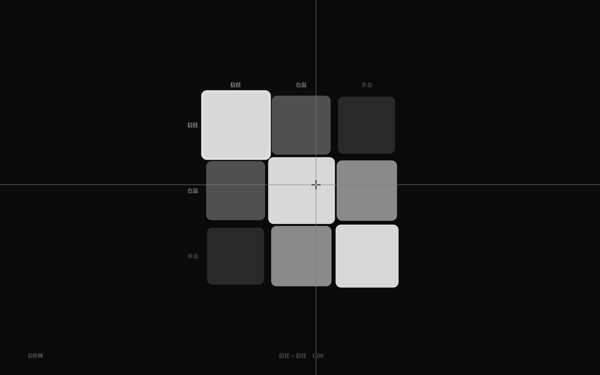

# 关系谱 GUI：黑底极简矩阵（v2.2）

> v2.1c 给了关系谱语法；v2.2 给它一个界面：`F3` 进入**近黑底、零彩色、iOS 般弹簧动画**的矩阵编辑器。
> 默认 tuner 已带 `关系谱 信任网`，刷新后按 `F3` 即可看到。

## 1. 进入 / 退出

- `F3`：八弦 → 关系谱矩阵（世界里至少有一个关系谱）；
- `F3` / `Esc`：淡出回八弦；
- `Tab` / `Shift+Tab`：多条关系谱之间切换；
- 背景从纸白平滑过渡到 `#0a0a0a`（280ms），矩阵整体 opacity + scale 0.98→1 淡入（260ms ease-out）。

## 2. 视觉

- 整屏近黑 `#0a0a0a`，无面板/按钮/常驻数字；
- 只用灰阶：行列标签白 α.25（选中时 α.55），格子亮度编码值（0→`#151515`，1→`#d8d8d8`）；
- 左下极淡矩阵名，底部一行「行 × 列  值」（α.28）；
- 多矩阵时右下有极淡的小圆点指示；
- 零彩色：自动验收采样全屏 0 个带色像素。

## 2.5 光标与视差（v2.2.1）

- **矩阵视差**：`offset = (光标 − 屏幕中心) × 0.08`；光标离中心越远，矩阵沿光标方向平移越多；
  x/y 各一枚 iOS spring（response 0.4s / damping 0.9），格子、行列标签、选中框一起动；
  拖动/滚轮编辑期间冻结视差（不漂），松手恢复；光标离开画面时回中。
- **自定义反色光标**：隐藏系统光标；整屏 1px 白色半透明十字线 + 交界处 22px/3px 满强度粗十字准星，
  以 `globalCompositeOperation='difference'` 画在最上层——深色背景上近白、白色格子上自动变暗，
  每个位置都按下方背景自然反色；中心留 4px 空隙，光标离开时淡出。
- **伪 3D 深度（v2.2.3）**：格子基础尺寸随数值 0.94..1.05 倍（越白越大，差异克制）；
  每格视差位移 = 组偏移 × (0.78 + value×0.44)（越白移动越快，黑约 0.78×、白约 1.22×），
  行列标签/选中框仍跟组偏移。高值格与低值格差速约 12px，形成静止时的层次与移动时的视差纵深。

## 3. 交互（尽量丰富）

| 手势 | 行为 |
|---|---|
| 悬停格子 | 轻微放大（1.06 spring），行列标签亮起 |
| 点击 | 选中（1.10 spring），选中框弹簧滑动 |
| 上下拖动 | 改该格值（target 缓动追随，松手写回一次） |
| 滚轮 | 选中格 ±0.02（clamp 0..1，写回） |
| ←/→/↑/↓ | 移动选中格 |
| Shift+↑/↓ 或 `+`/`-` | 调值 ±0.02 |
| 双击 | 归零并写回 |
| Tab / Shift+Tab | 切换矩阵 |
| Ctrl+Z | 撤销（不拦截） |
| F3 / Esc | 淡出退出 |

## 4. 写回

- `setMatrixCell` 只改目标格子；patch 写回只替换对应 `段` 行的数字，**保留注释/排版**；
- 行/列结构变化仍回退整图规范序列化；
- GUI 验收：拖动后文件段值更新、`data-matrix-cell-edits` 增加、Ctrl+Z 恢复。

## 5. 验收

- `pnpm test` **207/207**（矩阵 core 18 + 矩阵写回 3 + 其余）；
- `pnpm test:gui` **161/161**：F3 进入、3×3 值、视差跟随、伪 3D 差速、中心无偏移+光标存在、九格可定位、拖动改值+写回、Ctrl+Z、F3 退出；既有 151 项不回归；
- `check` / `check:gui` / `build` 通过；GUI 截图由 `artifacts/shot-matrix.mjs` 生成。

## 6. 边界

- 值域固定 0..1（编辑器 clamp；core 矩阵本身允许任意有限数）；
- 行列标签是普通文字，不做弦/实体引用校验；
- 暂不支持增删行列、矩阵缩放/平移、动态时间轴；
- 高 DPI 已修复（Retina 下内容不再缩到左上角）。
