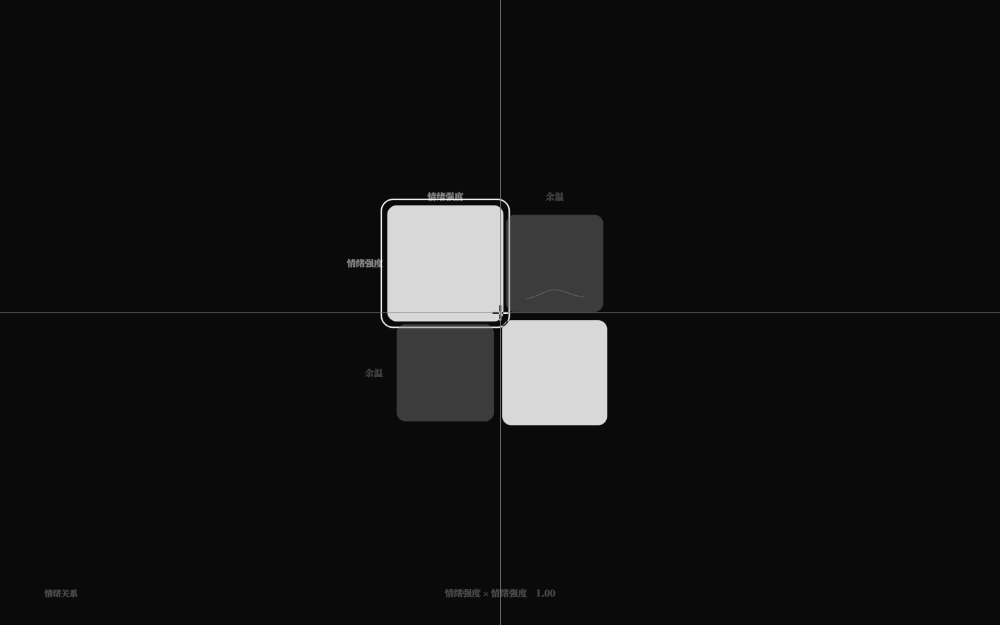
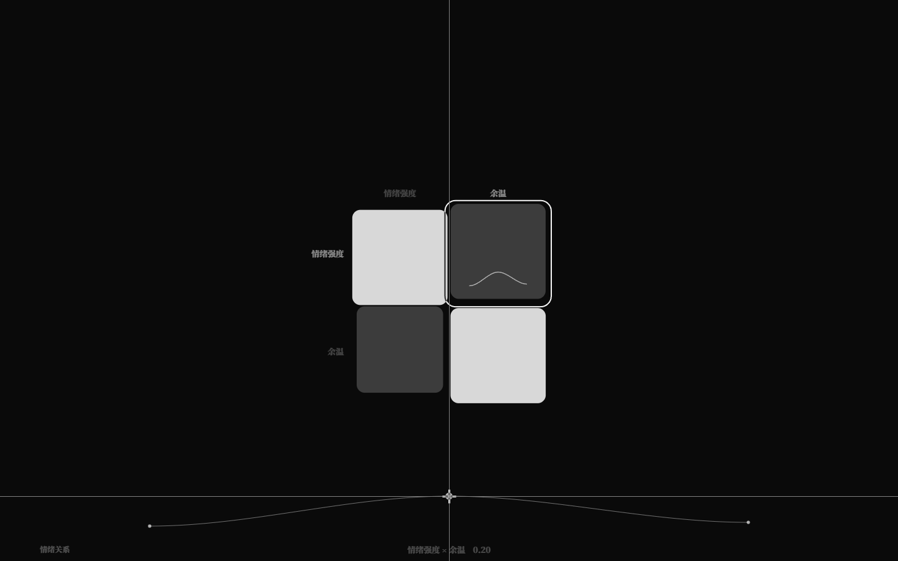

# 关系谱曲线：每格一条时间曲线（v2.3）

> v2.1c/2.2 的关系谱每个格子是一个数；v2.3 让每个格子可以带一条**时间曲线**，
> 规则里用 `查关系谱("矩阵","行","列", 位置)` 读取曲线在任意位置的值。
> GUI 里格内画极淡 sparkline，选中曲线格后可在底部直接拖点编辑。

## 1. 语言

```nro
关系谱 势力网
  行 信任 色温
  列 信任 色温
  段 0.3 0.2
  段 0.2 0.1
  曲线 信任 色温 0.1 0.5 0.9 0.4
  曲线 色温 信任 0.8 0.3
  插值 平滑
  循环 是
```

- `段` 行仍是必填的标量回退（没有曲线的格子用它）；
- `曲线 <行> <列> <1..64 个有限数字>` 可重复；行列标签必须存在、同一格只能一条；
- `插值 线性|平滑`（默认线性）、`循环 是/否`（默认否）作用于该矩阵所有曲线；
- 规范序列化顺序：行、列、段…、曲线…、插值/循环（非默认才写）。

## 2. 读取

```nro
结局 稳定: 当 查关系谱("势力网", "信任", "色温", 0.5) > 0.6
```

- 3 参：仍是**编译期常量**，读 `段` 标量；
- 4 参：第 4 参是数值表达式；格子有曲线时**运行期采样**（线性/余弦平滑、非循环 clamp、循环按 1 回绕）；
- 格子没有曲线时，4 参编译期折叠为标量（位置忽略）；
- 参数个数/字面量/位置类型 NRO2003；矩阵/行列不存在 NRO2101；曲线形状/标签错误 NRO2100；
- 运行时矩阵数据是静态的，随世界初始化进 `WorldState.matrices`，快照/分叉携带；旧快照 restore 时从 IR 重建。

## 3. GUI

- 有曲线的格子在格子底部画**极淡 sparkline**（灰阶 α.22，hover α.3），不改填充/尺寸/图层/差速；
- 选中带曲线的格子 → 矩阵下方出现**无面板底部曲线编辑器**（x≈240..1200、y≈790..850）：
  - 淡曲线 + 段点，拖动点上下改值（0..1，clamp），松手写回一次；
  - 切换选中时 200ms 淡入淡出；只有编辑器区域 pointerdown 才拦截；
- 写回只替换 `曲线 行 列 …` 行里的数字，注释/排版保留；
- 数据：`data-curve-count`、`data-selected-curve`、`data-curve-band-edits`；debug `curvePositions()`。





## 4. 验收

- `pnpm test` **227/227**：core 矩阵 28 项（曲线解析/校验/序列化 round-trip/4 参 lowering/no-curve 折叠/patch 回退）+ 矩阵写回 4 项（含曲线段值 patch）+ runtime 9 项（动态规则/结局、线性平滑循环 clamp、标量回退、快照/restore/branch、旧快照重建）；
- `pnpm test:gui` **169/169**：默认 tuner 选中「信任 × 色温」曲线格 → 底部编辑器出现、拖点改值、文件曲线行更新、Ctrl+Z 撤销；既有 165 项不回归；
- `check` / `check:gui` / `build` 通过。

## 5. 边界

- 曲线是静态作者数据；运行时调制还不直接改关系谱曲线；
- 值域在 GUI 编辑器固定 0..1（core 允许任意有限值）；
- 只支持矩阵级插值/循环，不能每格单独设置；
- 暂不支持增删曲线/行列、曲线平移缩放；下一步可做曲线动画/多矩阵联动。
