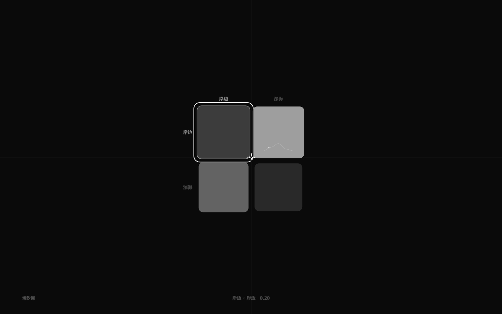
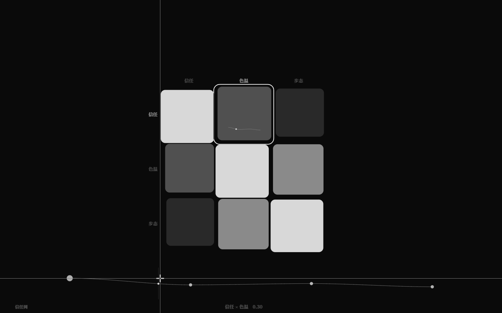
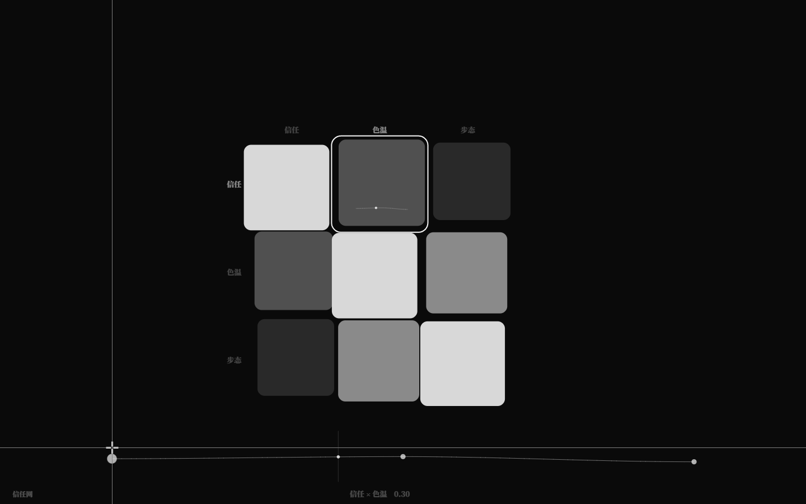
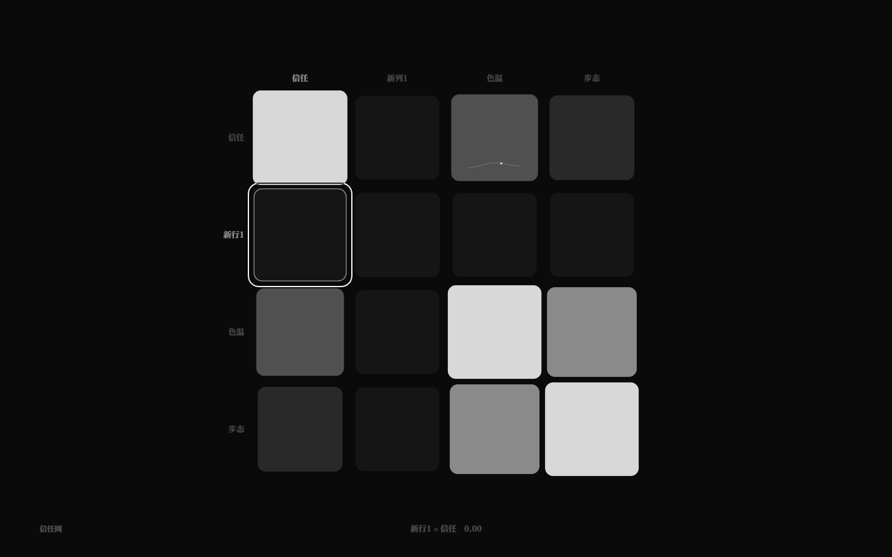
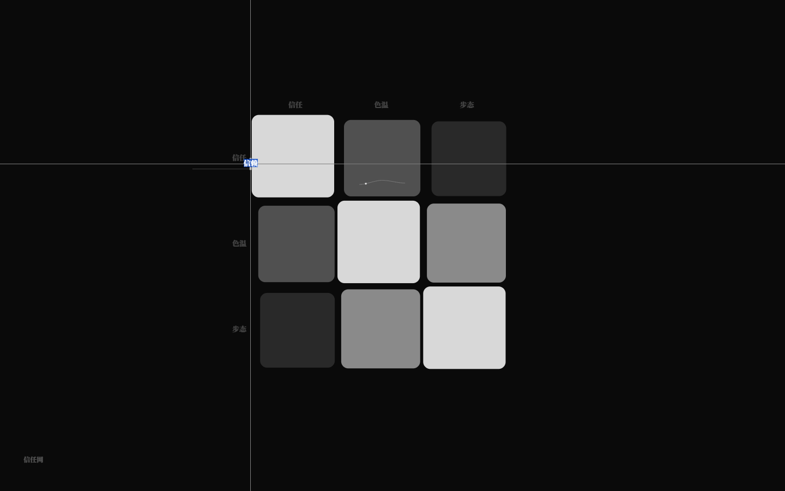
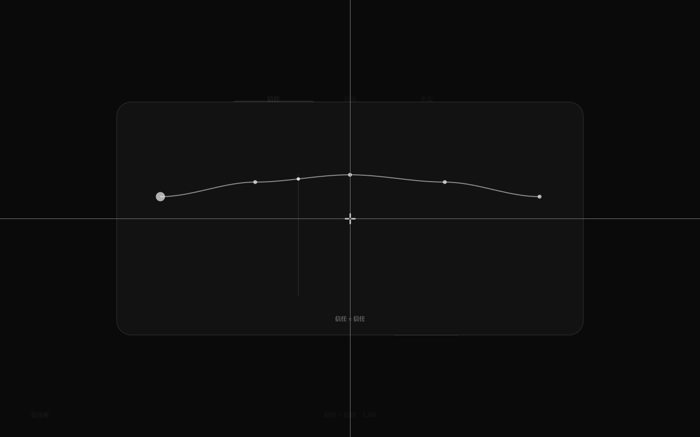

# 关系谱驱动世界：此刻 + 曲线播放（v2.3.2）

> 关系谱曲线已经能写、能读、能编辑；这一版让它**有时间**：
> 规则用内建值 `此刻`（当前拍数）采样曲线，GUI 用播放头让曲线动起来。

## 1. `此刻`

```nro
结局 涨潮: 当 查关系谱("潮汐网", "岸边", "深海", 此刻 / 40) > 0.8
```

- `此刻` 无参内建值，返回**当前拍数**（从 0 开始，tick 后递增）；也可写 `此刻()`；
- 可参与任意数值运算（如 `此刻 / 40` 得到 0..1 的归一化位置）；
- 带参数报 NRO2003；作为弦名会被内建值优先（不再报 NRO2001）；
- 运行时每个 tick 求值，因此规则/结局/效果/信号都能随拍数采样关系谱曲线。

## 2. 示例世界：`examples/relations.nro`

```nro
关系谱 潮汐网
  行 岸边 深海
  列 岸边 深海
  段 0.2 0.7
  段 0.4 0.1
  曲线 岸边 深海 0.1 0.5 0.9 0.3
  插值 平滑
  循环 是

力迫 潮涌
  当 查关系谱("潮汐网", "岸边", "深海", 此刻 / 40) > 0.45
  效果
    潮位 += 5

结局 涨潮: 当 查关系谱("潮汐网", "岸边", "深海", 此刻 / 40) > 0.8
```

`pnpm dev run examples/relations.nro` 看潮位随曲线涨落；`pnpm dev sim examples/relations.nro --runs 20 --ticks 80` 应稳定在「涨潮」。

## 3. GUI 曲线播放

- 当前矩阵至少有一条曲线时自动播放：归一化播放头 t 约 **8 秒**一个循环；
- 有曲线的格子：sparkline 上一个小亮点沿曲线采样移动（灰阶、极淡）；
- 底部快速编辑器 / 聚焦大曲线：在对应 t 处一条极淡竖线 + 曲线亮点；
- **Space** 播放/暂停（矩阵与聚焦模式都可）；暂停时停住；
- 拖动格子/曲线点/滚轮编辑时冻结播放头，松手恢复；
- 数据：`data-playing`、`data-playhead`（0..1，4 位）；debug `__neurouMatrix.playhead()`。


## 3.5 惯性播放、曲线键盘、拖尾与持续音（v2.3.3）

- **Space 惯性播放**：播放速度 0..1 线性加减速（加速 0.35s / 减速 0.28s）；按 Space 暂停后
  播放头不立刻刹停，而是继续滑行约 0.5s 再停；恢复从当前速度平滑加速。`data-play-speed`；
- **F2 数据集节点**：拖动节点/键盘调值时，节点留下约 450ms 的灰阶拖尾；
  同一手势期间持续发声——音色=当前谱波形，音高=节点横坐标，音量=节点纵坐标，
  随节点移动实时更新，松手停止；单击保留原来的短音；
- **关系谱曲线键盘映射**：选中曲线格（底部编辑器）或聚焦大曲线时，46 键映射
  `key.x → 最近段`、`key.y → 目标值`（上高下低）；按住持续发声（音色=该格曲线、
  音高=段索引、音量=段值），松手写回一次；多键独立；新增 `data-curve-key-edits`；
- **矩阵曲线节点拖尾**：底部编辑器与聚焦曲线拖动节点、键盘调值时同样绘制 450ms 拖尾。
- **v2.3.4 细化**：聚焦/曲线编辑时仍保留贯穿全屏的十字线（不再只剩准星）；持续音换波用 70ms 节流 + 50ms 双振荡器交叉淡化，消除调值时的爆破音。
- **v2.3.5 持续音补齐**：鼠标拖动关系谱曲线节点、聚焦 ↑/↓ 调值都会持续发声（同一手势只 start/stop 一次）；
  音频链加软削波 + 更激进压缩、起音 55ms/释放 180ms、音量降低，进一步压掉爆音。


## 3.6 周期与运行时同步（v2.4）

- 关系谱可声明 `周期 <拍数>`（例如 relations.nro 的 `周期 40`）；有周期时，GUI 播放头跟随**世界实际拍数**：
  `目标 = (tick % 周期) / 周期`，用约 0.35s 平滑追随，把 480ms 的 tick 跳变变成连续运动；
- 无周期的矩阵保持自由 8s 循环；`data-synced` / `data-period` 区分；
- Space 暂停时播放头冻结（世界 tick 继续），恢复后平滑追上当前 tick；拖动/滚轮编辑时冻结，松手恢复；聚焦模式同样同步。



## 3.7 曲线增删节点（v2.4.1）

- 底部快速编辑器或聚焦大曲线：**双击空白区域**在最近间隔插入一个节点（x 定位置、y 定值），一次写回；
- 选中节点后按 **Delete/Backspace** 删除（至少保留 2 个节点）；曲线行级 patch 支持节点数变化并保留行尾注释；
- 新点 spring 淡入、删点平滑收拢；增删后播放头/采样自然更新；
- 数据 `data-curve-point-adds` / `data-curve-point-removes`。





## 3.8 行列增删与内联改名（v2.4.3）

- 矩阵模式（未聚焦/未曲线编辑时）：
  - `Ctrl+Enter` 在选中行后插入一行，`Ctrl+Shift+Enter` 在选中列后插入一列；
  - `Ctrl+Backspace` 删除选中行，`Ctrl+Shift+Backspace` 删除选中列；1 行/列时忽略；
  - 新标签自动为「新行N / 新列N」；插入/删除走 spring 重排与淡入；
- **双击行/列标签** → 标签位置出现极简透明输入框（无面板、仅底部淡线），Enter 提交、Esc 取消；改名会同步该行列的曲线标签；
- 结构变化会回退规范序列化（注释暂不保真），数据 `data-matrix-row-adds/removes`、`data-matrix-col-adds/removes`、`data-matrix-renames`。





## 3.9 格子增删曲线（v2.4.5）

- 矩阵模式按 **Space** 切换选中格的曲线：
  - 格子没有曲线 → 添加一条默认 **5 点轻微钟形**曲线（0.82/0.94/1/0.94/0.82 × 该格标量，clamp 0..1），
    并延迟约 180ms **自动进入该格聚焦编辑**；sparkline/聚焦 250ms 淡入；
  - 格子已有曲线 → 移除，退出聚焦、sparkline/编辑器淡出；标量回退值保留；
- 有曲线的格子在右上角有一个极淡角标（小点+短刻度，静默 α.22，hover α.4），与 sparkline 一起标识；
- 无 Shift 的 `c` 仍是 46 键曲线映射；Shift+C 不再生效；
- 数据：`data-matrix-curve-adds` / `data-matrix-curve-removes`。




## 3.10 播放键与 F2/F3 模式切换（v2.4.5）

- **P**：播放/暂停（矩阵/聚焦模式都可，保留 playSpeed 惯性）；Space 不再控制播放，只切换选中格曲线；
- **F2 ↔ F3**：八弦 → 谱模式 → 关系谱矩阵 → 谱模式 可以互相切换；
  `F2` 在矩阵模式进入谱模式，`F3` 在谱模式进入矩阵，各自组件内的 Esc/F2/F3 退出规则保留。

## 4. 验收

- `pnpm test` **241/241**：新增 `此刻`、关系谱周期、曲线整条替换、行列增删/改名、格子曲线增删等；矩阵/谱/参考谱等全部通过；
- `pnpm test:gui` **193/193**：播放头前进、P 惯性暂停、关系谱曲线键盘映射改段并写回、周期同步、节点增删、行列增删/改名、Space 增删格子曲线（默认 5 点/自动聚焦/角标）、F2↔F3 互切；既有 190 项不回归；
- `pnpm dev check/run/sim examples/relations.nro` 通过；`check` / `check:gui` / `build` 通过。

## 5. 边界

- `此刻` 是拍数，不是秒/毫秒；时间轴由每拍 480ms 的运行时/GUI 决定；
- 有 `周期` 的矩阵播放头与运行时 tick 同步（平滑追随）；无周期矩阵是自由视觉预览；
- 曲线是循环的归一化时间轴，不能自定义起止/速度/相位；
- 下一步可做：曲线速度/相位编辑、多矩阵联动、更多可演奏示例世界。
