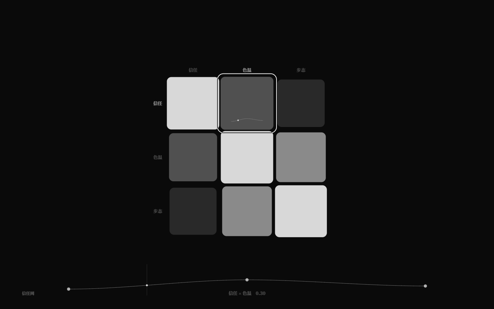
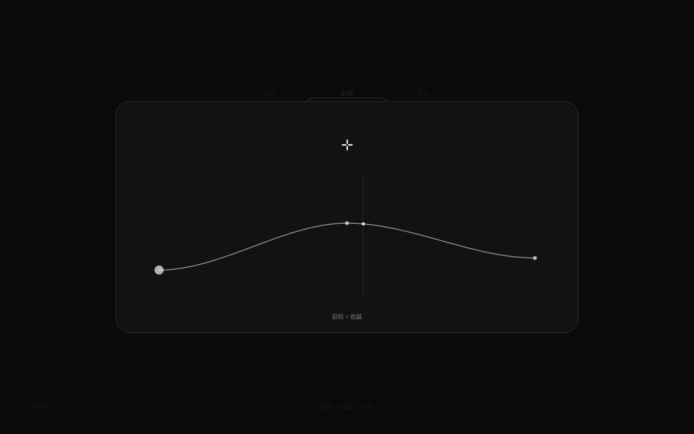
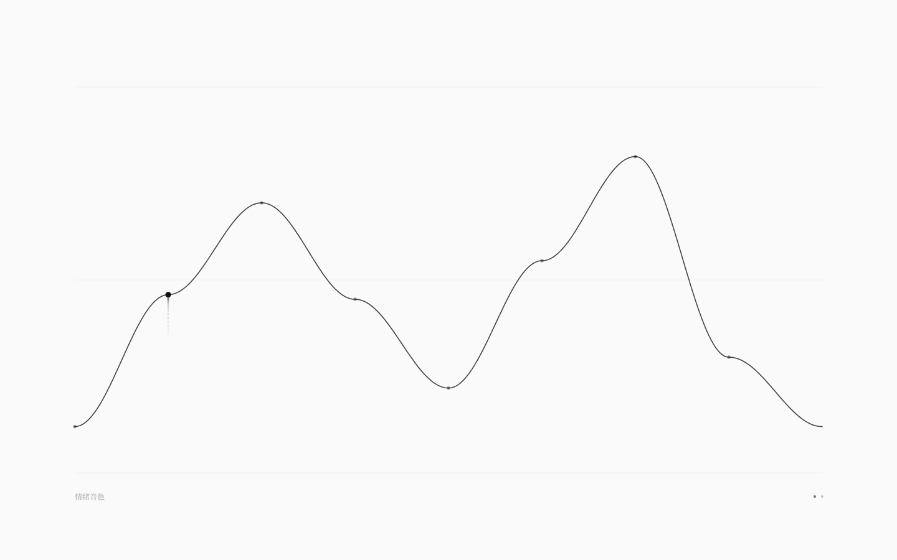
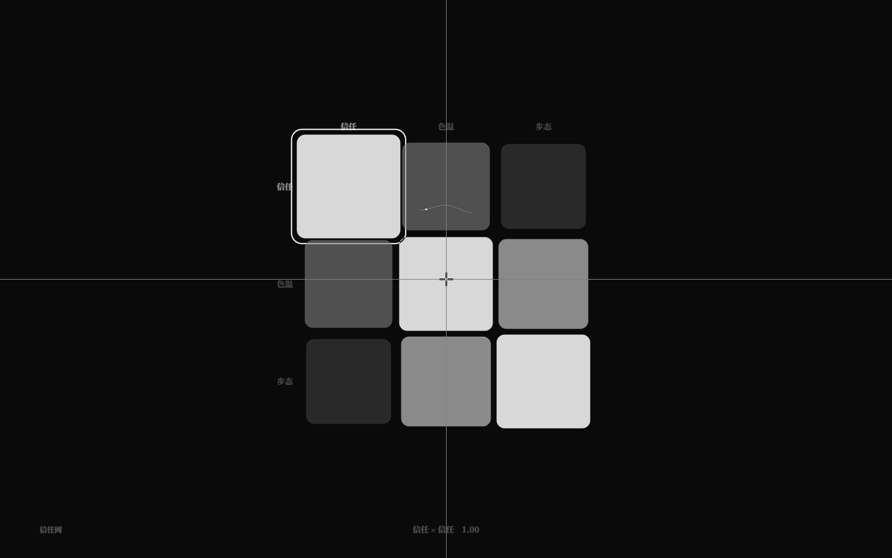
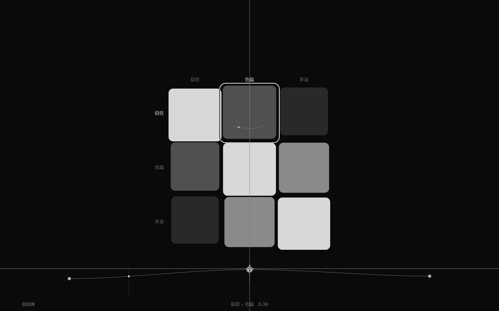
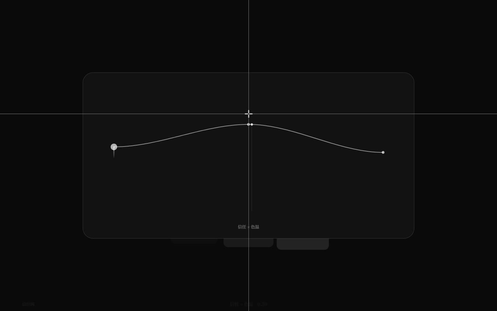

# 关系谱驱动世界：此刻 + 曲线播放（v2.3.2）

> 关系谱曲线已经能写、能读、能编辑；这一版让它**有时间**：
> 规则用内建值 `此刻`（当前拍数）采样曲线，GUI 用播放头让曲线动起来。

## 1. `此刻`

```nro
结局 涨潮: 当 查关系谱("潮汐网", "岸边", "深海", 此刻 / 40) > 0.8
```

- `此刻` 无参内建值，返回**当前拍数**（从 0 开始，tick 后递增）；也可写 `此刻()`；
- 可参与任意数值运算（如 `此刻 / 40` 得到 0..1 的归一化位置）；
- 带参数报 NRO2003；作为弦名会被内建值优先（不再报 NRO2001）；
- 运行时每个 tick 求值，因此规则/结局/效果/信号都能随拍数采样关系谱曲线。

## 2. 示例世界：`examples/relations.nro`

```nro
关系谱 潮汐网
  行 岸边 深海
  列 岸边 深海
  段 0.2 0.7
  段 0.4 0.1
  曲线 岸边 深海 0.1 0.5 0.9 0.3
  插值 平滑
  循环 是

力迫 潮涌
  当 查关系谱("潮汐网", "岸边", "深海", 此刻 / 40) > 0.45
  效果
    潮位 += 5

结局 涨潮: 当 查关系谱("潮汐网", "岸边", "深海", 此刻 / 40) > 0.8
```

`pnpm dev run examples/relations.nro` 看潮位随曲线涨落；`pnpm dev sim examples/relations.nro --runs 20 --ticks 80` 应稳定在「涨潮」。

## 3. GUI 曲线播放

- 当前矩阵至少有一条曲线时自动播放：归一化播放头 t 约 **8 秒**一个循环；
- 有曲线的格子：sparkline 上一个小亮点沿曲线采样移动（灰阶、极淡）；
- 底部快速编辑器 / 聚焦大曲线：在对应 t 处一条极淡竖线 + 曲线亮点；
- **Space** 播放/暂停（矩阵与聚焦模式都可）；暂停时停住；
- 拖动格子/曲线点/滚轮编辑时冻结播放头，松手恢复；
- 数据：`data-playing`、`data-playhead`（0..1，4 位）；debug `__neurouMatrix.playhead()`。





## 3.5 惯性播放、曲线键盘、拖尾与持续音（v2.3.3）

- **Space 惯性播放**：播放速度 0..1 线性加减速（加速 0.35s / 减速 0.28s）；按 Space 暂停后
  播放头不立刻刹停，而是继续滑行约 0.5s 再停；恢复从当前速度平滑加速。`data-play-speed`；
- **F2 数据集节点**：拖动节点/键盘调值时，节点留下约 450ms 的灰阶拖尾；
  同一手势期间持续发声——音色=当前谱波形，音高=节点横坐标，音量=节点纵坐标，
  随节点移动实时更新，松手停止；单击保留原来的短音；
- **关系谱曲线键盘映射**：选中曲线格（底部编辑器）或聚焦大曲线时，46 键映射
  `key.x → 最近段`、`key.y → 目标值`（上高下低）；按住持续发声（音色=该格曲线、
  音高=段索引、音量=段值），松手写回一次；多键独立；新增 `data-curve-key-edits`；
- **矩阵曲线节点拖尾**：底部编辑器与聚焦曲线拖动节点、键盘调值时同样绘制 450ms 拖尾。
- **v2.3.4 细化**：聚焦/曲线编辑时仍保留贯穿全屏的十字线（不再只剩准星）；持续音换波用 70ms 节流 + 50ms 双振荡器交叉淡化，消除调值时的爆破音。
- **v2.3.5 持续音补齐**：鼠标拖动关系谱曲线节点、聚焦 ↑/↓ 调值都会持续发声（同一手势只 start/stop 一次）；
  音频链加软削波 + 更激进压缩、起音 55ms/释放 180ms、音量降低，进一步压掉爆音。










## 4. 验收

- `pnpm test` **231/231**：新增 `此刻` core 3 项（路径/函数/参数错误）+ runtime 1 项（随 tick 前进并触发结局）；矩阵/谱/参考谱等全部通过；
- `pnpm test:gui` **176/176**：播放头前进、Space 惯性滑行后停住、关系谱曲线键盘映射改段并写回；既有 175 项不回归；
- `pnpm dev check/run/sim examples/relations.nro` 通过；`check` / `check:gui` / `build` 通过。

## 5. 边界

- `此刻` 是拍数，不是秒/毫秒；时间轴由每拍 480ms 的运行时/GUI 决定；
- GUI 播放头是**视觉预览**，与运行时的 tick 不绑定；规则采样用真实拍数；
- 曲线是循环的归一化时间轴，不能自定义起止/速度/相位；
- 下一步可做：把播放头与运行时 tick 同步、曲线速度/相位编辑、多矩阵联动。
