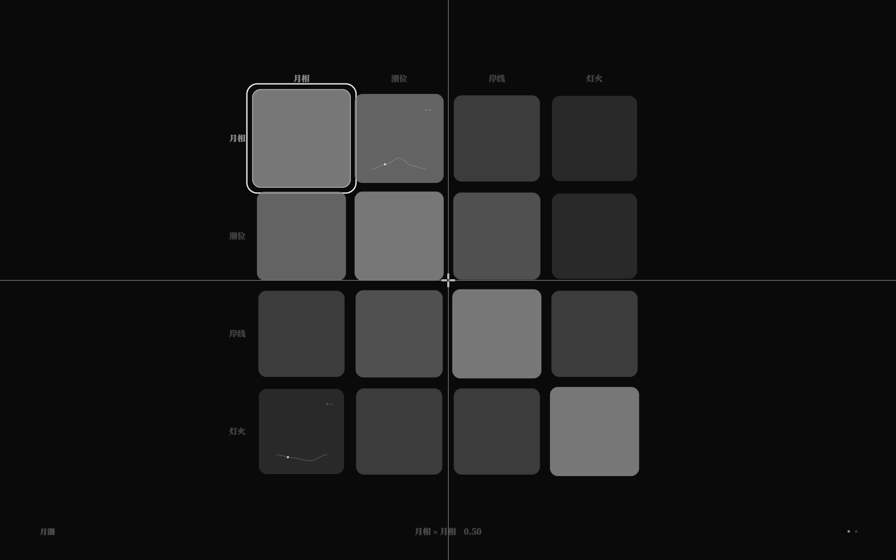

# 关系谱时间轴：周期 / 速度 / 相位 / 谱位（v2.6）

> v2.4 让关系谱曲线有了「周期」；v2.6 补上速度、相位，并给世界一个统一的采样位置表达式 `谱位("矩阵")`。
> GUI 播放头、动态耦合、规则采样现在可以共用同一条时间轴。

## 1. 语法

```nro
关系谱 月潮
  ...
  周期 30
  速度 1.4
  相位 0.1
```

- `周期`：一个循环对应多少拍（正数）；
- `速度`：时间轴倍率（0.1..8，默认 1）；2 表示两拍并作一拍；
- `相位`：0..1 的初始偏移（默认 0）；0.25 表示从曲线四分之一处开始；
- 可写 `谱位("月潮")`：

```nro
查关系谱("月潮", "月相", "潮位", 谱位("月潮"))
```

## 2. 语义

运行期位置：

```text
谱位(矩阵) = wrap01( (tick / period) * speed + phase )
```

- `tick` 是运行时拍数（`此刻`）；
- 矩阵没有 `周期` 时不能写 `谱位`（NRO2100）；
- GUI：有 `周期` 的矩阵播放头跟随这个位置（约 0.35s 平滑追上）；
  没有 `周期` 的矩阵仍是自由 8s 预览，`速度` 作为预览倍率、`相位` 作为首帧偏移；
- 动态耦合/规则里用 `谱位` 采样，和 GUI 看到的是同一位置；
- 序列化只在非默认时写 `速度`/`相位`。

## 2.5 GUI 键盘微调（v2.8）

- 矩阵模式（未聚焦/未编辑曲线时）：
  - `]` / `[`：速度 +0.2 / -0.2（0.2..4）；
  - `Shift+]` / `Shift+[`：相位 +0.05 / -0.05（wrap）；
- 每次修改立即写回源文件的 `速度`/`相位`（结构字段回退规范序列化）；
- 播放头立即用新值，仍约 0.35s 平滑；Tab 切换后各矩阵保留自己的时间轴；
- 数据 `data-matrix-timing-edits`；聚焦/曲线编辑时不响应。



## 2.6 当前谱值：一行读取「此刻的曲线值」（v2.13）

```nro
查关系谱("月潮", "月相", "潮位", 谱位("月潮"))   # 旧写法
当前谱值("月潮", "月相", "潮位")                 # 新写法，等价
```

- `当前谱值(矩阵, 行, 列)` = 在该矩阵自己的有效时间位置采样曲线；
- 矩阵必须有周期、该格必须有曲线，否则 NRO2100；
- 与 `谱位` 使用同一套速度/相位/相位源逻辑；
- 适合耦合强度、力迫条件、动作守卫等需要「当前值」的地方；
- 序列化写回 `当前谱值(...)`。

## 3. 示例

`examples/moon-tide.nro` 的关系谱：

```nro
周期 30
速度 1.4
相位 0.1
```

动态耦合直接引用这条时间轴：

```nro
耦合 月相 → 潮位 同向 延迟 1 强度 查关系谱("月潮", "月相", "潮位", 谱位("月潮"))
```

力迫「涨潮」也用同一位置判断，所以 GUI 里播放头与世界的潮汐完全同步。

打开：

```
http://127.0.0.1:5188/?world=examples%2Fmoon-tide.nro
```

按 `F3` 看播放头以 1.4 倍速、从 0.1 相位开始跟随 tick。


## 4. 验收

- `pnpm test` **262/262**：core 新增速度/相位 IR/序列化/`谱位` 2 项；runtime 新增 `谱位` 推进触发结局 1 项；快照测试更新 speed/phase 元数据；
- `pnpm test:gui` **208/208**：默认矩阵速度 1/相位 0；moon-tide 速度 1.4/相位 0.1、播放头跟随；Tab/Shift+Tab 切换两张矩阵并读取各自速度/相位；
- `pnpm dev check/sim examples/moon-tide.nro`、`check` / `check:gui` / `build` 通过。

## 5. 边界

- `谱位` 只接受直接写出的矩阵名字符串；
- 位置始终循环到 0..1；不提供倒放（负速度会被拒绝）；
- 相位在 GUI 里是首帧偏移，规则里的相位始终参与 `谱位` 计算；
- 一个世界可以有多张关系谱，F3 内用 Tab / Shift+Tab 切换，每张有自己的周期/速度/相位；
- 相位可以来自另一张矩阵的曲线（`相位源`，见 [多矩阵联动](31-多矩阵联动.md)）。
