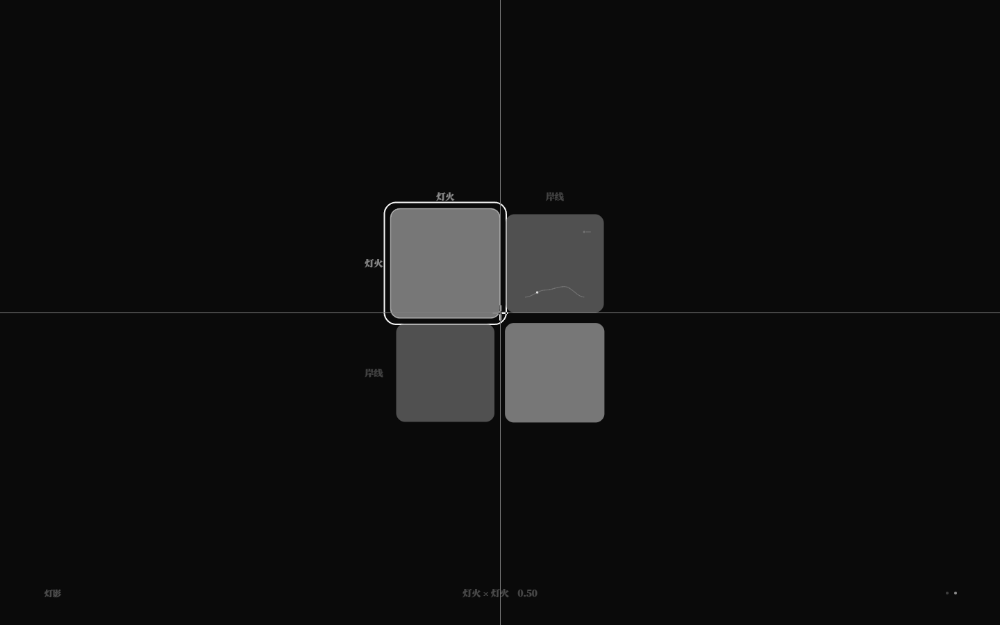

# 多矩阵联动：相位源（v2.7）

> 一个世界可以有多张关系谱；`相位源` 让**一张矩阵的时间轴由另一张矩阵的曲线驱动**。
> 月潮之间里，「灯影」的播放相位来自「月潮」的 月相×潮位 曲线——两张矩阵真正连在一起。

## 1. 语法

```nro
关系谱 灯影
  行 灯火 岸线
  列 灯火 岸线
  段 0.5 0.3
  段 0.3 0.5
  曲线 灯火 岸线 0.2 0.6 0.8
  周期 20
  速度 0.8
  相位源 月潮 月相 潮位
```

- `相位源 <源矩阵> <源行> <源列>`；
- 源矩阵必须存在、源矩阵必须有**周期**；目标格有曲线时采样曲线，无曲线时使用该格**标量值**作为相位（v2.16）；
- 源不能形成环（A→B→A 会报 NRO2100）；
- 有相位源时，本矩阵的静态 `相位` 被忽略。

## 2. 语义

设源矩阵 S 的曲线采样值为 `s = curve_S(谱位(S))`，则：

```text
谱位(本矩阵) = wrap01( (tick / period) * speed + s )
```

- 源矩阵自己的 `谱位` 也会递归计算它的相位源（深度上限 8，编译期已保证无环）；
- GUI 播放头、规则里的 `谱位("灯影")`、动态耦合强度都使用同一结果；
- 序列化写回 `相位源 ...`，round-trip 一致；
- GUI 数据：`data-phase-source=true`，`data-time-phase` 显示**有效相位**（随源曲线变化）。

## 2.5 标量相位源（v2.16）

- `相位源 源谱 乙 乙` 可以指向没有曲线的格子：
  - 有曲线：按源矩阵时间轴采样曲线；
  - 无曲线：直接用该格标量值（按 0..1 使用）作为相位；
- GUI 的 `data-time-phase` 会显示这个有效相位；播放头 = wrap(本矩阵时间轴 + 相位)；
- 这适合把某个静态标量（可被 GUI 编辑/规则改动）当作另一张矩阵的相位偏移。


## 3. 月潮之间里的联动

```nro
关系谱 月潮   # 周期30 / 速度1.4 / 相位0.1
  曲线 月相 潮位 0.2 0.5 0.9 0.4

关系谱 灯影   # 周期20 / 速度0.8
  相位源 月潮 月相 潮位
  曲线 灯火 岸线 0.2 0.6 0.8
```

- F3 打开矩阵：默认「月潮」，Tab 切到「灯影」；
- 月潮播放头按 1.4 倍速走；灯影的相位 = 月潮曲线在该时刻的值，因此灯影播放头会跟着月潮曲线忽快忽慢；
- 力迫「灯影」再用灯影自己的曲线值判断，形成两层时间结构。



## 4. 验收

- `pnpm test` **251/251**：core 新增相位源解析/序列化/缺曲线/成环 3 项；runtime 新增相位源替代静态相位 1 项；
- `pnpm test:gui` **204/204**：月潮静态相位 0.1；Tab 切灯影后 `data-phase-source=true`、速度 0.8、有效相位随源谱曲线变化；切回恢复；
- `pnpm dev check/sim examples/moon-tide.nro`、`check` / `check:gui` / `build` 通过。

## 5. 边界

- 相位源只读，不能在 GUI 里画连线选择（需改源文本）；
- 源曲线值按归一化 0..1 使用；如果曲线值超出 0..1，相位会先 wrap 再参与计算；
- 不支持「速度源」或「周期源」，目前只有相位可以联动。
