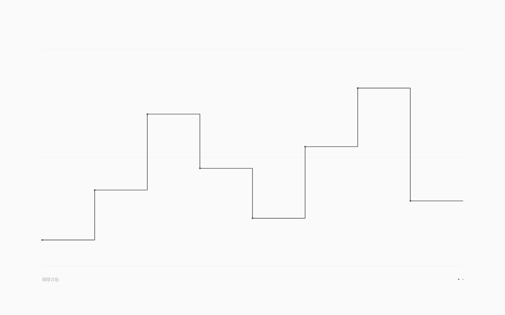
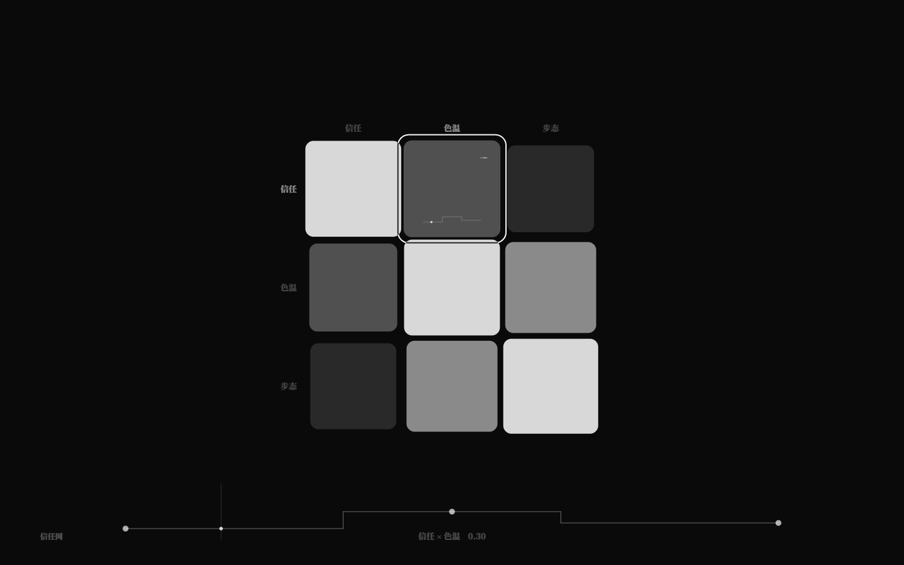

# 阶跃插值：离散的平台曲线（v2.9）

> 谱与关系谱的曲线以前只有「线性 / 平滑」；v2.9 增加 `阶跃`：
> 曲线按 n 个**等宽平台**保持，只在平台边界跳变。适合离散状态、档位、事件门。

## 1. 语法

```nro
谱 阶梯
  段 0 1 2
  范围 0..2
  插值 阶跃

关系谱 阶梯网
  ...
  曲线 甲 乙 0 1 2
  插值 阶跃
```

## 2. 采样语义

设曲线有 `n` 个段值、归一化位置 `p = clamp01(位置)`（`循环 是` 时按 [0,1) 回绕）：

```text
index = min(n - 1, floor(p * n))
值 = bands[index]
```

- 每个平台宽度 `1/n`，最后一段包含 p=1；
- 不插值，平台内恒定；
- n=1 时任意位置都返回该值；
- 与线性/平滑共用同一 `查谱` / `查关系谱` / 播放头采样路径。

## 3. GUI

- F2 谱曲线、F3 矩阵 sparkline / 底部快速编辑器 / 聚焦大曲线都画成**水平平台 + 垂直跳变**的阶梯；
- F2 试听：把 n 个平台值展开成 12× 密集阶梯后送入现有音色引擎（`smooth=false`），保证听到的是离散台阶；
- 拖点、双击增点、Delete 删点、键盘映射、播放头、聚焦编辑全部保留；
- debug state 可读 `interpolation`。





## 4. 验收

- `pnpm test` **255/255**：core 新增谱/矩阵阶跃解析与序列化 1 项；runtime 新增阶跃采样 3 点 + 快照元数据 1 项；
- `pnpm test:gui` **208/208** 不回归（组件自测覆盖阶跃 F2/F3 渲染、试听、拖点、增删）；
- `check` / `check:gui` / `build` / 生产冒烟通过。

## 5. 边界

- 阶跃是矩阵级/谱级设置，不能逐格/逐段设置；
- 曲线位置在平台边界处的取值按 `floor(p*n)` 归入右侧平台（p=0.5、n=2 时取 bands[1]）；
- 运行时谱快照会携带 `interpolation: '阶跃'`。
