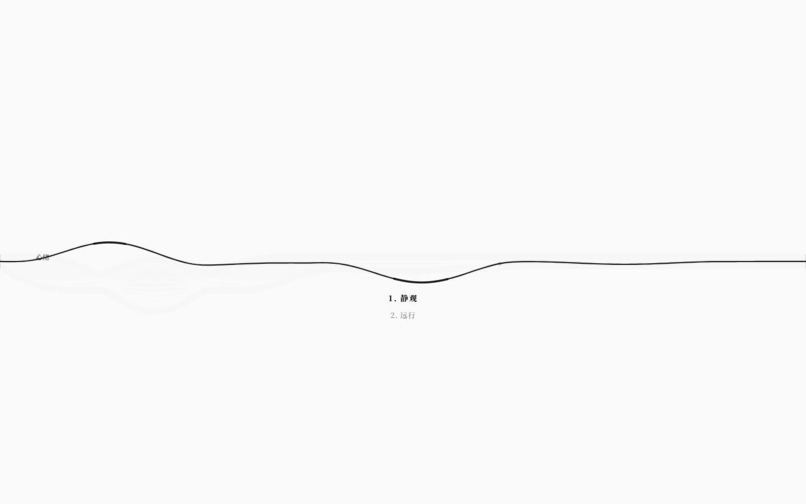
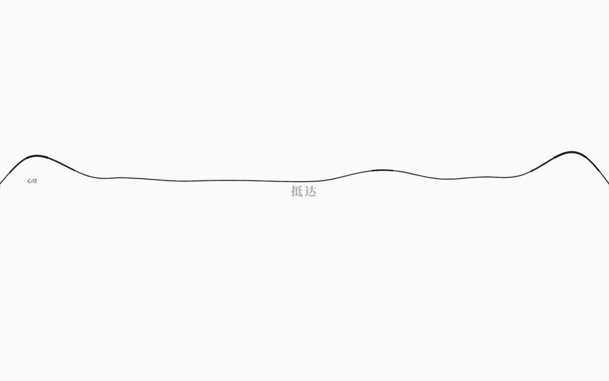

# 可玩层：动作选择与结局呈现（v3.0）

> v2.x 的 GUI 是「调律台」：能调弦、谱、关系谱，但世界规则里的**动作**没有入口，
> **结局**也不会出现。v3.0 补上最小可玩层：不破坏极简美学，让世界可以被真正玩到结局。

## 1. 操作

在八弦视图（默认 `strings` 模式）：

| 操作 | 结果 |
|---|---|
| `Enter` | 打开极淡的动作列表（当前世界有可执行动作时）；列表打开时执行当前项 |
| `↑` / `↓` | 列表打开时切换动作 |
| `1`–`9` | 列表打开时直接执行对应动作 |
| `Esc` / 点击画布 | 关闭动作列表 |
| `R` | 结局出现后重新开始当前世界 |
| `A` | **仍然只是 46 键拨弦**，不再打开动作列表 |

动作只能来自运行时 `universe.availableActions()`：已结束、动作耗时的 busy 期、守卫不成立时不会出现在列表里。

## 2. 视觉

- 动作列表：**无面板、无背景、无边框**；
  - 居中偏下，衬线小字 13px；
  - 未选中 alpha ≈0.35，选中 alpha ≈0.9、略大、略宽字距；
  - 180ms 淡入淡出；`pointer-events: none`，不阻挡弦的鼠标操作。
- 结局：画面中央单个衬线结局名，alpha ≈0.3，宽字距淡入；没有按钮/弹窗/分数。
- 动作执行后列表关闭；约 400ms 防连发，避免一帧内重复排队。

## 3. 工程结构

- `App` 每次 tick/render 从 `universe.availableActions()` 投影 `WorldView.actions`；
- 执行动作 = `universe.act(id)`：只排队，下一拍由运行时按规则结算；
- 结局 = `universe.state.ended`，只读取名字做呈现；
- `R` → `App.restartWorld()`：用当前 `WorldIR` 新建 `Universe(seed=7)`，不写回文件；
- `resetSignal` 变化 → `StringField` 重置本地 sim/按键/拖尾/动作 UI，避免旧波形残留；
- 数据属性：`data-action-count`、`data-action-open`、`data-action-selected`、`data-last-action`、`data-ending`。

## 4. 验收

- `pnpm test` **300/300**（本版未改语言/运行时）；
- `pnpm test:gui` **215/215**：新增
  - 可玩层收到世界动作；
  - Enter 打开动作列表；
  - 动作执行后淡显结局；
  - R 重开清结局并恢复动作。
- `pnpm check` / `check:gui` / `check:docs` / `build` / 生产冒烟通过。

## 5. 边界

- 动作是**回合制**的：一拍一个动作，不是实时输入；
- 列表不显示动作描述/成本（保持极简）；
- 结局只显示名字，不显示统计；
- GUI 仍不实时显示运行期矩阵写入/动态格；
- 没有移动端专用布局；
- `R` 重开不写回 `.nro`，只重建当前运行时；刷新页面仍从文件开局。
