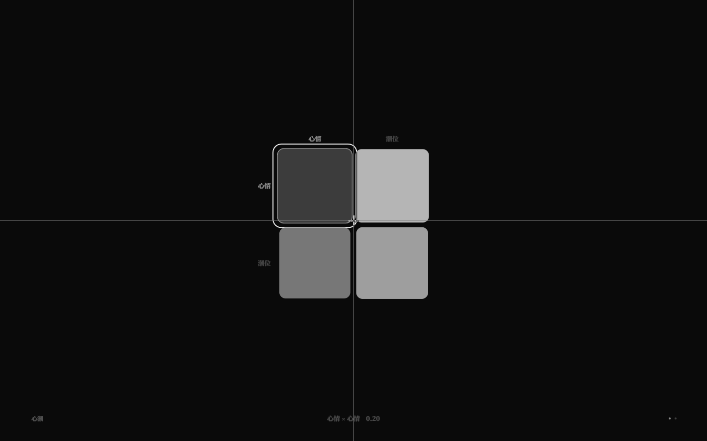
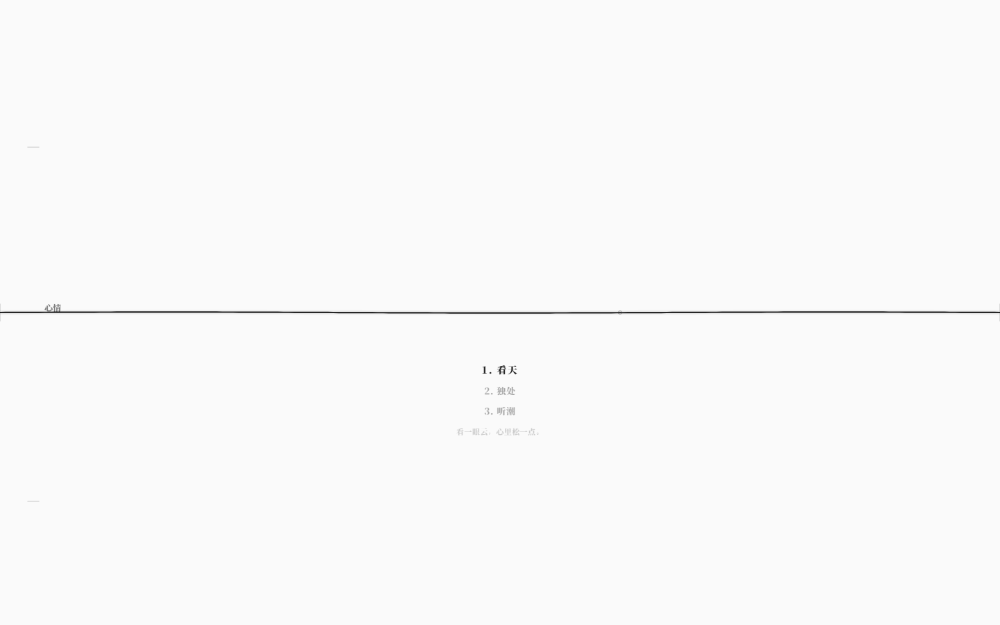

# 运行期只读叠加：F3 里的世界当前值（v3.1）

> v2.x 的 F3 矩阵画布显示的是**源文件 IR**：作者写的 `段` 与曲线。
> 运行期写入、动态格算出来的值只在运行时里，画布看不到。
> v3.1 增加 `V`：在同一张矩阵上叠加运行期当前值，只读、不破坏编辑。

## 1. 操作

进入 F3 关系谱矩阵后：

| 操作 | 结果 |
|---|---|
| `V` | 打开/关闭运行期只读叠加 |
| 叠加打开时 | 格子颜色/大小显示 `getMatrixCell` 的运行期结果；动态格实时求值；运行期写入同步可见 |
| `Tab` / `P` / `F3` / `V` | 仍可用 |
| 其它编辑 | 全部禁用：拖值、Enter 聚焦、Ctrl 结构、Space/Shift+Space 曲线增删、曲线编辑、时机键 |

叠加关闭后立即回到源文件静态值，编辑恢复。数据属性 `data-live-values=true/false`。

## 2. 视觉

- 仍走原有 180ms 缓动，值变化不硬跳；
- 只读叠加没有面板、没有文字提示、没有图例；
- 动态格/运行期值在格子上有极淡小点角标（与曲线角标区分）；
- 底部曲线编辑器在叠加模式隐藏，避免“看着运行值改静态曲线”的误导。

## 3. 工程结构

- `App` 每拍从 `universe.getMatrixCell(matrix, row, col)` 取运行期值，投影为 `MatrixView.runtimeValues`；
- `MatrixField` 的格值 source：`live ? runtimeValues : values`；
- `getMatrixCell` 已包含：运行期矩阵写入、动态格表达式求值；曲线采样仍由曲线编辑器负责；
- 只读判定在 MatrixField 的指针/键盘入口统一拦截，不把 live 模式写回 IR；
- 动作描述：动作列表选中项的 `描述` 在列表下方以 α≈0.2、11px 衬线小字呈现。

## 4. 验收

- `pnpm test` **300/300**（语言/运行时未改）；
- `pnpm test:gui` **220/220**：新增
  - F3 默认不是 live；
  - `V` 打开 `data-live-values=true`；
  - live 下 Enter 不进入聚焦；
  - `V` 关闭恢复 editable；
  - 动作列表显示选中动作描述。
- `check` / `check:gui` / `check:docs` / `build` / 生产冒烟通过。

## 5. 边界

- 只读：live 模式不能改值/曲线/结构；
- 曲线仍显示作者数据，运行期只叠加标量格与动态格；
- 运行期矩阵写入不写回 `.nro`；
- 没有“live 差异高亮”图例，靠小点角标与颜色即可；
- 动作列表仍不显示成本，只显示描述。
