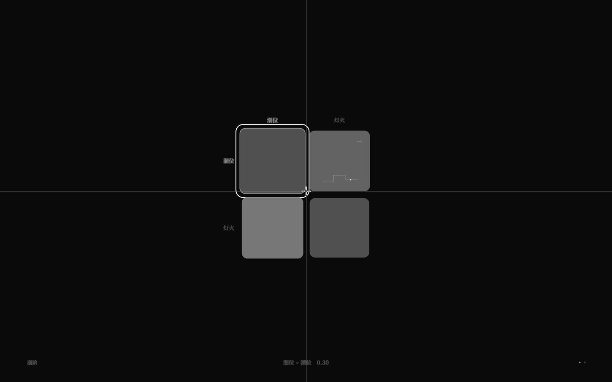
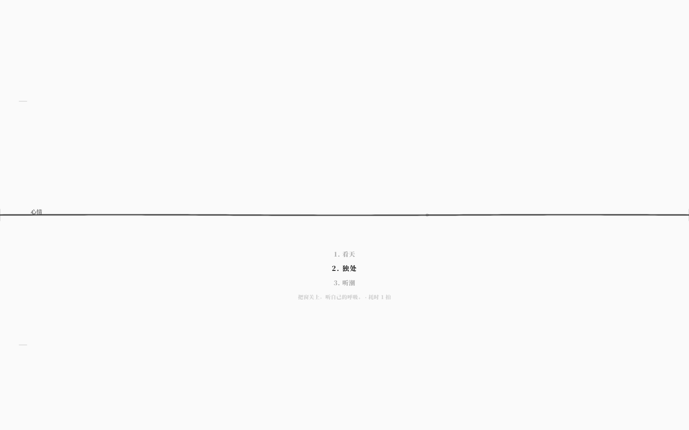
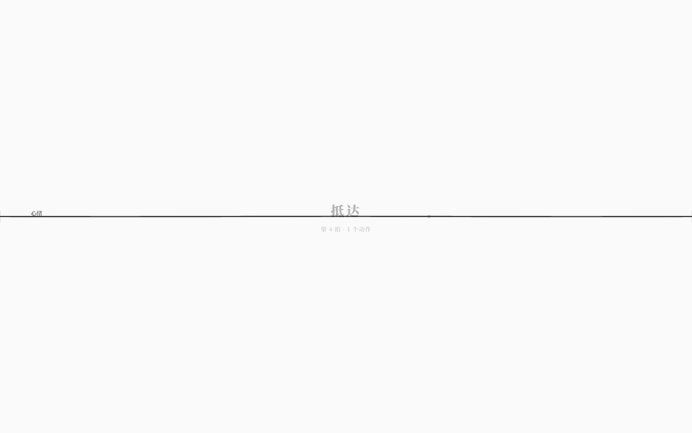

# 运行期曲线叠加与可玩细节（v3.2）

> v3.1 的 F3 `V` 只叠加了标量格/动态格；曲线格仍显示作者数据。
> v3.2 让 live 叠加按矩阵当前时间位置**真正采样曲线**，并把动作成本、结局拍数/动作数带进可玩层。

## 1. F3 曲线运行期采样

```text
App.getMatrixPosition(matrix)         // 周期/速度/相位/相位源
App.getMatrixCell(matrix,row,col,pos) // 曲线 -> 当前采样；动态格/标量 -> 当前值
        ↓
MatrixView.runtimeValues
        ↓
MatrixField live 叠加（仍走 180ms 缓动，只读）
```

- 带曲线的格子：live 时显示**当前运行采样值**，不是静态 `段` 回退值；
- 动态格：仍实时求值；
- 运行期写入：同步可见；
- 关闭 `V` 立即回到作者数据，编辑恢复。

运行时新增公开 API：

```ts
universe.getMatrixPosition(matrixName): number | undefined
```

未知矩阵返回 `undefined`；位置包含周期/速度/相位/相位源。



## 2. 动作成本

动作列表选中项第二行现在是：

- `描述 · 耗时 N 拍`（两者都有）；
- 只有描述：`描述`；
- 只有耗时：`耗时 N 拍`；
- 都没有：不占位。

仍是 α≈0.2 / 11px 衬线，不出现面板。



## 3. 结局拍数与动作数

结局名字下方增加一行 α≈0.16 / 12px 小字：

- 有动作：`第 N 拍 · M 个动作`；
- 无动作：`第 N 拍`。

只读展示，不改变结局判定。`R` 重开后该行消失。



## 4. 验收

- 单元测试 **302/302**：新增 `getMatrixPosition` 周期/速度/相位 2 项；
- GUI **222/222**：新增动作成本、结局拍数/动作数 2 项；
- `check` / `check:gui` / `check:docs` / `build` / 生产冒烟通过。

## 5. 边界

- live 仍只读；
- 曲线运行的“当前位置”由运行时矩阵时间决定，不是用户拖动 F3 播放头的位置；
- 结局统计不记录动作序列，只给总次数；
- 动作列表不显示守卫失败原因。
