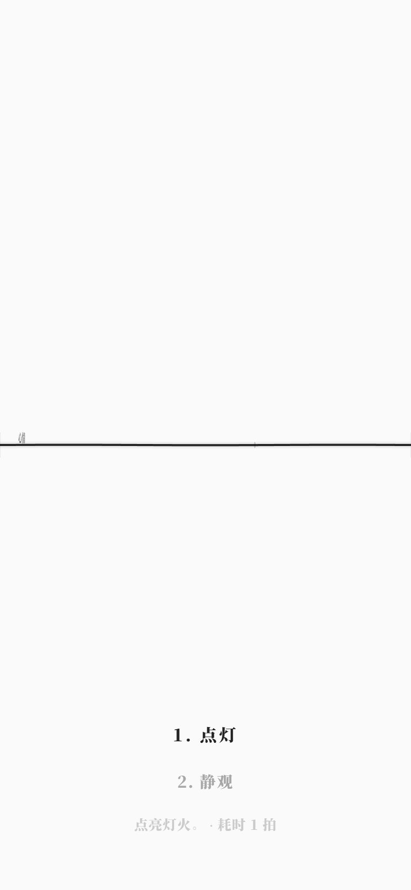
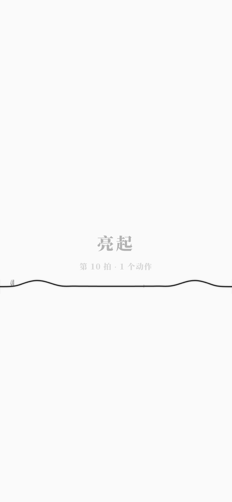

# 移动端触控（v3.3）

> v3.0 的动作列表依赖 `Enter`；手机没有物理键盘。v3.3 给触控设备一个不破坏极简的入口：
> **底部 16% 区域长按**，列表直接点选。

## 1. 触控手势

| 操作 | 结果 |
|---|---|
| 底部 16% 区域长按 ≥650ms | 打开动作列表（该区域不拨弦/不绷弦） |
| 移动 >10px | 取消长按 |
| 点击动作项 | 执行该动作 |
| 点击列表外 | 关闭列表 |
| 其它区域拖动/点触 | 保持原来的拖弦、拨弦、按住绷弦 |

桌面端完全不变：`Enter` 打开、`↑/↓` 选择、`Enter` 执行，动作列表 `pointer-events:none`。

设备判定：`pointer: coarse` 或 `maxTouchPoints > 0`；root 有 `data-touch=true/false`。

## 2. 响应式

在 `max-width: 720px` 或粗指针下：

- 动作列表字号 15px、行高更松、选中 16px；
- 列表位置避开底部安全区：`bottom: calc(6% + env(safe-area-inset-bottom))`；
- 动作描述/结局统计 13px；
- 画布仍铺满，无横向滚动。

## 3. 验收

- 单元测试 **302/302**（本版未改语言/运行时）；
- GUI **226/226**：新增移动端 `data-touch`、无横向滚动、长按打开列表、点选执行/结局 4 项；
- `check` / `check:gui` / `check:docs` / `build` / 生产冒烟通过。
- 手机实测（390×844 hasTouch）：底部 y=776 长按 760ms → 列表打开、plucks 0；点列表外关闭；上方拖弦值 50→40.591；点动作到结局。

## 4. 边界

- 移动端只做了竖屏 390×844 实测，未做平板/横屏专用布局；
- 动作列表仍是长按入口，没有常驻按钮；
- 画布仍按逻辑 1440×900 拉伸，极端宽高比会变形；
- 没有触控撤销/双指手势；
- 音频仍依赖浏览器自动播放策略，首次触摸后才可发声。
