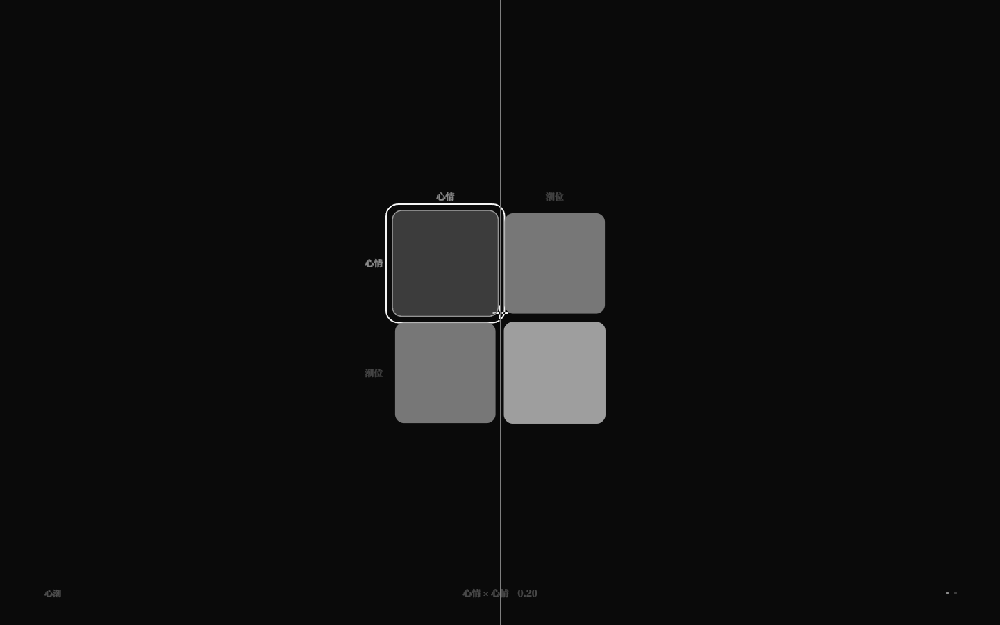

# 世界选择与发布闭环（v3.4）

> 之前 `?world=` 只在 dev 生效，生产包固定 tuner。v3.4 把 10 个示例世界在构建时内联，
> 生产包也能用 URL 打开任意世界，并用 `?seed=` 复现同一局。

## 1. URL

```text
/?world=examples/relational.nro&seed=42
```

- `world`：只接受 `examples/<名字>.nro` 一层路径，防穿越；
  - dev：读文件系统；
  - 生产：从构建内联的 `BUNDLED_WORLDS` 中取；
  - 未知/非法值回退 tuner。
- `seed`：0..2147483647 的整数；默认 7。影响 `Universe` 的随机/模拟种子。
- 页面根节点有 `data-world-file`、`data-seed`，方便验收与分享。

## 2. 构建方式

```ts
import.meta.glob('../../../examples/*.nro', {
  eager: true,
  query: '?raw',
  import: 'default',
});
```

- 10 个示例总 raw 约 27KB；
- 主包 gzip 从 26.10KB 增到约 35.06KB；
- 构建后仍无写回中间件，生产是只读展示/试玩；
- 首屏、FPS、吞吐仍通过 `pnpm perf` 门禁（First Paint 128ms）。



## 3. 验收

- 单元测试 **302/302**；
- GUI **228/228**：新增 dev `?world=` / `?seed=` 2 项；
- `pnpm build` 后：
  - 默认生产冒烟通过；
  - `node scripts/gui-prod-world-smoke.mjs`：生产 `?world=examples/relational.nro&seed=42` 加载正确、矩阵 2 张、无 console error；
- `pnpm perf` 全 PASS。

## 4. 示例世界

`tuner` / `spectra` / `relations` / `tides` / `moon-tide` / `lighthouse` /
`negotiation` / `rain-slice` / `relational` / `core-test`。

## 5. 边界

- 没有可视化世界选择器/列表，世界通过 URL 分享；
- 生产只读，不可写回 `.nro`；
- 所有世界内联进首包，app entry gzip 26.1→35.1KB；如需减少首包可改懒加载；
- seed 只影响初始 Universe，不影响作者写死的静态谱/矩阵。
