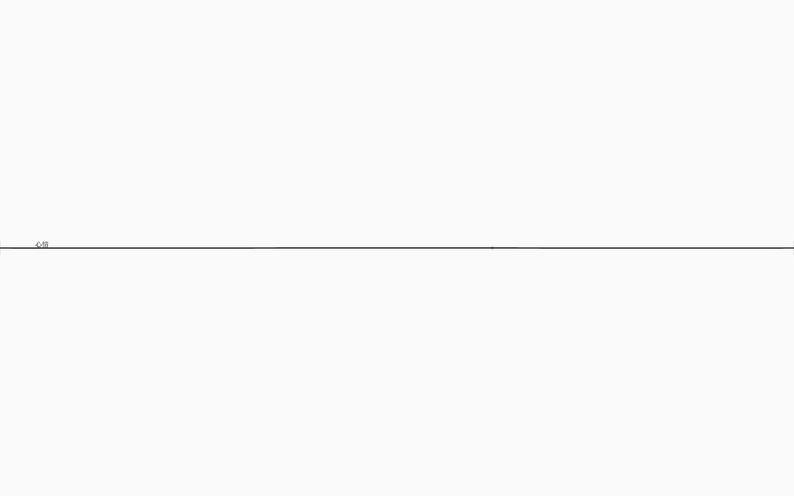
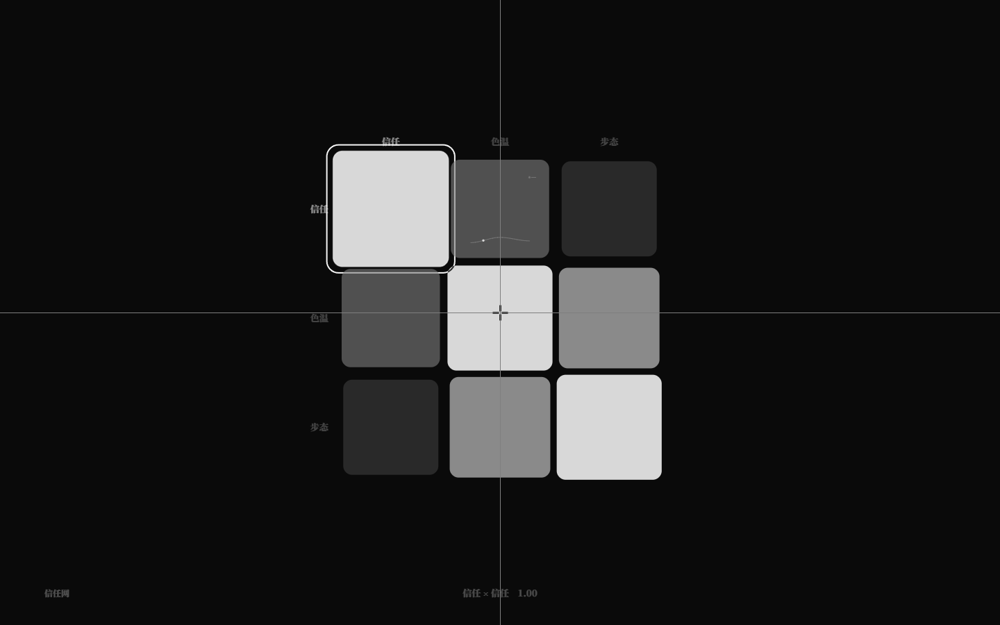

# 声音层：世界 cue 与关系谱听音（v3.5）

> v2.0 的谱音色只在**拨弦**和 F2 试听时出现。v3.5 让声音成为世界的一层：
> - 信号里的 `音频` cue 会真正发声；
> - cue 的参数命中谱名时，用该谱塑造音色；
> - F3 可按 `S` 直接听关系谱的当前值/曲线。

## 1. 世界音频 cue

DSL 早已支持：

```nro
信号 钟鸣
  当 钟声 > 40
  音频 铜钟 0.8
```

v3.5 起 GUI 会在每拍消费 `音频` cue：

- `音频 <参数名> <0..1>`；
- 参数名命中某个谱的 id/名字 → 用该谱的 bands 生成 `PeriodicWave` 音色；
- 未命中 → 用名字哈希出音高，value 控制音量/亮度/衰减；
- 首次用户手势后才创建 AudioContext；创建失败静默降级；
- 根节点可观测：`data-cue-audio`（已播放数）、`data-last-cue`（`名字:值`）。



## 2. F3 关系谱听音

进入 F3 后按 `S`：

- `data-matrix-listen=true`；
- 每 ~260ms 按当前播放头/悬停格采样值调用 `matrixTick('nav', value)`；
- 有曲线的格子按播放头本地采样，静态格用当前值；
- 值不变不重复发声；再按 `S`、退出 F3、切换矩阵时停止；
- 无面板/无提示，只作为可听反馈。



## 3. 新示例：`examples/soundscape.nro`

- 1 根 `钟声` 弦、1 条 `铜钟` 谱、1 张 `回声` 关系谱；
- 2 个动作（敲钟/静听）、2 个信号（钟鸣/余音）、2 个结局（寂/满）；
- 钟鸣的 `音频 铜钟 0.8` 用铜钟谱做音色；
- F3 `S` 可以听「回声」的曲线；
- sim 60 局：满约 82% / 寂约 18%，2 种结局。

## 4. 验收

- 单元 **304/304**：示例编译/模拟自动覆盖 `soundscape.nro`；
- GUI **232/232**：新增
  - 世界音频 cue 被 GUI 消费；
  - cue 命中谱名（`data-last-cue=钟:0.8`）；
  - `S` 打开/关闭关系谱听音。
- 自测 RMS：`playCue` 峰值 **0.02740**；矩阵听音峰值 **0.00922**，S 关后 tick 数不再增长；
- `check` / `check:gui` / `check:docs` / `build` / 生产冒烟通过。

## 5. 边界

- 声音是本地 Web Audio 合成，不是素材文件，也不是运行时音频求解器；
- 没有全局静音/音量控件；
- 首次手势前的世界 cue 可能被浏览器自动播放策略丢弃；
- 关系谱听音只在 F3，且是节流试听，不是连续声场；
- 没有离线导出/音频渲染。
